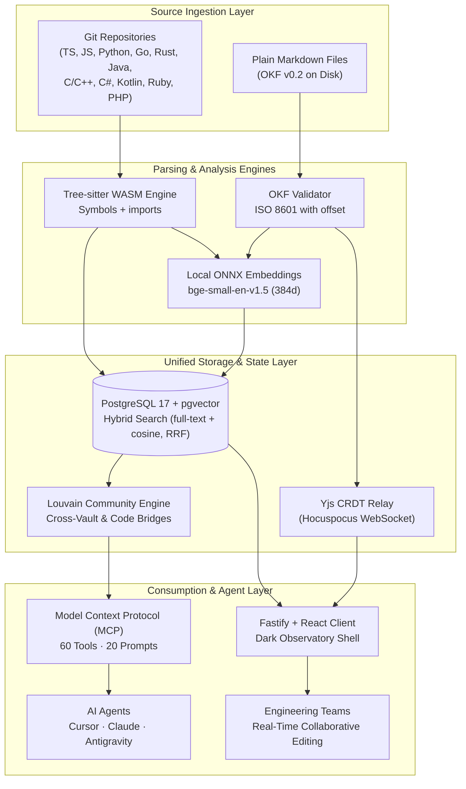
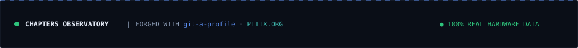

# Elara

<div align="center">



<p align="center">
  <a href="#overview"></a>
  <a href="#model-context-protocol-mcp-interface"></a>
  <a href="LICENSE"></a>
</p>

### The open-source, self-hostable second brain for engineering teams and the AI agents that work alongside them.

**Status: in testing.** The repository keeps its original name, `chapters`; the product is Elara. Bugs found in testing are tracked in [Issues](https://github.com/PIIIX-org/chapters/issues).

[Quickstart](#quickstart) • [Architectural Comparison](#architectural-comparison) • [Benchmarks (retracted)](#benchmarks-retracted) • [MCP Server](#model-context-protocol-mcp-interface)

</div>

---

## Overview

Software knowledge splits across two silos: human team wikis stored in closed cloud databases (Notion, Outline) and local code repositories indexed by headless command-line tools. Human engineers lose context as architecture documentation drifts away from source code, while autonomous AI coding agents struggle with hallucinated symbol paths and truncated context windows.

**Elara** joins the two. It stores all documentation as plain, human-readable Markdown files directly on disk using the **Google Open Knowledge Format (OKF v0.2)** with strict ISO 8601 timestamps (explicit UTC or offset). It also connects to your Git repositories and indexes TypeScript, JavaScript, Python, Go, Rust, Java, C, C++, C#, Kotlin, Ruby and PHP source files into a **Tree-sitter symbol and import index**, and the headings of their Markdown and HTML files as searchable sections.

When you write notes, you link directly to code files using `[[repo:<repo>/<path>]]` syntax. When code changes, Elara re-syncs and re-indexes the repository, so links and symbols follow the codebase. For AI agents, Elara exposes a native **Model Context Protocol (MCP)** server with 60 tools and 20 engineering prompts.

---

## Architectural Comparison

How Elara compares against existing tools across core architectural dimensions:



### Key Architectural Differentiators

| Capability | Elara | Obsidian | Swimm | Graphify | Outline | Notion |
| :--- | :--- | :--- | :--- | :--- | :--- | :--- |
| **License & Hosting** | **MIT Open-Source · Self-Host** | Proprietary Local App | Closed Commercial SaaS | Open-Source CLI | AGPLv3 Self-Host | Closed Commercial Cloud |
| **Storage Architecture** | **Plain OKF v0.2 MD on Disk** | Unstructured Local MD | Cloud Markdown Sync | InMemory AST Cache | PostgreSQL Database | Proprietary Block DB |
| **Multiplayer Engine** | **Yjs CRDT Relay (Hocuspocus)** | Manual Git Merge Conflicts | Git Pull-Request Flow | Single User CLI | Operational Transform | Proprietary Cloud OT |
| **Code AST Ingestion** | **Tree-sitter WASM Engine** | None | IDE Extension Snippets | Headless AST Graph | None | Static Code Blocks |
| **Unified Graph** | **Notes + Code (Louvain communities, shortest path)**| Notes Only Graph | Code Documentation Only| Code Syntax Only | Document Tree Only | Relational Tables Only |
| **AI Interface** | **Native 60-Tool MCP Server** | Community REST Hacks | Webhook Ingestion | Stdout CLI Piping | REST API | Proprietary Cloud Copilot |
| **Vector Indexing** | **PostgreSQL + pgvector** | Third-party Plugins | Cloud Embedding API | Local Vector Store | None | Closed Embedding Service |

---

## System Architecture

Elara uses a dual-index architecture that links plain Markdown notes and polyglot Git repositories into a unified knowledge graph:



---

## Benchmarks (retracted)

The benchmark numbers this README used to show (the TP-01 to TP-15 "Master Test Plans", the throughput, latency, and security badges, and the reports under `docs/benchmarks/`) are **retracted**. They cannot be reproduced: the runners were never merged (they exist only on the unmerged `dev-chroma` branch), they ran against production, and some results are impossible (an NDCG@10 of 1.37, where NDCG cannot exceed 1). The 2026-10-14 study that found this is the Elara vault note `audit/2026-10-14-ai-performance-study`.

Their replacement is the [premise benchmark](benchmarks/README.md): a scripted agent's tokens and tool calls to reach the evidence for 109 questions on five repositories pinned to fixed commits, with Elara's MCP tools against ripgrep and ranged reads, plus hit@k, MRR, NDCG@10 and line-level precision/recall. It runs in CI against a lab instance built from the commit under test, never against production, and gates retrieval and token changes. Its committed baseline ([`benchmarks/baseline.json`](benchmarks/baseline.json)) and the runs it links are the only benchmark numbers Elara publishes.

Correctness is covered by the server and client test suites that CI runs on every pull request.

---

## Model Context Protocol (MCP) Interface

Elara exposes a complete, permission-scoped Model Context Protocol (MCP) server that transforms any AI agent into an active collaborator on your knowledge base and codebases.

### MCP Configuration

Elara serves MCP over Streamable HTTP at `POST /mcp` (also `POST /elara/mcp`) on your instance; there is no stdio server. Create a token in Settings > MCP Connections, then add the server to your client, for example:

```json
{
  "mcpServers": {
    "elara": {
      "url": "https://<your-elara-host>/mcp",
      "headers": {
        "Authorization": "Bearer <your-mcp-token>"
      }
    }
  }
}
```

Claude Code: `claude mcp add --transport http elara https://<your-elara-host>/mcp --header "Authorization: Bearer <your-mcp-token>"`.

When you create a token you choose what it may do; none of this can be changed later (revoke it and create a new one):

- **Reach**: the whole account (Settings > MCP Connections) or one vault (the vault's settings). The API also mints repository tokens.
- **Access**: *Read only* (search, read, browse), *Read and write* (also create, edit, rename, trash, restore and revert notes, sync repositories) or *Admin* (also share and revoke, change vault or repository settings, trash or delete a vault or repository, purge notes and history, connect repositories, manage team members). The forms start at Read and write. Through the API, a token minted without a level gets Admin on the account and Read and write on a vault or repository. Admin on a vault token lets the agent share, trash or purge that vault, so only the vault's owner can grant it: the form offers it only to the owner, and warns first.
- **Profile**: which tools the agent sees and may call, a smaller list costing fewer tokens before its first call. *Reader*: search, read, browse and code questions (`search`, `read_note`, `read_file`, `browse_vault`, `browse_repository`, `find_symbols`, `graph`, `find_graph_path`, `list_vaults`, `list_repositories`). *Writer*: also create, edit and append to notes. *Admin*: every tool the access level allows. The forms start at the profile that matches the access level (Read only: Reader, Read and write: Writer, Admin: Admin) until you pick one. Through the API, a token minted without a profile gets Admin. A profile never adds to what the access level allows.
- **Expiry**: 7, 30 or 90 days, or never. An expired token is refused like a revoked one.
- **Allowed tools** (optional): limit the token to the tools you tick. A token with an allow-list gets no MCP prompts, and neither does a Reader-profile token.

A token's `tools/list` shows only the tools it can call: its allow-list, its access level, its profile and its reach. A call the token may not make fails with a message naming what is missing, for example `share_vault needs the admin capability; this connection has write access` or `delete_note needs the admin profile; this connection has the writer profile`. Tokens created before profiles existed have the Admin profile, so they list and call what they did before. Tokens created before this existed keep working: account tokens have Admin; vault and repository tokens have Read and write, so they can no longer share, change the settings of, trash or purge their vault or repository.

### Key MCP Capabilities

- **60 tools**, documented with their exact parameters in [`skills/elara/references/mcp-tools.md`](skills/elara/references/mcp-tools.md):
  - `list_vaults`, `browse_vault`, `read_note`, `create_note`, `edit_note`, `append_note`, `upsert_note`, `delete_note`
  - `list_repositories`, `browse_repository`, `read_file`, `find_symbols`, `repository_status`
  - `search` (hybrid full-text + 384d semantic search with permission scoping)
  - `graph` (nodes and edges with Louvain communities) and `find_graph_path` (shortest path, breadth-first)
  - `audit_okf_conformance` (structural validation against OKF v0.2)
- **20 engineering prompts**, for example:
  - `draft_adr` — drafts an Architecture Decision Record linking relevant notes and code.
  - `audit_architecture_drift` — compares recent code changes with linked notes.
  - `summarize_concept_chain` — explains how two notes or code files connect, via `find_graph_path`.
  - `active_project_companion` — records decisions and notes in the project vault during a work session.

---

## Codebase Architecture

<details>
<summary>📁&nbsp;&nbsp;<b>Curated Repository Map</b> — Browse the codebase structure <code>TypeScript / SQL</code></summary>
<br>

```
chapters/
├── client/                     # Web frontend (React + Vite + Tailwind)
│   ├── src/components/         # UI components
│   ├── src/hooks/              # Data hooks, CodeMirror + Yjs editor binding
│   ├── src/pages/              # Routed pages
│   └── src/api/, src/lib/      # API client and shared helpers
│
├── server/                     # Backend API & engine (Fastify + TypeScript)
│   ├── src/auth/               # Sessions, OIDC, MFA, lockout
│   ├── src/sync/               # Hocuspocus WebSocket relay for live Yjs sync
│   ├── src/graph/              # Graph assembly, Louvain communities, shortest path
│   ├── src/mcp/                # Model Context Protocol server (60 tools, 20 prompts)
│   ├── src/notes/              # OKF v0.2 parser, validation, and disk storage
│   ├── src/repositories/       # Git/local ingestion, Tree-sitter extraction, import resolution
│   ├── src/search/             # Hybrid search (Postgres full-text + pgvector) and embeddings
│   └── src/export/             # Vault export/import, instance backup and restore
│
├── docs/                       # Specifications and agent docs
│   ├── agents/                 # Operating docs for AI agents working on this repo
│   ├── benchmarks/             # Retracted benchmark reports (see "Benchmarks (retracted)")
│   └── superpowers/specs/      # Design specs
│
├── benchmarks/runs/            # Artifacts of the retracted TP-01..TP-15 runs
│
├── skills/elara/               # Agent skill: MCP reference, OKF rules, mapping protocol
│
└── assets/                     # Committed SVGs (hero, badges, charts)
```

</details>

---

## Quickstart

### Prerequisites

- **Node.js**: `v20.x` or later
- **pnpm**: `v9.x` or later
- **PostgreSQL**: `v17.x` with `pgvector` extension (or Docker Compose)

### 1. Launch with Docker Compose (Recommended)

Run the full stack (PostgreSQL 17, pgvector, and the Elara backend):

```bash
# Clone the repository
git clone https://github.com/PIIIX-org/chapters.git
cd chapters

# Start all services
docker compose up -d

# Open Elara
open http://localhost:3000
```

### 2. Manual Local Development

```bash
# Install dependencies across workspaces
pnpm install

# Run database migrations
pnpm --filter @elara/server db:migrate

# Start server and client in development mode
pnpm dev
```

---

## License

Elara is open-source software licensed under the **[MIT License](LICENSE)**.

<!-- forged-with: git-a-profile -->
<div align="center">



<sub>Forged with <a href="https://github.com/PIIIX-org/git-a-profile">git-a-profile</a> · <a href="https://github.com/PIIIX-org">PIIIX</a></sub>

</div>
