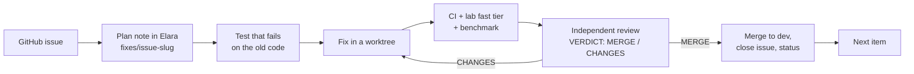

# Elara fix programme: hand-off after phase 1

Date: 2026-10-17. Repository: [PIIIX-org/chapters](https://github.com/PIIIX-org/chapters) (product name Elara). Written for whoever continues the work: the owner, another agent, or a future session.

## 1. Where things stand

| | State |
|---|---|
| Study | Done. Round 1 + round 2 reports, the 59-project landscape study and the Zep study produced a fix list of 192 items (`FIX-LIST.md`). |
| Issues | All 183 open items filed as GitHub issues (#413–#589 plus #403, #408–#411), label `elara-study`, one milestone per phase. |
| Plan | Elara, Chapters vault: `fixes/index`, `fixes/phase-0` … `fixes/phase-7` and `fixes/features` (order and status of every item). |
| Phase 0 (owner actions) | 4 of 6 closed. Open: #589 (revoke 5 old GitHub tokens; the owner will do it) and #664 (production deploys on push, before CI; found during the promotion). |
| Phase 1 (guardrails and security) | **Done and on `prod`: 25 of 25 issues closed**, 24 PRs merged to `dev`, promoted in [#660](https://github.com/PIIIX-org/chapters/pull/660) (`prod` = `5c5bdc0`). |
| Phases 2–5 | Not started. 42, 74, 35 and 46 open issues (review follow-ups and the new features of section 8a included). |
| Phase 6 (added 2026-10-17) | Rendered views, data attachments and structured fields, after phase 3: 5 open issues (#668–#671, #692); decision #667 (Markdown stays the only stored note format). |
| Phase 7 (added 2026-10-17) | New capabilities: 8 issues (#693–#700). See section 8a. |

## 2. What phase 1 delivered

**Release gates (nothing reaches `prod` without proof)**

| PR | What it does |
|---|---|
| [#590](https://github.com/PIIIX-org/chapters/pull/590) | The prod image is published only after CI passes on that exact commit. (The production server currently deploys on the push itself, not from this image: #664.) |
| [#591](https://github.com/PIIIX-org/chapters/pull/591) | CI checks every note file parses and matches its database row. |
| [#597](https://github.com/PIIIX-org/chapters/pull/597) | `fails-before`: a fix PR's new tests must fail on the old code. |
| [#602](https://github.com/PIIIX-org/chapters/pull/602) | PR template with an Evidence section; `pr-evidence` rejects claims without links. |
| [#616](https://github.com/PIIIX-org/chapters/pull/616) | The integration lab runs in CI (fast tier on every PR, full tier nightly and on demand). Known defects live in `lab/known-defects.json`; a fix must remove its own entries. |
| [#622](https://github.com/PIIIX-org/chapters/pull/622) | Premise benchmark as a release gate (`bench` ×3 instances, median, `bench-gate`), correct NDCG, never against production. |
| [#625](https://github.com/PIIIX-org/chapters/pull/625) | `review-verdict` gate: a promotion needs a `VERDICT: MERGE` comment naming the exact head. Required checks applied to `dev` and `prod`. |
| [#631](https://github.com/PIIIX-org/chapters/pull/631) | Commit attribution check, issue forms with "found by", STATE.md generated from GitHub by a bot. |
| [#637](https://github.com/PIIIX-org/chapters/pull/637), [#648](https://github.com/PIIIX-org/chapters/pull/648) | `/health` reports restarts (`bootId`, `lastShutdown`, …); an uptime monitor posts to issue [#636](https://github.com/PIIIX-org/chapters/issues/636). |
| [#651](https://github.com/PIIIX-org/chapters/pull/651) | Weekly trial with real AI agents against the lab instance (8 tasks, Elara arm vs local grep arm). Inactive until an API key is added (section 6). |

**Security**

| PR | What it does |
|---|---|
| [#592](https://github.com/PIIIX-org/chapters/pull/592), [#643](https://github.com/PIIIX-org/chapters/pull/643) | Every MCP tool and prompt response is scanned for secrets in CI. Git credentials no longer leak through sync errors, query strings, fragments, `ssh://user:pw@` remotes or broken URL encodings. The review caught a crash at server start in the first version. |
| [#639](https://github.com/PIIIX-org/chapters/pull/639) | Every MCP tool declares its scope; one wrapper enforces the token's pin. |
| [#640](https://github.com/PIIIX-org/chapters/pull/640), [#647](https://github.com/PIIIX-org/chapters/pull/647), [#655](https://github.com/PIIIX-org/chapters/pull/655) | Token levels read / write / admin, tool allow-lists, expiry. Pinned tokens lose admin tools and can't exceed the minter's permission. `tools/list` shows only tools the token can actually call (live permission check). |
| [#642](https://github.com/PIIIX-org/chapters/pull/642) | Saving a perspective needs edit access; global perspectives are visible only to their creator. |
| [#645](https://github.com/PIIIX-org/chapters/pull/645) | Behaviour tests for token revocation, expiry, deactivation, the rate limit, account separation and prompt note text. |
| [#654](https://github.com/PIIIX-org/chapters/pull/654) | Deactivating a user revokes their MCP tokens; reactivation brings none back. |

Docs and housekeeping: #627 (prod merged back into dev), #652 (first bot STATE.md refresh), #659 (STATE.md: auto redeploy, promotion procedure), #661 (lab baseline: the #496 bundle check marked intermittent after two full runs on the same commit disagreed).

**Reviews.** Every PR was reviewed by a separate Opus session told to disprove the PR (docs-only and bot PRs by the coordinator). Reviews sent PRs back with blocking problems many times; in the last stretch alone #642, #643, #648, #651 (twice), #655 and #661, each fixed before merging. Reviews: `D:/taha/research/elara-study/fixes/reviews/<pr>.md` and Elara `reviews/pr-<n>`.

## 3. How the work is done (keep doing it this way)

- **Briefs.** Fix agents follow `D:/taha/research/elara-study/fixes/BRIEF.md`; reviewers follow `fixes/REVIEW.md`. Both are complete; hand them to a new agent as-is.
- **One fix at a time, in phase order** (owner's rule). Related items may share a PR. A review may run while the next fix starts.
- **Merging to `dev` (hard rule: never with a red or pending check, required or not).** Post the verdict comment (first line `VERDICT: MERGE`, then `Review: [[reviews/pr-<n>]]` (a review record link is mandatory, also for docs and bot PRs), `Head reviewed: <full sha>`, `Reviewer: …`). Then merge only with `bun D:/taha/research/tools/safe-merge.ts <n>`: it waits until every check run and commit status on the head is green, including `review-verdict/dev`, refuses otherwise, and merges with `--match-head-commit`. Never `gh pr merge` by hand. Since 2026-10-17 `review-verdict/dev` is also a required check on `dev`, so GitHub blocks the merge too. If the branch is behind, run `gh pr update-branch`, wait for the checks, and post a new verdict naming the new head.
- **After a CHANGES review**, the fix goes back to the same reviewer, and the merge needs a `VERDICT: MERGE` on the head that is merged. Coordinator-only checks of post-review commits made the phase 1 promotion review fail once (six delta reviews had to be done after the fact).
- **Status in Elara.** `bun D:/taha/research/tools/fix-status.ts <item> "<status>"` updates the phase table.
- **Promotion to `prod`, once per phase.** PR `dev`→`prod`; full lab tier and full benchmark on that exact head (the PR's own lab run is full tier because its base is `prod`; `gh workflow run elara-lab.yml --ref dev -f tier=full -f bench=all` for an extra run); independent review of the promotion (REVIEW.md §9), which also checks that every PR in the range has a verdict on its merged head; verdict comment; then `git push origin <sha>:prod` (fast-forward, not the merge button), and only after every check on the promotion PR is green, because production deploys on that push (#664).
- **Owner decisions without an answer** get the conservative default, written on the issue and in the plan note, with the alternatives listed.

## 4. Phase 1 promotion

**Done: 2026-10-17 01:37 UTC, [#660](https://github.com/PIIIX-org/chapters/pull/660), `prod` `111e3f1` → `5c5bdc0` (fast-forward).**

| Step | Result |
|---|---|
| Full lab tier + full benchmark on `5c5bdc0` | [run 38977444259](https://github.com/PIIIX-org/chapters/actions/runs/38977444259): gate PASS on attempt 2 (20 tests, 676 checks passed, 118 known failures, 0 regressions, 0 stale); `bench` ×3 and `bench-gate` green. Attempt 1 failed only because #496 had been closed by mistake (see section 10) and was reopened. |
| Flaky check found on the way | Two full runs on the same commit disagreed on the #496 bundle check; marked `intermittent` in [#661](https://github.com/PIIIX-org/chapters/pull/661) after its own review. |
| CI on `5c5bdc0` | [PR run 38977444289](https://github.com/PIIIX-org/chapters/actions/runs/38977444289), [dev push 38977440491](https://github.com/PIIIX-org/chapters/actions/runs/38977440491), [prod push 38991686362](https://github.com/PIIIX-org/chapters/actions/runs/38991686362) (image published 01:43 UTC). |
| Promotion review | Independent, REVIEW.md §9 (Elara `reviews/pr-660`). First answer CHANGES: 9 of 25 PRs lacked a verdict comment on their merged head. Fixed with six post-merge independent delta reviews (#590, #591, #597, #602, #616, #622; all MERGE), coordinator verdicts for #412 and #627, a formatted verdict for #592, and body corrections. Second answer MERGE. |
| Production | New code running since 01:38:18 UTC (`/health` shows the #637 fields, bootId `01a14782…`; [uptime run 38992345112](https://github.com/PIIIX-org/chapters/actions/runs/38992345112)). |

**Found during the promotion: [#664](https://github.com/PIIIX-org/chapters/issues/664) (owner).** Production booted the new code 23 seconds after the push, 5 minutes before CI published the gated image. The server therefore deploys on the push to `prod`, not from the image #590 publishes after CI, so a commit that fails CI would still reach production. Today's deploy was safe because the same commit had passed CI, the full lab and the benchmark first. Until #664 is fixed, never push to `prod` before every check on the promotion PR is green. `/health` reports `version: null` because the deploy doesn't pass the version.

After deploy (from the promotion body): migrations 0019 and 0020 ran at boot; to roll back past phase 1 see section 10.

## 5. Decisions taken for the owner (can be changed)

| Issue | Default taken | Alternatives (on the issue) |
|---|---|---|
| [#549](https://github.com/PIIIX-org/chapters/issues/549) | Pinned tokens get no admin tools unless granted at mint; account tokens minted through the API without a level get `admin` (the Settings form defaults to read+write). | API default `write` for account tokens. |
| [#550](https://github.com/PIIIX-org/chapters/issues/550) | Global perspectives visible and deletable only by their creator. A deactivated creator's globals become invisible to everyone (no data removed). | Admins see and delete all globals (option C); any account may save private globals. |
| [#593](https://github.com/PIIIX-org/chapters/issues/593) | Owners also see URL query tokens as `***`. | Show the raw query to owners. |
| [#571](https://github.com/PIIIX-org/chapters/issues/571) | Agent trial built but inactive without an API key. | Add the key (section 6). |
| [#588](https://github.com/PIIIX-org/chapters/issues/588) | `rea-snapshot` and `elara-freshness-lab` archived (not deleted); the freshness-lab webhook deleted. | Unarchive or delete. |
| [#635](https://github.com/PIIIX-org/chapters/issues/635) | `STATE_MD_TOKEN` is the owner's gh login token (owner's choice). | A fine-grained token with Contents + Pull requests on `chapters` only (recommended later). |

## 6. Waiting on the owner (optional unless marked)

1. **#589 (required):** revoke the 5 GitHub tokens exposed before #383, then close the issue.
2. **#703 and #704 (required before item 87):** give access for a verified production backup and a migration rehearsal on a copy of production (#703), and sign off the design of the authoritative store (#704).
3. **#664 (required):** make production deploy from the CI-published image (or wait for the CI `publish` job) instead of on every push to `prod`, and pass the version so `/health` shows it.
4. **Replace `STATE_MD_TOKEN`** with a fine-grained token when convenient: `gh secret set STATE_MD_TOKEN --env state-md -R PIIIX-org/chapters`. Revoking the current gh login breaks the STATE.md bot until then.
5. **Turn on the agent trial:** add `AGENT_TRIAL_API_KEY` as a secret and `AGENT_TRIAL_MODEL` as a variable in the `agent-trial` environment (optional `AGENT_TRIAL_PROVIDER`, `AGENT_TRIAL_BASE_URL`). Details in `benchmarks/README.md`, section "Agent trial".
6. **Prod repository connections** `rea` and `elara-freshness-lab` are no longer needed (Settings → Repositories → delete). Leaving them costs only polling. Removing one needs a logged-in owner session; there is no MCP tool for it.
7. Decide the #549 / #550 defaults if the ones in section 5 don't suit.

## 7. Open follow-ups found during phase 1

| Issue | Phase | What |
|---|---|---|
| [#658](https://github.com/PIIIX-org/chapters/issues/658) | 2 | Lab: app stays down after a SIGKILL step if `compose start` fails (one flaky run seen). |
| [#621](https://github.com/PIIIX-org/chapters/issues/621) | 2 | Import applies shares from the archive manifest without asking. |
| [#623](https://github.com/PIIIX-org/chapters/issues/623) | 3 | Search results with equal scores have no tie-breaker. |
| [#644](https://github.com/PIIIX-org/chapters/issues/644) | 5 | Credential redaction is quadratic on long error text. |
| [#650](https://github.com/PIIIX-org/chapters/issues/650) | 5 | `fails-before` can't check `.github/scripts/*.test.mjs` tests. |
| [#656](https://github.com/PIIIX-org/chapters/issues/656) | 5 | Deactivation leaves repository sync tokens and export links working; two admins can deactivate each other. |
| [#657](https://github.com/PIIIX-org/chapters/issues/657) | 5 | Agent trial: zero usage trusted, estimate factor, timeouts across retries. |
| [#662](https://github.com/PIIIX-org/chapters/issues/662) | 5 | Gate hardening follow-ups from the post-merge delta reviews (#590, #597, #602, #622). |
| [#663](https://github.com/PIIIX-org/chapters/issues/663) | 2 | Lab: restart-extraction file-count check failed once without printing the clean run's count. |
| #617–#620 | 5 | Small bugs and OKF/attachment gaps from the lab. |

## 8. What the next phases fix

| Phase | Items | Goal | First items |
|---|---|---|---|
| 2: stop data loss | 42 | Never lose or corrupt what a person or agent wrote: edits that delete live typing (#408), lost appends, one authoritative store, crash safety, size caps, backups (#409). | 35 strict schemas, 36 frontmatter merge, 24 `note_history` (#411), 140 webhook disables polling (#410), 94/95 backup restore. |
| 3: the premise | 74 | Exact answers in fewer tokens than grep (today 2–5× more): budgets, slim tool profile, located hits, working code index, grep/references tools. | 17–20 token budgets, 25 strip embeddings from replies, 21–23 browse/graph limits. |
| 4: knowledge truth and memory | 35 | Code claims tied to commits and re-checked on sync; session logs and handoff for agents. | 104 claim anchors, 105 quote resolution. |
| 5: everything else | 46 | Persian/Arabic search, sync/webhooks, prompts, graph, attachments, OKF, docs; re-prioritised after phase 3 numbers. | 130 Persian normalisation. |
| 6: rendered views and data attachments | 6 (5 open) | Markdown stays the only stored note format (HTML is 35% more bytes, breaks line-addressed citations and co-editing; JavaScript in notes is stored XSS). Instead: rendered HTML/PDF/public views generated from Markdown, queryable JSON/CSV/YAML attachments, text extraction for every attachment type, sandboxed interactive HTML attachments. Starts after phase 3. | #667 decision, #668 rendered views. |
| 7: new capabilities | 8 | Secret guard on write, issue/PR/CI links, multi-agent coordination, outbound events, transclusion, capture, importers, review inbox (section 8a). | #693 secret guard. |

Section 8a explains the features added on 2026-10-17 (speed, caching, drift repair, structure, new capabilities). Appendix A at the end lists every remaining item of phases 0 and 2–7 in order, with its issue, priority and the full change text, plus the issues added to each phase. The fix-list order is also in Elara `fixes/phase-2` … `fixes/phase-5`; the added issues and their place in the work order are in `fixes/features` and section 8a.

## 8a. New features (added 2026-10-17)

The premise: agents faster, smarter and cheaper, **without losing anything the user would have without Elara**. Today Elara breaks that rule twice: installing it costs about 8.5k tokens of tool definitions in every session before any call, and many answers cost more than grep. These features were added after the study, from using Elara as the main agent during phase 1 and from the 59-project comparison. All are filed with the `new-feature` label; the Elara note `fixes/features` has the same content.

**Must do first (already in the plan):** finish phase 2 (never lose user text); slim tool profile under ~2k tokens (#428, #429) plus a cacheable prompt (#681); every answer cheaper than finding it yourself (phase 3, gated by the benchmark); turn on the agent trial with an API key (owner action, section 6), because only real agents on real tasks show whether the premise holds.

### Speed and cost (phase 3, after its fix-list items)

| Issue | Feature | Why |
|---|---|---|
| [#674](https://github.com/PIIIX-org/chapters/issues/674) | Elara tells the agent when not to use it (routing hints) | For an exact string in one repo, grep is 2–5× cheaper today; saying so beats losing quietly. |
| [#675](https://github.com/PIIIX-org/chapters/issues/675) | One budgeted call for compound questions: where, callers, why, still true | Turns, not single responses, drive time and cost; most turns were such chains. |
| [#676](https://github.com/PIIIX-org/chapters/issues/676) | Answers for the code being edited: ref and working-tree overlay | The index describes `dev`; agents work in branches and worktrees with uncommitted changes. |
| [#677](https://github.com/PIIIX-org/chapters/issues/677) | Vault as a git remote: clone, grep locally, push back | Lets Elara feed grep instead of competing with it; the tools agents use well keep plain files. |
| [#678](https://github.com/PIIIX-org/chapters/issues/678) | Learn from real usage (zero-result searches, unread notes, fallbacks to grep) | The benchmark measures fixed questions; real use shows which notes and tools to fix. |
| [#679](https://github.com/PIIIX-org/chapters/issues/679) | Shared reading cache across agents (one digest per file at a commit) | ~25 parallel agents re-read the same files in phase 1. |

### Caching (phase 3)

Cache everything that can be cached, under one rule: **a cache key always carries the caller's scope and the content revision**, so a cached answer is never served to someone without access or after the content changed.

| Issue | Cache | Saves |
|---|---|---|
| [#680](https://github.com/PIIIX-org/chapters/issues/680) | Caching contract: scope + revision in every key, metrics, cross-tenant tests | Makes every other cache safe. |
| [#681](https://github.com/PIIIX-org/chapters/issues/681) | Cacheable agent prompt: byte-stable tool list, prompts and instructions | Provider prompt caching bills repeated prefixes at a fraction of the price; Elara's definitions sit at the start of every prompt. |
| [#682](https://github.com/PIIIX-org/chapters/issues/682) | "Unchanged since revision N" answers (`if_revision`, ETag) | Re-reads cost a few tokens instead of the whole content. |
| [#683](https://github.com/PIIIX-org/chapters/issues/683) | Per-session de-duplication (refer to passages already sent) | Repeated passages within one session. |
| [#679](https://github.com/PIIIX-org/chapters/issues/679) | Shared reading cache across agents | Parallel agents reading the same files. |
| [#684](https://github.com/PIIIX-org/chapters/issues/684) | Content-addressed index caches (parse, symbols, embeddings by blob hash; query embeddings; no re-clone) | Server time and cost; a no-change sync does no work. |
| [#685](https://github.com/PIIIX-org/chapters/issues/685) | Search and graph result cache keyed by query, scope and `index_version` | Latency of repeated searches. |
| [#668](https://github.com/PIIIX-org/chapters/issues/668) | Rendered views cached per note revision (phase 6) | Rendering cost. |

### Memory and drift (phase 4; lessons first, drift repair after the claim items)

Code drift breaks notes, Markdown docs inside repos, links and the index itself. Phase 4 already detects it (claims graded fresh / moved / stale / lost, #502–#505; links surviving renames, #512; `doctor`, #495). What was missing is **automatic repair**, at three levels:

- **Server, automatic (no judgment needed):** moved or renamed code whose quote is unchanged is re-anchored on every sync (#687); the index verifies itself against the remote and the files and repairs from the authoritative copy (#691).
- **In the app and by request (judgment needed):** `fix_drift` returns, per stale claim, the old quote, the current code and a ready edit for the agent to apply; the app shows a drift inbox and banners with accept / edit / mark lost (#688). No LLM runs on the server; the calling agent writes new wording.
- **Before merge:** a PR check lists notes and docs that cite the lines a PR changes, so they are fixed in the same PR (#689). Repo Markdown docs get the same treatment as notes (#690).

| Issue | Feature |
|---|---|
| [#686](https://github.com/PIIIX-org/chapters/issues/686) | Lessons shown at the moment they matter (procedural memory; first in phase 4). Phase 1 relearned the same traps repeatedly; memory pays off as fewer corrections (Hindsight 0.85 → 0.36 per task). |
| [#687](https://github.com/PIIIX-org/chapters/issues/687) | Drift auto-repair: re-anchor moved citations on every sync |
| [#688](https://github.com/PIIIX-org/chapters/issues/688) | Drift repair proposals: `fix_drift` tool and drift inbox |
| [#689](https://github.com/PIIIX-org/chapters/issues/689) | PR check: notes that cite the changed lines |
| [#690](https://github.com/PIIIX-org/chapters/issues/690) | Markdown docs inside repos as claim-bearing documents |
| [#691](https://github.com/PIIIX-org/chapters/issues/691) | Index drift self-check and automatic repair |

### Structure (phase 6)

| Issue | Feature |
|---|---|
| [#692](https://github.com/PIIIX-org/chapters/issues/692) | Structured note fields and live queries: user-defined types, `query_notes`, live tables (phase-1 status tables were edited by a script; verdicts could not be queried). |

### New capabilities (phase 7)

| Issue | Feature |
|---|---|
| [#693](https://github.com/PIIIX-org/chapters/issues/693) | Secret guard on write (block, quarantine or redact), P1 |
| [#694](https://github.com/PIIIX-org/chapters/issues/694) | Index issues, PRs, reviews and CI runs, linked to code and notes |
| [#695](https://github.com/PIIIX-org/chapters/issues/695) | Coordination for many agents: claims, expiring locks, assignment, inbox |
| [#696](https://github.com/PIIIX-org/chapters/issues/696) | Outbound events and subscriptions (note changed, claim stale, drift found) |
| [#697](https://github.com/PIIIX-org/chapters/issues/697) | Transclusion: embed a block of one note in another |
| [#698](https://github.com/PIIIX-org/chapters/issues/698) | Capture external sources as citable, dated notes |
| [#699](https://github.com/PIIIX-org/chapters/issues/699) | Importers for Obsidian, Notion and Logseq |
| [#700](https://github.com/PIIIX-org/chapters/issues/700) | Review inbox for agent changes (approve or revert) |

### Plan gaps (found 2026-10-17)

| Issue | Phase | Gap |
|---|---|---|
| [#703](https://github.com/PIIIX-org/chapters/issues/703) | 2 (first) | Verified production backup and a migration rehearsal on a copy of production before item 87. Needs the owner. |
| [#704](https://github.com/PIIIX-org/chapters/issues/704) | 2 (before #486) | Design review and owner sign-off before item 87 (authoritative store). |
| [#705](https://github.com/PIIIX-org/chapters/issues/705) | 2 (first) | Production error and performance monitoring beyond the uptime check. |
| [#706](https://github.com/PIIIX-org/chapters/issues/706) | 2 | Alert when the nightly lab fails. |
| [#709](https://github.com/PIIIX-org/chapters/issues/709) | 3 | Compatibility runs with several agent clients (Claude Code, Codex, Cursor, Gemini). |
| [#707](https://github.com/PIIIX-org/chapters/issues/707) | 5 (with #556) | Mark note and file content as untrusted data in every tool response, not only prompts. |
| [#708](https://github.com/PIIIX-org/chapters/issues/708) | 5 | Real account deletion: erase a user and their data. |
| [#710](https://github.com/PIIIX-org/chapters/issues/710) | 5 | User-facing release notes for each promotion. |

### Not doing

No server-side LLM calls (answer synthesis, query rewriting), no LLM-extracted entity graphs, no features only humans can use. They make Elara more expensive, which works against the premise (landscape study: Khoj, Open Notebook, LazyGraphRAG, Cognee).

### Work order

Phase 2 (#703 backup and rehearsal setup and #705 monitoring first; #704 design sign-off before #486) → phase 3 (fix-list items, slim profile and budgets first; then #681, #680 and the caches; then #674–#679 and #709) → phase 4 (#686 first, then the claim items, then #687–#691) → phase 5 → phase 6 → phase 7. Appendix A lists every issue per phase.

## 9. Where everything is

| What | Where |
|---|---|
| Code | `D:/taha/chapters` (main checkout on `dev`; agents work in `D:/taha/worktrees/<name>`, never in the main checkout) |
| Study reports | `D:/taha/research/elara-study/REPORT.md`, `REPORT-ROUND2.md`, `elara-what-we-did-wrong.html` |
| Fix list and issue map | `FIX-LIST.md`, `fix-issues.json` (item → issue) |
| Briefs and reviews | `fixes/BRIEF.md`, `fixes/REVIEW.md`, `fixes/reviews/<pr>.md` |
| Promotion bodies | `merge/promote-body.md` (#407), `merge/promote-phase-1-body.md` |
| Tools | `D:/taha/research/tools/`: `elara-call.ts` (Elara MCP helper), `fix-status.ts`, `publish-fix-plan.ts`, `file-fix-issues.ts` |
| Elara notes | Chapters vault (`c1e3c446-…`): `fixes/*`, `reviews/pr-*`, `audit/2026-10-14-*`; landscape vault `second-brain-landscape` |
| Benchmark | `benchmarks/` in the repo; method and numbers only from CI (`benchmarks/README.md`) |
| Lab | `lab/`, `docs/agents/lab.md`; workflow `elara-lab.yml` |
| **Backup of everything above** | Private repo `PIIIX-org/elara-study-archive`, visible only to the owner and org members with access (all of `research/elara-study`, `research/tools`, study notes, landscape notes, workspace rules and skills; secrets and upstream clones excluded on purpose; see its README) |

## 10. Gotchas

- **Rolling back past phase 1:** migrations 0019 + 0020 leave `mcp_connections.access` NOT NULL with no default. Before running older code: `ALTER TABLE mcp_connections ALTER COLUMN access SET DEFAULT 'write'` (`docs/self-hosting/backup.md`).
- **Never merge with a failing or pending check.** Until 2026-10-17, 20 PRs were merged while `review-verdict/dev` was red: the verdict comment was posted seconds before the merge, the workflow then found the PR closed and set no status, and 8 coordinator verdicts had no review link. Repair: post-merge independent reviews of all 20; 16 now pass (their statuses were set from the owner account by running the repo's own checker after the merge, `verdict-after-merge.ts`); #659, #665, #672 and #701 keep a red CHANGES status, and their corrections landed in #711. `review-verdict/dev` became required on `dev`, and `safe-merge.ts` is now the only way to merge.
- **Never test against production** (`chapters.piiix.org`); the lab instance is the staging server.
- **Clean room:** never copy code or prompt text from MiroFish, OASIS, CAMEL, Graphiti, Zep or the landscape projects.
- **Local machine:** no Docker or pnpm (the sandbox blocks symlinks); CI and the lab are the test runners. All files stay under `D:/taha`; point Bun/npm caches at `D:/taha/tools/cache`.
- **Commits:** author and committer `Taha-Mahmoodi <Taha-Mahmoodi@users.noreply.github.com>` plus the trailer `Co-Authored-By: Claude Opus <noreply@anthropic.com>` (the `attribution` check).
- **Elara `edit_note` frontmatter** replaces the whole map; never put `---` inside a frontmatter value.
- **GitHub closing keywords:** never write "fix #N", "fixes #N" or "closes #N" in a PR body unless the PR really closes it, not even in "does not fix #N". #661 closed #496 that way; it was reopened, and the lab gate fails while a baseline entry points at a closed issue.
- **Flaky lab checks:** if two full runs on the same commit disagree on a known-defect check, mark that entry `intermittent` with the measured reason (as in #661) rather than re-running until green.

## Appendix A. Every remaining item, in order

Generated 2026-10-17 from `FIX-LIST.md`, `fix-issues.json`, the phase order in Elara `fixes/phase-N` and the GitHub milestones. "State" is the GitHub issue state at generation time. Work the fix-list items top to bottom within a phase. Added issues are listed by number after them; their place in the work order is given in section 8a (Work order) and in the line under each phase heading.

### Phase 0: owner actions

4 fix-list items plus 2 added issues (after the fix-list items).

| Order | Item | Issue | Priority | State | Change |
|---|---|---|---|---|---|
| 1 | 189 | [#586](https://github.com/PIIIX-org/chapters/issues/586) | Now | closed | Redeploy production (`docker compose pull && docker compose up -d`) so #400/#405/#398/#402 run and the boot catch-up re-indexes missing files. |
| 2 | 190 | [#587](https://github.com/PIIIX-org/chapters/issues/587) | Now | closed | Rotate the webhook secret pasted in chat; decide on the inactive GitHub hook 697510656. |
| 3 | 191 | [#588](https://github.com/PIIIX-org/chapters/issues/588) | Now | closed | Decide whether to keep the upstream `rea` connection (re-clones every 5 min) and the scratch repos `elara-freshness-lab` and `rea-snapshot`. |
| 4 | 192 | [#589](https://github.com/PIIIX-org/chapters/issues/589) | Now | open | Revoke the 5 GitHub tokens exposed before #383 (from the bug log; still on the owner's list). |
| — | — | [#635](https://github.com/PIIIX-org/chapters/issues/635) | — | closed | Add STATE_MD_TOKEN so the STATE.md bot can open its PR |
| — | — | [#664](https://github.com/PIIIX-org/chapters/issues/664) | P1 | open | Production deploys on the push to prod, before CI publishes the gated image (#590 is bypassed) |

### Phase 2: stop data loss

36 fix-list items plus 7 added issues (#703 (backup and rehearsal set-up) and #705 (monitoring) come first; #704 (design sign-off) before #486; the rest where they fit).

| Order | Item | Issue | Priority | State | Change |
|---|---|---|---|---|---|
| 1 | 35 | [#437](https://github.com/PIIIX-org/chapters/issues/437) | P0 | open | All tool input schemas `.strict()`: unknown arguments rejected with the real parameter names (today `create_note {content}` silently creates an empty note). |
| 2 | 36 | [#438](https://github.com/PIIIX-org/chapters/issues/438) | P0 | open | `edit_note` frontmatter merges per key, with explicit `replace:true` and `removeKeys` (today a partial frontmatter wipes title and tags). |
| 3 | 24 | [#411](https://github.com/PIIIX-org/chapters/issues/411) | P0 | open | `note_history`: metadata only and paginated; `get_revision` for one revision's content (#411). |
| 4 | 140 | [#410](https://github.com/PIIIX-org/chapters/issues/410) | P0 | open | Fix the webhook-disables-polling bug: poll whenever the webhook is stale (`scheduler.ts:27`) and update its unit test (#410). |
| 5 | 94 | [#409](https://github.com/PIIIX-org/chapters/issues/409) | P0 | open | Backup restore: handle trashed vaults (`restore.ts:91`), repository-scoped tokens, attachments, trash, all revisions, stable note ids, MFA secrets; restore by validate → plan → apply, idempotent by id (#409). |
| 6 | 95 | [#493](https://github.com/PIIIX-org/chapters/issues/493) | P0 | open | Write backups with mode 600 (world-readable today); backup manifest with SHA-256 digests; restore-and-verify run in CI. |
| 7 | 87 | [#486](https://github.com/PIIIX-org/chapters/issues/486) | P0 | open | One authoritative store: DB row + revision + CRDT update in one transaction (or a durable write journal); `.md`, `.crdt`, FTS, vectors, symbols are projections recording `last_applied_seq` and `index_version`, rebuilt and reconciled at startup. |
| 8 | 88 | [#487](https://github.com/PIIIX-org/chapters/issues/487) | P0 | open | Save collab state when the last socket closes (an acknowledged collab edit is lost if the tab closes within the 2 s save delay, 8/8). |
| 9 | 89 | [#488](https://github.com/PIIIX-org/chapters/issues/488) | P0 | open | Never rebuild text from a stale `.crdt` without saving the result; seed the CRDT deterministically from the text (a stale reload doubled a whole note). |
| 10 | 90 | [#489](https://github.com/PIIIX-org/chapters/issues/489) | P0 | open | Rerun the lab SIGKILL boundary tests (`lab/data-path`) after the change: no row-ahead-of-file, no row-without-file, no missing revisions, no leftover `.tmp`, no duplication. |
| 11 | 91 | [#490](https://github.com/PIIIX-org/chapters/issues/490) | P0 | open | Concurrent `create_note` in one folder must not return errors for notes that were created (4–10 of 16 in the lab). |
| 12 | 92 | [#491](https://github.com/PIIIX-org/chapters/issues/491) | P0 | open | One body-size cap on every write path, including the collab socket (today REST/MCP refuse 1 MiB but collab stores up to 100 MiB; 60 MiB froze the server ~20 s). |
| 13 | 93 | [#492](https://github.com/PIIIX-org/chapters/issues/492) | P0 | open | Quarantine writes that grow a note ≥1.9× or contain repeated blocks. |
| 14 | 96 | [#494](https://github.com/PIIIX-org/chapters/issues/494) | P0 | open | Durable jobs table for extraction and embedding: leases, attempts, `last_error`, idempotency key (item + hash + stage); status columns per file and note. |
| 15 | 78 | [#403](https://github.com/PIIIX-org/chapters/issues/403) | P0 | open | Record the real MCP actor `{kind, id, session, tool}` on every Y transaction and revision (#403; today all agent edits are `collab/null`). |
| 16 | 74 | [#474](https://github.com/PIIIX-org/chapters/issues/474) | P0 | open | `read_note` serves the live document when it is loaded, not the debounced file on disk. |
| 17 | 72 | [#408](https://github.com/PIIIX-org/chapters/issues/408) | P0 | open | `edit_note(path, base_rev?, ops[])` with ops: replace_text (unique find + expected count), insert before/after anchor, replace_section, append, prepend, delete_block, frontmatter set/add/remove (#408). |
| 18 | 73 | [#408](https://github.com/PIIIX-org/chapters/issues/408) | P0 | open | Compile ops to character-level changes on the live Y.Doc in one transaction; never delete and re-insert the whole body (today an agent append deletes 20–23 words a user is typing, 4/4 runs). |
| 19 | 75 | [#475](https://github.com/PIIIX-org/chapters/issues/475) | P0 | open | Compare-and-set: a stale base is three-way merged; clean merges apply and report concurrent changes; overlaps become a linked agent proposal and the human's text is untouched. |
| 20 | 76 | [#476](https://github.com/PIIIX-org/chapters/issues/476) | P0 | open | Whole-markdown writes accepted only as a structural diff against the live doc. |
| 21 | 77 | [#477](https://github.com/PIIIX-org/chapters/issues/477) | P0 | open | Every write returns `{rev, status: applied\|merged\|conflicted\|retry, diff_stats, concurrent_changes, indexed}` and accepts an idempotency key and `dry_run`. |
| 22 | 79 | [#478](https://github.com/PIIIX-org/chapters/issues/478) | P0 | open | Atomic `append_note` / `upsert_note` so read-then-write appends are never lost (50–92% lost in the lab; 1/11 in the real two-agent log). |
| 23 | 80 | [#479](https://github.com/PIIIX-org/chapters/issues/479) | P1 | open | Log delete, restore and rename as history events; revert must not relabel the newest row. |
| 24 | 81 | [#480](https://github.com/PIIIX-org/chapters/issues/480) | P1 | open | Deduplicate revisions with deep equality, not `JSON.stringify` key order. |
| 25 | 85 | [#484](https://github.com/PIIIX-org/chapters/issues/484) | P1 | open | Rename/move/delete also take the per-note lock. |
| 26 | 82 | [#481](https://github.com/PIIIX-org/chapters/issues/481) | P1 | open | Show agents in editor presence ("In this note now"). |
| 27 | 83 | [#482](https://github.com/PIIIX-org/chapters/issues/482) | P1 | open | Restore point before an agent's first write in a session. |
| 28 | 84 | [#483](https://github.com/PIIIX-org/chapters/issues/483) | P1 | open | Fix the cursor jumping to the top after a remote edit, and Ctrl+Z doing nothing after an agent edit. |
| 29 | 86 | [#485](https://github.com/PIIIX-org/chapters/issues/485) | P2 | open | Offline edits made while an agent writes should not land at position 0. |
| 30 | 97 | [#495](https://github.com/PIIIX-org/chapters/issues/495) | P1 | open | `doctor` command comparing hashes across file, row, CRDT, FTS, vectors, links; extend `check-notes` beyond parse failures. |
| 31 | 98 | [#496](https://github.com/PIIIX-org/chapters/issues/496) | P1 | open | Move embedding off the main thread (a large non-minified file still blocks `/health` ~160 s); per-file work budget. |
| 32 | 99 | [#497](https://github.com/PIIIX-org/chapters/issues/497) | P1 | open | Per-repository extraction quotas so one repo can't starve the single global queue. |
| 33 | 100 | [#498](https://github.com/PIIIX-org/chapters/issues/498) | P1 | open | Close live collab sockets on logout (edits typed after logout are saved today). |
| 34 | 101 | [#499](https://github.com/PIIIX-org/chapters/issues/499) | P1 | open | Export/import: keep revisions and trash; rewrite attachment links to the new vault. |
| 35 | 102 | [#500](https://github.com/PIIIX-org/chapters/issues/500) | P1 | open | Fix the restore CLI message that says MCP tokens are unusable (they still work). |
| 36 | 103 | [#501](https://github.com/PIIIX-org/chapters/issues/501) | P2 | open | Compact long revision histories instead of storing full snapshots forever. |
| — | — | [#621](https://github.com/PIIIX-org/chapters/issues/621) | P1 | open | Import applies shares from the archive manifest without asking |
| — | — | [#658](https://github.com/PIIIX-org/chapters/issues/658) | P2 | open | Lab: app stays down after a SIGKILL step when 'compose start' fails or runs too early |
| — | — | [#663](https://github.com/PIIIX-org/chapters/issues/663) | P2 | open | Lab: restart-extraction file-count check failed once without printing the clean run's count |
| — | — | [#703](https://github.com/PIIIX-org/chapters/issues/703) | P0 | open | [phase 2] Verified production backup and a migration rehearsal on a copy of production before item 87 |
| — | — | [#704](https://github.com/PIIIX-org/chapters/issues/704) | P0 | open | [phase 2] Design review and owner sign-off before item 87 (authoritative store) |
| — | — | [#705](https://github.com/PIIIX-org/chapters/issues/705) | P1 | open | [phase 2] Production error and performance monitoring beyond the uptime check |
| — | — | [#706](https://github.com/PIIIX-org/chapters/issues/706) | P2 | open | [phase 2] Alert when the nightly lab fails |

### Phase 3: the premise (fewer tokens, exact answers)

60 fix-list items plus 14 added issues (after the fix-list items: #681, #680, #682–#685, then #674–#679 and #709; #623 where it fits).

| Order | Item | Issue | Priority | State | Change |
|---|---|---|---|---|---|
| 1 | 17 | [#420](https://github.com/PIIIX-org/chapters/issues/420) | P0 | open | Every read, search, browse, graph and history tool takes `budget_tokens` (defaults ~2k for search, ~4k for reads). |
| 2 | 18 | [#421](https://github.com/PIIIX-org/chapters/issues/421) | P0 | open | Over budget: drop whole low-ranked items, then step down a ladder (full → no context → locations only → counts per file → total). Never cut silently. |
| 3 | 19 | [#422](https://github.com/PIIIX-org/chapters/issues/422) | P0 | open | Every response ends with a `truncated` block: shown, total (fetch limit+1 to know), dropped per section, cursor, how to narrow. |
| 4 | 20 | [#423](https://github.com/PIIIX-org/chapters/issues/423) | P0 | open | Very large results become a pageable, greppable handle instead of inline text. |
| 5 | 25 | [#427](https://github.com/PIIIX-org/chapters/issues/427) | P0 | open | Strip `embedding` and internal columns from every write reply (93% of an `edit_note` reply today). |
| 6 | 21 | [#424](https://github.com/PIIIX-org/chapters/issues/424) | P0 | open | `browse_repository`: path prefix filter and cursor (today 90–650 KB per call; it also ignores `path`). |
| 7 | 22 | [#425](https://github.com/PIIIX-org/chapters/issues/425) | P0 | open | `browse_vault`: root listing must respect `recursive:false`; return path and title only by default; `fields` selection. |
| 8 | 23 | [#426](https://github.com/PIIIX-org/chapters/issues/426) | P0 | open | `graph`: `limit`, `neighborsOf`, `depth`, `edgeTypes` actually implemented (today silently ignored); default to the aggregate view; reject unknown arguments. |
| 9 | 26 | [#428](https://github.com/PIIIX-org/chapters/issues/428) | P0 | open | Tool profiles: **reader** (~6 tools: orient, search, grep, read, outline, code questions), **writer** (adds edit, create, handoff), **admin** (opt-in per token). 34 of 57 tools are admin-only today. |
| 10 | 27 | [#429](https://github.com/PIIIX-org/chapters/issues/429) | P0 | open | Two-sentence tool descriptions; long manuals served as MCP resources; CI fails if the reader profile schema exceeds ~2k tokens (today ~8.5k). |
| 11 | 28 | [#430](https://github.com/PIIIX-org/chapters/issues/430) | P1 | open | Replace the UUID regex repeated 60 times with `format: "uuid"`; describe every parameter (15 of 123 have descriptions). |
| 12 | 30 | [#432](https://github.com/PIIIX-org/chapters/issues/432) | P1 | open | Print paths once per response with short ids the agent can cite. |
| 13 | 31 | [#433](https://github.com/PIIIX-org/chapters/issues/433) | P1 | open | Return `structuredContent` with `outputSchema`, plus a short text summary. |
| 14 | 32 | [#434](https://github.com/PIIIX-org/chapters/issues/434) | P1 | open | Tool annotations: `readOnlyHint`, `destructiveHint`, `idempotentHint`, `title`. |
| 15 | 33 | [#435](https://github.com/PIIIX-org/chapters/issues/435) | P1 | open | Put essential usage rules in MCP `initialize.instructions`. |
| 16 | 34 | [#436](https://github.com/PIIIX-org/chapters/issues/436) | P1 | open | Drop the `listChanged:true` capability or implement it (GET /mcp returns 404). |
| 17 | 29 | [#431](https://github.com/PIIIX-org/chapters/issues/431) | P1 | open | Tool search for the long tail instead of listing every tool (Cognee pattern). |
| 18 | 37 | [#439](https://github.com/PIIIX-org/chapters/issues/439) | P1 | open | Structured errors: `{code, rule, retryable, retryAfterMs, suggestions}` (e.g. NOTE_NOT_FOUND, INVALID_SLUG with the regex, TYPE_MISMATCH, ALREADY_EXISTS, RATE_LIMITED with closest paths). |
| 19 | 38 | [#440](https://github.com/PIIIX-org/chapters/issues/440) | P1 | open | HTTP 429 sent as a JSON-RPC error with a `Retry-After` header. |
| 20 | 39 | [#441](https://github.com/PIIIX-org/chapters/issues/441) | P1 | open | `find_symbols` and `search` say "no match" instead of returning unrelated low-score hits that look like answers. |
| 21 | 40 | [#442](https://github.com/PIIIX-org/chapters/issues/442) | P1 | open | Distinguish "no match" from "index unavailable or still building" in every search response. |
| 22 | 41 | [#443](https://github.com/PIIIX-org/chapters/issues/443) | P1 | open | A NUL byte in a body must produce a clean error, not echo the SQL and full body. |
| 23 | 42 | [#444](https://github.com/PIIIX-org/chapters/issues/444) | P1 | open | Split the semantic OKF `type` from the folder (today `type` must equal the first path segment, so the semantic type has no home; the OKF sample bundle imports 0/9 notes). |
| 24 | 43 | [#445](https://github.com/PIIIX-org/chapters/issues/445) | P1 | open | `read_note` returns the body as plain text, not escaped JSON inside JSON. |
| 25 | 44 | [#446](https://github.com/PIIIX-org/chapters/issues/446) | P1 | open | Update a note's `timestamp` on edit so recency ranking works. |
| 26 | 45 | [#447](https://github.com/PIIIX-org/chapters/issues/447) | P2 | open | `find_graph_path` and graph lookups accept names or partial paths with candidate suggestions, not exact paths only. |
| 27 | 46 | [#448](https://github.com/PIIIX-org/chapters/issues/448) | P2 | open | Cross-vault search for account tokens (today search refuses without a vaultId). |
| 28 | 47 | [#449](https://github.com/PIIIX-org/chapters/issues/449) | P0 | open | Parse `.tsx` with the TSX grammar (230 of 231 `.tsx` files fail to parse today). |
| 29 | 48 | [#450](https://github.com/PIIIX-org/chapters/issues/450) | P0 | open | Extract `export const f = () =>` and other arrow-function or exported consts, and class methods, as definitions (2.2% of rea's functions are found today). |
| 30 | 49 | [#451](https://github.com/PIIIX-org/chapters/issues/451) | P0 | open | Give `.mts`/`.cts` files a language and parse them. |
| 31 | 51 | [#453](https://github.com/PIIIX-org/chapters/issues/453) | P0 | open | Key every derived artifact by content hash + parser version + embedder id; save progress per file so a crash can't corrupt the index. |
| 32 | 50 | [#452](https://github.com/PIIIX-org/chapters/issues/452) | P0 | open | Chunk code by symbol plus a skeleton chunk per large file or class; chunk notes by heading section prefixed with the heading path. Replace one 512-token embedding per whole file or note (72% of files and 101/103 notes are longer). |
| 33 | 52 | [#454](https://github.com/PIIIX-org/chapters/issues/454) | P0 | open | Apply repo, vault, path glob, language and kind filters inside both the keyword and the vector query (today vectors are filtered after retrieval across all repos, returning 0 results for the target repo). |
| 34 | 53 | [#455](https://github.com/PIIIX-org/chapters/issues/455) | P0 | open | Keyword channel: split camelCase and snake_case, add a trigram index, weight path, title and symbol fields, use OR semantics, and relax the query when nothing matches (today every word must match). |
| 35 | 54 | [#456](https://github.com/PIIIX-org/chapters/issues/456) | P0 | open | Fuse keyword and vector with RRF over a fixed window; exact and identifier matches always outrank fuzzy ones. |
| 36 | 10 | [#413](https://github.com/PIIIX-org/chapters/issues/413) | P0 | open | Index every note heading section and every code symbol as a block with a stable id, heading or symbol path, line span and content hash. |
| 37 | 11 | [#414](https://github.com/PIIIX-org/chapters/issues/414) | P0 | open | Search hits return `{path#Lx-Ly, block id, heading path, approx tokens, snippet of up to 200 chars around the match, which channel matched}` instead of whole documents and frontmatter. |
| 38 | 12 | [#415](https://github.com/PIIIX-org/chapters/issues/415) | P0 | open | Group hits by note, at most 3 passages per note. |
| 39 | 13 | [#416](https://github.com/PIIIX-org/chapters/issues/416) | P0 | open | One `read` call accepts several targets (line range, block id or heading path) and returns the range served, total lines, next range and revision. |
| 40 | 14 | [#417](https://github.com/PIIIX-org/chapters/issues/417) | P0 | open | `read_file` and `read_note` without a range return an outline with line spans, not the whole body. |
| 41 | 15 | [#418](https://github.com/PIIIX-org/chapters/issues/418) | P0 | open | Never collapse newlines in stored text, so line addressing stays valid. |
| 42 | 16 | [#419](https://github.com/PIIIX-org/chapters/issues/419) | P1 | open | Search results stop carrying frontmatter by default (53% of a note hit today). |
| 43 | 55 | [#457](https://github.com/PIIIX-org/chapters/issues/457) | P1 | open | Rank code above docs and plans for code-shaped queries (35% of code top-10 were docs). |
| 44 | 56 | [#458](https://github.com/PIIIX-org/chapters/issues/458) | P1 | open | Report `retrieval_mode` and `degraded` in search responses. |
| 45 | 57 | [#459](https://github.com/PIIIX-org/chapters/issues/459) | P1 | open | Don't bake timestamps into embedded text (caused unstable Persian ranking). |
| 46 | 58 | [#460](https://github.com/PIIIX-org/chapters/issues/460) | P1 | open | On edit, replace all of a note's vectors, not one row. |
| 47 | 59 | [#461](https://github.com/PIIIX-org/chapters/issues/461) | P1 | open | Semantic-edge neighbour lookup filtered by vault/tenant (today other users' notes can take a note's 8 slots). |
| 48 | 60 | [#462](https://github.com/PIIIX-org/chapters/issues/462) | P1 | open | Set `hnsw.ef_search` / iterative scan on every vector query, not only semantic-edge recompute. |
| 49 | 61 | [#463](https://github.com/PIIIX-org/chapters/issues/463) | P1 | open | Re-embed notes whose embedding is stale after a restart, not only notes with no embedding. |
| 50 | 62 | [#464](https://github.com/PIIIX-org/chapters/issues/464) | P2 | open | Structure for more languages (Rust, Java, C/C++, Swift) and heading outlines for Markdown/HTML. |
| 51 | 63 | [#465](https://github.com/PIIIX-org/chapters/issues/465) | P2 | open | Don't silently skip real source in folders named `build/`; report skipped files. |
| 52 | 64 | [#466](https://github.com/PIIIX-org/chapters/issues/466) | P2 | open | Resolve `?raw` and workspace-package imports. |
| 53 | 65 | [#467](https://github.com/PIIIX-org/chapters/issues/467) | P2 | open | Only add a reranker after the benchmark shows it helps. |
| 54 | 66 | [#468](https://github.com/PIIIX-org/chapters/issues/468) | P0 | open | `grep` over notes and code: regex, path glob, repo, `ref`, context lines, same line numbering as `read`. |
| 55 | 67 | [#469](https://github.com/PIIIX-org/chapters/issues/469) | P0 | open | Symbol and edge table at index time: definitions, references, calls, imports, tests. |
| 56 | 68 | [#470](https://github.com/PIIIX-org/chapters/issues/470) | P0 | open | Tools `symbol_at(path:line)`, `references`, `callers`, `impact(depth)` (grouped by depth, "N total, showing M"), `tests_for`. Each row: `path:line`, enclosing symbol, one line of context, confidence (resolved or textual). Ambiguous names return candidates. |
| 57 | 69 | [#471](https://github.com/PIIIX-org/chapters/issues/471) | P0 | open | Git awareness: indexed commit SHA everywhere, `changed_since(commit or date, path)`, `diff`, reads at a `ref`. |
| 58 | 70 | [#472](https://github.com/PIIIX-org/chapters/issues/472) | P1 | open | Note backlinks carry the link's line and surrounding paragraph; `neighbors(depth)` computed in SQL; MCP access to backlinks, local graph, per-note drift and revision content (REST-only today). |
| 59 | 71 | [#473](https://github.com/PIIIX-org/chapters/issues/473) | P1 | open | No LLM in the query path for these tools; deterministic answers only. |
| 60 | 136 | [#534](https://github.com/PIIIX-org/chapters/issues/534) | P0 | open | `orient(query?, focus?, budget)`: ranked repo map (definitions ranked by references, biased to the query and focus files, signatures with line numbers, fit to budget) plus vault outline, one level at a time, ≤10 entries. |
| — | — | [#623](https://github.com/PIIIX-org/chapters/issues/623) | P2 | open | Search results with equal scores have no tie-breaker: ranks move between identical instances |
| — | — | [#674](https://github.com/PIIIX-org/chapters/issues/674) | P1 | open | [phase 3] Elara tells the agent when not to use it |
| — | — | [#675](https://github.com/PIIIX-org/chapters/issues/675) | P1 | open | [phase 3] One budgeted call for compound questions: where, who calls it, why, is it still true |
| — | — | [#676](https://github.com/PIIIX-org/chapters/issues/676) | P1 | open | [phase 3] Answer for the code the agent is editing: branch, ref and working-tree overlay |
| — | — | [#677](https://github.com/PIIIX-org/chapters/issues/677) | P1 | open | [phase 3] Vault as a git remote: clone, grep locally, push back |
| — | — | [#678](https://github.com/PIIIX-org/chapters/issues/678) | P2 | open | [phase 3] Learn from real usage: zero-result searches, unread notes, fallbacks to grep |
| — | — | [#679](https://github.com/PIIIX-org/chapters/issues/679) | P1 | open | [phase 3] Shared reading cache across agents: one digest per file at a commit |
| — | — | [#680](https://github.com/PIIIX-org/chapters/issues/680) | P1 | open | [phase 3] Caching contract: every cache key carries the caller's scope and the content revision |
| — | — | [#681](https://github.com/PIIIX-org/chapters/issues/681) | P1 | open | [phase 3] Make the agent's prompt cacheable: stable, deterministic tool list and instructions |
| — | — | [#682](https://github.com/PIIIX-org/chapters/issues/682) | P1 | open | [phase 3] "Unchanged since revision N" answers instead of repeating content |
| — | — | [#683](https://github.com/PIIIX-org/chapters/issues/683) | P2 | open | [phase 3] Per-session de-duplication: refer to content already sent in this session |
| — | — | [#684](https://github.com/PIIIX-org/chapters/issues/684) | P1 | open | [phase 3] Content-addressed index caches: reuse parse, symbols and embeddings by blob hash |
| — | — | [#685](https://github.com/PIIIX-org/chapters/issues/685) | P2 | open | [phase 3] Search and graph result cache keyed by query, scope and index version |
| — | — | [#709](https://github.com/PIIIX-org/chapters/issues/709) | P2 | open | [phase 3] Compatibility runs with several agent clients (Claude Code, Codex, Cursor, Gemini) |

### Phase 4: knowledge truth and memory

29 fix-list items plus 6 added issues (#686 comes before the fix-list items; #687–#691 after the claim items #502–#505).

| Order | Item | Issue | Priority | State | Change |
|---|---|---|---|---|---|
| 1 | 104 | [#502](https://github.com/PIIIX-org/chapters/issues/502) | P0 | open | Code claims in notes carry a quote, source ref, resolved `path:Lx-Ly`, commit, a hash of that range, and the session's read set. |
| 2 | 105 | [#503](https://github.com/PIIIX-org/chapters/issues/503) | P0 | open | Resolve the quote at write time; a quote that can't be found makes the claim `unverified`. |
| 3 | 106 | [#504](https://github.com/PIIIX-org/chapters/issues/504) | P0 | open | On every index sync, regrade each claim: fresh, moved, stale or lost; show the state in search hits and rank unverified or stale claims lower. |
| 4 | 107 | [#505](https://github.com/PIIIX-org/chapters/issues/505) | P0 | open | `repository_drift` MCP tool: notes whose cited code changed since `verified_against`, so the owner's pre-task drift check is one call. |
| 5 | 108 | [#506](https://github.com/PIIIX-org/chapters/issues/506) | P0 | open | Audit checks content, not just format: cited files and lines exist and match, future timestamps, empty bodies, duplicated blocks, oversized notes, unresolved repo links (today a vault with 4 wrong facts scores 100/100). |
| 6 | 111 | [#509](https://github.com/PIIIX-org/chapters/issues/509) | P1 | open | Actually enforce `stale_after` and `superseded` (format-checked today, never read). |
| 7 | 110 | [#508](https://github.com/PIIIX-org/chapters/issues/508) | P1 | open | Agent-written claims labelled `unverified` until a check passes. |
| 8 | 109 | [#507](https://github.com/PIIIX-org/chapters/issues/507) | P1 | open | Note-level verification: human verifier, `verified_at_commit`, `review_every`, expiry; agents can request but not grant. |
| 9 | 112 | [#510](https://github.com/PIIIX-org/chapters/issues/510) | P1 | open | Extract `[[repo:...]]` links consistently: one link parser shared by graph, audit and drift (today three parsers disagree; `~~~` fences aren't stripped; `code:` and `repo:x:path` forms are reported broken by the audit but resolve in the graph). |
| 10 | 113 | [#511](https://github.com/PIIIX-org/chapters/issues/511) | P1 | open | Rename: rewrite bare `[[name]]` links, don't rewrite links inside code spans, update links in trashed notes; revert must not restore dead links. |
| 11 | 114 | [#512](https://github.com/PIIIX-org/chapters/issues/512) | P1 | open | Repo links to files survive file and repo renames; repo names unique or case-insensitive. |
| 12 | 115 | [#513](https://github.com/PIIIX-org/chapters/issues/513) | P1 | open | Per-vault REST graph includes repository edges (today hard-codes `repositoryIds: []`). |
| 13 | 116 | [#514](https://github.com/PIIIX-org/chapters/issues/514) | P1 | open | `types`/`tags`/date filters must not drop every code node and repo-link edge. |
| 14 | 117 | [#515](https://github.com/PIIIX-org/chapters/issues/515) | P0 | open | Session log per agent: append-only typed events (title, files and notes touched, outcome), with provenance (agent, session, commit). |
| 15 | 118 | [#516](https://github.com/PIIIX-org/chapters/issues/516) | P0 | open | Rolling session summary that records which event it covers up to. |
| 16 | 119 | [#517](https://github.com/PIIIX-org/chapters/issues/517) | P0 | open | `handoff(budget)`: best summary (≤40% of budget), newer events, pinned facts, open items, and a list of what was dropped (Honcho; Zep context block). |
| 17 | 120 | [#518](https://github.com/PIIIX-org/chapters/issues/518) | P0 | open | First-class `handoff` and decision-log note types; append-only logs that can't lose entries. |
| 18 | 121 | [#519](https://github.com/PIIIX-org/chapters/issues/519) | P1 | open | Facts/claims with status (active, superseded, invalidated, expired), `superseded_by`, and bi-temporal fields: `valid_from`/`valid_to` (when true in the world) separate from `recorded_at`/`expired_at` (when Elara learned it) (Zep). |
| 19 | 122 | [#520](https://github.com/PIIIX-org/chapters/issues/520) | P1 | open | A contradicting fact closes the old one instead of deleting it; reads default to current facts; point-in-time queries supported (Zep). |
| 20 | 123 | [#521](https://github.com/PIIIX-org/chapters/issues/521) | P1 | open | Every fact links to the note, message or session it came from; a source is deleted only when nothing depends on it (Zep provenance, refcounted deletes). |
| 21 | 124 | [#522](https://github.com/PIIIX-org/chapters/issues/522) | P1 | open | Dedup and contradiction detection on write: exact matches merge, similar ones become review candidates, nothing merges silently. |
| 22 | 125 | [#523](https://github.com/PIIIX-org/chapters/issues/523) | P1 | open | Don't use ingestion time as event time unless the text has no date (Zep pitfall). |
| 23 | 126 | [#524](https://github.com/PIIIX-org/chapters/issues/524) | P1 | open | Ingestion and job states an agent can check per item (`processed`, error) (Zep batch tasks). |
| 24 | 127 | [#525](https://github.com/PIIIX-org/chapters/issues/525) | P1 | open | Batch operations: `read_notes`, bulk import/export as one async job with per-item status. |
| 25 | 128 | [#526](https://github.com/PIIIX-org/chapters/issues/526) | P2 | open | A budgeted context call that packs the best facts across scopes into a character budget (Zep auto search). |
| 26 | 129 | [#527](https://github.com/PIIIX-org/chapters/issues/527) | P2 | open | Prompt that prepares the next session from the log. |
| 27 | 137 | [#535](https://github.com/PIIIX-org/chapters/issues/535) | P1 | open | Retire the heavy mapping protocol: one deterministic, cited outline note per repo; agent notes only for why, invariants and decisions, with auto-anchored citations; a budgeted mapping job with caps. |
| 28 | 138 | [#536](https://github.com/PIIIX-org/chapters/issues/536) | P1 (partial) | open | Mapping protocol: templates server-valid and links un-backticked (#406); still to do: read-only Phase 0 with no writes into repos the user doesn't own, audit instead of graph dump in Phase 5, size guidance for large repos, commit pinning of line anchors, line-range validation. |
| 29 | 139 | [#537](https://github.com/PIIIX-org/chapters/issues/537) | P1 | open | One `elara` vault per project; remove the duplicate `codebase/chapters` and `project/chapters` notes across the `all`, Chapters and ELara vaults. |
| — | — | [#686](https://github.com/PIIIX-org/chapters/issues/686) | P1 | open | [phase 4] Lessons shown at the moment they matter (procedural memory) |
| — | — | [#687](https://github.com/PIIIX-org/chapters/issues/687) | P1 | open | [phase 4] Drift auto-repair: re-anchor moved citations automatically on every sync |
| — | — | [#688](https://github.com/PIIIX-org/chapters/issues/688) | P1 | open | [phase 4] Drift repair proposals: fix_drift tool and a drift inbox in the app |
| — | — | [#689](https://github.com/PIIIX-org/chapters/issues/689) | P1 | open | [phase 4] Catch drift before merge: PR check lists notes that cite the changed lines |
| — | — | [#690](https://github.com/PIIIX-org/chapters/issues/690) | P2 | open | [phase 4] Treat Markdown docs inside repositories as claim-bearing documents |
| — | — | [#691](https://github.com/PIIIX-org/chapters/issues/691) | P1 | open | [phase 4] Index drift self-check: compare indexed tree with the remote and the files, repair automatically |

### Phase 5: everything else

34 fix-list items plus 12 added issues (#707 together with #556; the rest where they fit).

| Order | Item | Issue | Priority | State | Change |
|---|---|---|---|---|---|
| 1 | 130 | [#528](https://github.com/PIIIX-org/chapters/issues/528) | P1 (P0 for Persian vaults) | open | Canonical search view: NFC, ي/ى→ی, ك→ک, strip tatweel and diacritics, map Persian/Arabic digits, match ZWNJ words joined and split; display text and offsets stay original. |
| 2 | 131 | [#529](https://github.com/PIIIX-org/chapters/issues/529) | P1 | open | Trigram channel and a recorded language per note; pick the text-search analyser by script. |
| 3 | 132 | [#530](https://github.com/PIIIX-org/chapters/issues/530) | P1 | open | Multilingual embedder (e5 or bge-m3 class) with its query/passage prefixes; today bge-small-en makes Persian notes look identical (cosine 0.93) and creates 124–171 meaningless semantic edges per vault. |
| 4 | 133 | [#531](https://github.com/PIIIX-org/chapters/issues/531) | P1 | open | `index_version` with a shadow reindex when the embedder changes. |
| 5 | 134 | [#532](https://github.com/PIIIX-org/chapters/issues/532) | P1 | open | Judged Persian/English benchmark before the switch (Persian natural questions hit@1 0.20 today). |
| 6 | 135 | [#533](https://github.com/PIIIX-org/chapters/issues/533) | P2 | open | Vector search must be able to say "nothing relevant" for nonsense queries. |
| 7 | 141 | [#538](https://github.com/PIIIX-org/chapters/issues/538) | P1 | open | Webhook receiver: ignore `ping` and pushes to non-default branches; remember delivery ids to block replays; merge overlapping syncs. |
| 8 | 142 | [#539](https://github.com/PIIIX-org/chapters/issues/539) | P1 | open | Non-UUID repository id returns 404, not 500 (22P02 mapping misses wrapped errors). |
| 9 | 143 | [#540](https://github.com/PIIIX-org/chapters/issues/540) | P1 | open | `repository_status`: indexed commit SHA, `lastWebhookAt`, symbol coverage, last extraction error, files skipped and why. |
| 10 | 144 | [#541](https://github.com/PIIIX-org/chapters/issues/541) | P1 | open | Track a non-default branch (connect/update has no branch field; sync always uses remote HEAD). |
| 11 | 145 | [#542](https://github.com/PIIIX-org/chapters/issues/542) | P1 | open | Don't re-clone the whole repo every poll when nothing changed (rea: 71 MB every 5 min). |
| 12 | 146 | [#543](https://github.com/PIIIX-org/chapters/issues/543) | P1 | open | Viewer-only users must not be able to force a sync over MCP (REST already blocks it). |
| 13 | 147 | [#544](https://github.com/PIIIX-org/chapters/issues/544) | P1 | open | UI confirms the first valid webhook delivery after a secret is generated (first secret silently never reached the DB). |
| 14 | 148 | [#545](https://github.com/PIIIX-org/chapters/issues/545) | P2 | open | `lastSyncedAt` should not lag the actual visible state. |
| 15 | 154 | [#551](https://github.com/PIIIX-org/chapters/issues/551) | P2 | open | `graph` actually applies saved perspectives. |
| 16 | 156 | [#553](https://github.com/PIIIX-org/chapters/issues/553) | P1 | open | Cut the 20 prompts to the ~6 that inject real data. |
| 17 | 157 | [#554](https://github.com/PIIIX-org/chapters/issues/554) | P1 | open | Fix templates that produce notes the server rejects (`draft_adr` `status: proposed`, `incident_postmortem` `status: resolved`). |
| 18 | 158 | [#555](https://github.com/PIIIX-org/chapters/issues/555) | P1 | open | Hydrate code too (take `repositoryId`); surface hydration failures. |
| 19 | 159 | [#556](https://github.com/PIIIX-org/chapters/issues/556) | P1 | open | Put injected note content in an embedded-resource block marked untrusted, not in user-role instructions. |
| 20 | 160 | [#557](https://github.com/PIIIX-org/chapters/issues/557) | P1 | open | Label communities; drop singleton communities from output (190 of 212 repo communities are single nodes). |
| 21 | 161 | [#558](https://github.com/PIIIX-org/chapters/issues/558) | P1 | open | Paths and edges returned with names, direction and the reason the edge exists, not bare UUIDs. |
| 22 | 162 | [#559](https://github.com/PIIIX-org/chapters/issues/559) | P2 | open | Keep LLM-extracted entity graphs out of the default lookup path (graphs lose on local questions and cost far more). |
| 23 | 163 | [#560](https://github.com/PIIIX-org/chapters/issues/560) | P1 | open | Index PDF text for search. |
| 24 | 164 | [#561](https://github.com/PIIIX-org/chapters/issues/561) | P1 | open | Purging a note cleans up its attachments; add an attachment delete route and MCP tool. |
| 25 | 165 | [#562](https://github.com/PIIIX-org/chapters/issues/562) | P1 | open | Send private files with `Cache-Control: private`. |
| 26 | 166 | [#563](https://github.com/PIIIX-org/chapters/issues/563) | P1 | open | Accept OKF `verified` without a `tier` field; fix the vendored schema that wrongly requires `tier`. |
| 27 | 167 | [#564](https://github.com/PIIIX-org/chapters/issues/564) | P1 | open | Quote YAML values that other parsers misread (`yes`, `NO`, `1:20`). |
| 28 | 168 | [#565](https://github.com/PIIIX-org/chapters/issues/565) | P2 | open | Export attachment links relative to the bundle, not as instance API URLs. |
| 29 | 169 | [#566](https://github.com/PIIIX-org/chapters/issues/566) | P1 | open | CI check that regenerates `mcp-tools.md`, SKILL tables and `llms.txt` from live `tools/list`/`prompts/list` and fails on a diff. |
| 30 | 170 | [#567](https://github.com/PIIIX-org/chapters/issues/567) | P1 | open | Delete the legacy `skills/chapters` copy once nothing depends on it. |
| 31 | 171 | [#568](https://github.com/PIIIX-org/chapters/issues/568) | P1 | open | Keep the always-on rule text short and load the long reference on demand; allow grep for exact identifier lookups in Elara-bound work. |
| 32 | 172 | [#569](https://github.com/PIIIX-org/chapters/issues/569) | P2 | open | Make `elara.piiix.org` live with a valid certificate, or keep docs on `chapters.piiix.org`. |
| 33 | 187 | [#584](https://github.com/PIIIX-org/chapters/issues/584) | P2 | open | Freeze UI redesigns, rebrands and new editions until the benchmark shows Elara beating grep on at least one task class. |
| 34 | 188 | [#585](https://github.com/PIIIX-org/chapters/issues/585) | P2 | open | Move HTML reports, profile generators and `benchmarks/runs` (14 MB) out of the product repo; delete or merge `dev-chroma`. |
| — | — | [#617](https://github.com/PIIIX-org/chapters/issues/617) | P2 | open | Web client logs a 401 console error after logout |
| — | — | [#618](https://github.com/PIIIX-org/chapters/issues/618) | P2 | open | MCP has no tool to list or read vault attachments |
| — | — | [#619](https://github.com/PIIIX-org/chapters/issues/619) | P2 | open | Attachment upload drops non-ASCII file names |
| — | — | [#620](https://github.com/PIIIX-org/chapters/issues/620) | P2 | open | OKF interop: exports have no root index.md/okf_version; OKF markdown links are not graph edges on import |
| — | — | [#644](https://github.com/PIIIX-org/chapters/issues/644) | P2 | open | Git credential redaction is quadratic on long error text (200 KB: 10 s+) |
| — | — | [#650](https://github.com/PIIIX-org/chapters/issues/650) | P2 | open | fails-before cannot check .github/scripts/*.test.mjs tests |
| — | — | [#656](https://github.com/PIIIX-org/chapters/issues/656) | P2 | open | Deactivation leaves repository sync tokens and export links working; concurrent admin deactivation |
| — | — | [#657](https://github.com/PIIIX-org/chapters/issues/657) | P2 | open | Agent trial follow-ups from the #651 review |
| — | — | [#662](https://github.com/PIIIX-org/chapters/issues/662) | P2 | open | Gate hardening follow-ups from the post-merge delta reviews (#590, #597, #602, #622) |
| — | — | [#707](https://github.com/PIIIX-org/chapters/issues/707) | P1 | open | [phase 5] Mark note and file content as untrusted data in every tool response, not only prompts |
| — | — | [#708](https://github.com/PIIIX-org/chapters/issues/708) | P1 | open | [phase 5] Real account deletion: erase a user and their data |
| — | — | [#710](https://github.com/PIIIX-org/chapters/issues/710) | P2 | open | [phase 5] User-facing release notes for each promotion |

### Phase 6: rendered views and data attachments

6 issues, not from the fix list; plan note in Elara `fixes/phase-6`.

| Order | Item | Issue | Priority | State | Change |
|---|---|---|---|---|---|
| 1 | — | [#667](https://github.com/PIIIX-org/chapters/issues/667) | P1 | closed | Decision: Markdown stays the only stored note format |
| 2 | — | [#668](https://github.com/PIIIX-org/chapters/issues/668) | P2 | open | Rendered views of any note: HTML page, PDF, public link |
| 3 | — | [#669](https://github.com/PIIIX-org/chapters/issues/669) | P2 | open | Data attachments that can be queried: JSON, CSV, YAML |
| 4 | — | [#670](https://github.com/PIIIX-org/chapters/issues/670) | P2 | open | Extract text from every attachment type for search and citations |
| 5 | — | [#671](https://github.com/PIIIX-org/chapters/issues/671) | P2 | open | Sandboxed interactive HTML attachments |
| 6 | — | [#692](https://github.com/PIIIX-org/chapters/issues/692) | P1 | open | Structured note fields and live queries: user-defined types, query_notes, live tables |

### Phase 7: new capabilities

8 issues, not from the fix list; plan note in Elara `fixes/phase-7`.

| Order | Item | Issue | Priority | State | Change |
|---|---|---|---|---|---|
| 1 | — | [#693](https://github.com/PIIIX-org/chapters/issues/693) | P1 | open | Secret guard on write: block, quarantine or redact secrets in notes |
| 2 | — | [#694](https://github.com/PIIIX-org/chapters/issues/694) | P1 | open | Index issues, PRs, reviews and CI runs, linked to code and notes |
| 3 | — | [#695](https://github.com/PIIIX-org/chapters/issues/695) | P2 | open | Coordination for many agents: task claims, expiring locks, assignment, agent inbox |
| 4 | — | [#696](https://github.com/PIIIX-org/chapters/issues/696) | P2 | open | Outbound events and subscriptions: note changed, claim stale, drift found |
| 5 | — | [#697](https://github.com/PIIIX-org/chapters/issues/697) | P2 | open | Embed a section of one note in another (transclusion by block id) |
| 6 | — | [#698](https://github.com/PIIIX-org/chapters/issues/698) | P2 | open | Save external sources as citable notes: URL snapshots with date and provenance |
| 7 | — | [#699](https://github.com/PIIIX-org/chapters/issues/699) | P2 | open | Importers for Obsidian, Notion and Logseq |
| 8 | — | [#700](https://github.com/PIIIX-org/chapters/issues/700) | P2 | open | Review inbox for agent changes: approve or revert what agents wrote |

## Appendix B. Fix-list items marked done before the programme

Items 1–9 of `FIX-LIST.md` ("Already done") were fixed before the issues were filed (#398, #400, #402, #405, #406) and are on `prod` since #407.
