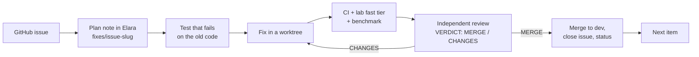

# Elara fix programme: hand-off after phase 1

Date: 2026-10-17. Repository: [PIIIX-org/chapters](https://github.com/PIIIX-org/chapters) (product name Elara). Written for whoever continues the work: the owner, another agent, or a future session.

## 1. Where things stand

| | State |
|---|---|
| Study | Done. Round 1 + round 2 reports, the 59-project landscape study and the Zep study produced a fix list of 192 items (`FIX-LIST.md`). |
| Issues | All 183 open items filed as GitHub issues (#413–#589 plus #403, #408–#411), label `elara-study`, one milestone per phase. |
| Plan | Elara, Chapters vault: `fixes/index`, `fixes/phase-0` … `fixes/phase-5` (order and status of every item). |
| Phase 0 (owner actions) | 4 of 6 closed. Open: #589 (revoke 5 old GitHub tokens; the owner will do it) and #664 (production deploys on push, before CI; found during the promotion). |
| Phase 1 (guardrails and security) | **Done and on `prod`: 25 of 25 issues closed**, 24 PRs merged to `dev`, promoted in [#660](https://github.com/PIIIX-org/chapters/pull/660) (`prod` = `5c5bdc0`). |
| Phases 2–5 | Not started. 38, 61, 29 and 43 open issues (follow-ups found by reviews included). |

## 2. What phase 1 delivered

**Release gates (nothing reaches `prod` without proof)**

| PR | What it does |
|---|---|
| [#590](https://github.com/PIIIX-org/chapters/pull/590) | The prod image is published only after CI passes on that exact commit. (The production server currently deploys on the push itself, not from this image: #664.) |
| [#591](https://github.com/PIIIX-org/chapters/pull/591) | CI checks every note file parses and matches its database row. |
| [#597](https://github.com/PIIIX-org/chapters/pull/597) | `fails-before`: a fix PR's new tests must fail on the old code. |
| [#602](https://github.com/PIIIX-org/chapters/pull/602) | PR template with an Evidence section; `pr-evidence` rejects claims without links. |
| [#616](https://github.com/PIIIX-org/chapters/pull/616) | The integration lab runs in CI (fast tier on every PR, full tier nightly and on demand). Known defects live in `lab/known-defects.json`; a fix must remove its own entries. |
| [#622](https://github.com/PIIIX-org/chapters/pull/622) | Premise benchmark as a release gate (`bench` ×3 instances, median, `bench-gate`), correct NDCG, never against production. |
| [#625](https://github.com/PIIIX-org/chapters/pull/625) | `review-verdict` gate: a promotion needs a `VERDICT: MERGE` comment naming the exact head. Required checks applied to `dev` and `prod`. |
| [#631](https://github.com/PIIIX-org/chapters/pull/631) | Commit attribution check, issue forms with "found by", STATE.md generated from GitHub by a bot. |
| [#637](https://github.com/PIIIX-org/chapters/pull/637), [#648](https://github.com/PIIIX-org/chapters/pull/648) | `/health` reports restarts (`bootId`, `lastShutdown`, …); an uptime monitor posts to issue [#636](https://github.com/PIIIX-org/chapters/issues/636). |
| [#651](https://github.com/PIIIX-org/chapters/pull/651) | Weekly trial with real AI agents against the lab instance (8 tasks, Elara arm vs local grep arm). Inactive until an API key is added (section 6). |

**Security**

| PR | What it does |
|---|---|
| [#592](https://github.com/PIIIX-org/chapters/pull/592), [#643](https://github.com/PIIIX-org/chapters/pull/643) | Every MCP tool and prompt response is scanned for secrets in CI. Git credentials no longer leak through sync errors, query strings, fragments, `ssh://user:pw@` remotes or broken URL encodings. The review caught a crash at server start in the first version. |
| [#639](https://github.com/PIIIX-org/chapters/pull/639) | Every MCP tool declares its scope; one wrapper enforces the token's pin. |
| [#640](https://github.com/PIIIX-org/chapters/pull/640), [#647](https://github.com/PIIIX-org/chapters/pull/647), [#655](https://github.com/PIIIX-org/chapters/pull/655) | Token levels read / write / admin, tool allow-lists, expiry. Pinned tokens lose admin tools and can't exceed the minter's permission. `tools/list` shows only tools the token can actually call (live permission check). |
| [#642](https://github.com/PIIIX-org/chapters/pull/642) | Saving a perspective needs edit access; global perspectives are visible only to their creator. |
| [#645](https://github.com/PIIIX-org/chapters/pull/645) | Behaviour tests for token revocation, expiry, deactivation, the rate limit, account separation and prompt note text. |
| [#654](https://github.com/PIIIX-org/chapters/pull/654) | Deactivating a user revokes their MCP tokens; reactivation brings none back. |

Docs and housekeeping: #627 (prod merged back into dev), #652 (first bot STATE.md refresh), #659 (STATE.md: auto redeploy, promotion procedure), #661 (lab baseline: the #496 bundle check marked intermittent after two full runs on the same commit disagreed).

**Reviews.** Every PR was reviewed by a separate Opus session told to disprove the PR (docs-only and bot PRs by the coordinator). Reviews sent PRs back with blocking problems many times; in the last stretch alone #642, #643, #648, #651 (twice), #655 and #661, each fixed before merging. Reviews: `D:/taha/research/elara-study/fixes/reviews/<pr>.md` and Elara `reviews/pr-<n>`.

## 3. How the work is done (keep doing it this way)

- **Briefs.** Fix agents follow `D:/taha/research/elara-study/fixes/BRIEF.md`; reviewers follow `fixes/REVIEW.md`. Both are complete; hand them to a new agent as-is.
- **One fix at a time, in phase order** (owner's rule). Related items may share a PR. A review may run while the next fix starts.
- **Merging to `dev`.** Post the verdict comment (first line `VERDICT: MERGE`, then `Review: [[reviews/pr-<n>]]`, `Head reviewed: <full sha>`, `Reviewer: …`), then `gh pr merge <n> --merge --delete-branch`. If GitHub says the branch is behind, run `gh pr update-branch`, wait for the checks, and post a new verdict naming the new head (the update adds no content).
- **After a CHANGES review**, the fix goes back to the same reviewer, and the merge needs a `VERDICT: MERGE` on the head that is merged. Coordinator-only checks of post-review commits made the phase 1 promotion review fail once (six delta reviews had to be done after the fact).
- **Status in Elara.** `bun D:/taha/research/tools/fix-status.ts <item> "<status>"` updates the phase table.
- **Promotion to `prod`, once per phase.** PR `dev`→`prod`; full lab tier and full benchmark on that exact head (the PR's own lab run is full tier because its base is `prod`; `gh workflow run elara-lab.yml --ref dev -f tier=full -f bench=all` for an extra run); independent review of the promotion (REVIEW.md §9), which also checks that every PR in the range has a verdict on its merged head; verdict comment; then `git push origin <sha>:prod` (fast-forward, not the merge button), and only after every check on the promotion PR is green, because production deploys on that push (#664).
- **Owner decisions without an answer** get the conservative default, written on the issue and in the plan note, with the alternatives listed.

## 4. Phase 1 promotion

**Done: 2026-10-17 01:37 UTC, [#660](https://github.com/PIIIX-org/chapters/pull/660), `prod` `111e3f1` → `5c5bdc0` (fast-forward).**

| Step | Result |
|---|---|
| Full lab tier + full benchmark on `5c5bdc0` | [run 38977444259](https://github.com/PIIIX-org/chapters/actions/runs/38977444259): gate PASS on attempt 2 (20 tests, 676 checks passed, 118 known failures, 0 regressions, 0 stale); `bench` ×3 and `bench-gate` green. Attempt 1 failed only because #496 had been closed by mistake (see section 10) and was reopened. |
| Flaky check found on the way | Two full runs on the same commit disagreed on the #496 bundle check; marked `intermittent` in [#661](https://github.com/PIIIX-org/chapters/pull/661) after its own review. |
| CI on `5c5bdc0` | [PR run 38977444289](https://github.com/PIIIX-org/chapters/actions/runs/38977444289), [dev push 38977440491](https://github.com/PIIIX-org/chapters/actions/runs/38977440491), [prod push 38991686362](https://github.com/PIIIX-org/chapters/actions/runs/38991686362) (image published 01:43 UTC). |
| Promotion review | Independent, REVIEW.md §9 (Elara `reviews/pr-660`). First answer CHANGES: 9 of 25 PRs lacked a verdict comment on their merged head. Fixed with six post-merge independent delta reviews (#590, #591, #597, #602, #616, #622; all MERGE), coordinator verdicts for #412 and #627, a formatted verdict for #592, and body corrections. Second answer MERGE. |
| Production | New code running since 01:38:18 UTC (`/health` shows the #637 fields, bootId `01a14782…`; [uptime run 38992345112](https://github.com/PIIIX-org/chapters/actions/runs/38992345112)). |

**Found during the promotion: [#664](https://github.com/PIIIX-org/chapters/issues/664) (owner).** Production booted the new code 23 seconds after the push, 5 minutes before CI published the gated image. The server therefore deploys on the push to `prod`, not from the image #590 publishes after CI, so a commit that fails CI would still reach production. Today's deploy was safe because the same commit had passed CI, the full lab and the benchmark first. Until #664 is fixed, never push to `prod` before every check on the promotion PR is green. `/health` reports `version: null` because the deploy doesn't pass the version.

After deploy (from the promotion body): migrations 0019 and 0020 ran at boot; to roll back past phase 1 see section 10.

## 5. Decisions taken for the owner (can be changed)

| Issue | Default taken | Alternatives (on the issue) |
|---|---|---|
| [#549](https://github.com/PIIIX-org/chapters/issues/549) | Pinned tokens get no admin tools unless granted at mint; account tokens minted through the API without a level get `admin` (the Settings form defaults to read+write). | API default `write` for account tokens. |
| [#550](https://github.com/PIIIX-org/chapters/issues/550) | Global perspectives visible and deletable only by their creator. A deactivated creator's globals become invisible to everyone (no data removed). | Admins see and delete all globals (option C); any account may save private globals. |
| [#593](https://github.com/PIIIX-org/chapters/issues/593) | Owners also see URL query tokens as `***`. | Show the raw query to owners. |
| [#571](https://github.com/PIIIX-org/chapters/issues/571) | Agent trial built but inactive without an API key. | Add the key (section 6). |
| [#588](https://github.com/PIIIX-org/chapters/issues/588) | `rea-snapshot` and `elara-freshness-lab` archived (not deleted); the freshness-lab webhook deleted. | Unarchive or delete. |
| [#635](https://github.com/PIIIX-org/chapters/issues/635) | `STATE_MD_TOKEN` is the owner's gh login token (owner's choice). | A fine-grained token with Contents + Pull requests on `chapters` only (recommended later). |

## 6. Waiting on the owner (optional unless marked)

1. **#589 (required):** revoke the 5 GitHub tokens exposed before #383, then close the issue.
2. **#664 (required):** make production deploy from the CI-published image (or wait for the CI `publish` job) instead of on every push to `prod`, and pass the version so `/health` shows it.
3. **Replace `STATE_MD_TOKEN`** with a fine-grained token when convenient: `gh secret set STATE_MD_TOKEN --env state-md -R PIIIX-org/chapters`. Revoking the current gh login breaks the STATE.md bot until then.
4. **Turn on the agent trial:** add `AGENT_TRIAL_API_KEY` as a secret and `AGENT_TRIAL_MODEL` as a variable in the `agent-trial` environment (optional `AGENT_TRIAL_PROVIDER`, `AGENT_TRIAL_BASE_URL`). Details in `benchmarks/README.md`, section "Agent trial".
5. **Prod repository connections** `rea` and `elara-freshness-lab` are no longer needed (Settings → Repositories → delete). Leaving them costs only polling. Removing one needs a logged-in owner session; there is no MCP tool for it.
6. Decide the #549 / #550 defaults if the ones in section 5 don't suit.

## 7. Open follow-ups found during phase 1

| Issue | Phase | What |
|---|---|---|
| [#658](https://github.com/PIIIX-org/chapters/issues/658) | 2 | Lab: app stays down after a SIGKILL step if `compose start` fails (one flaky run seen). |
| [#621](https://github.com/PIIIX-org/chapters/issues/621) | 2 | Import applies shares from the archive manifest without asking. |
| [#623](https://github.com/PIIIX-org/chapters/issues/623) | 3 | Search results with equal scores have no tie-breaker. |
| [#644](https://github.com/PIIIX-org/chapters/issues/644) | 5 | Credential redaction is quadratic on long error text. |
| [#650](https://github.com/PIIIX-org/chapters/issues/650) | 5 | `fails-before` can't check `.github/scripts/*.test.mjs` tests. |
| [#656](https://github.com/PIIIX-org/chapters/issues/656) | 5 | Deactivation leaves repository sync tokens and export links working; two admins can deactivate each other. |
| [#657](https://github.com/PIIIX-org/chapters/issues/657) | 5 | Agent trial: zero usage trusted, estimate factor, timeouts across retries. |
| [#662](https://github.com/PIIIX-org/chapters/issues/662) | 5 | Gate hardening follow-ups from the post-merge delta reviews (#590, #597, #602, #622). |
| [#663](https://github.com/PIIIX-org/chapters/issues/663) | 2 | Lab: restart-extraction file-count check failed once without printing the clean run's count. |
| #617–#620 | 5 | Small bugs and OKF/attachment gaps from the lab. |

## 8. What the next phases fix

| Phase | Items | Goal | First items |
|---|---|---|---|
| 2: stop data loss | 38 | Never lose or corrupt what a person or agent wrote: edits that delete live typing (#408), lost appends, one authoritative store, crash safety, size caps, backups (#409). | 35 strict schemas, 36 frontmatter merge, 24 `note_history` (#411), 140 webhook disables polling (#410), 94/95 backup restore. |
| 3: the premise | 61 | Exact answers in fewer tokens than grep (today 1.9–5× more): budgets, slim tool profile, located hits, working code index, grep/references tools. | 17–20 token budgets, 25 strip embeddings from replies, 21–23 browse/graph limits. |
| 4: knowledge truth and memory | 29 | Code claims tied to commits and re-checked on sync; session logs and handoff for agents. | 104 claim anchors, 105 quote resolution. |
| 5: everything else | 43 | Persian/Arabic search, sync/webhooks, prompts, graph, attachments, OKF, docs; re-prioritised after phase 3 numbers. | 130 Persian normalisation. |

Full order: Elara `fixes/phase-2` … `fixes/phase-5`.

## 9. Where everything is

| What | Where |
|---|---|
| Code | `D:/taha/chapters` (main checkout on `dev`; agents work in `D:/taha/worktrees/<name>`, never in the main checkout) |
| Study reports | `D:/taha/research/elara-study/REPORT.md`, `REPORT-ROUND2.md`, `elara-what-we-did-wrong.html` |
| Fix list and issue map | `FIX-LIST.md`, `fix-issues.json` (item → issue) |
| Briefs and reviews | `fixes/BRIEF.md`, `fixes/REVIEW.md`, `fixes/reviews/<pr>.md` |
| Promotion bodies | `merge/promote-body.md` (#407), `merge/promote-phase-1-body.md` |
| Tools | `D:/taha/research/tools/`: `elara-call.ts` (Elara MCP helper), `fix-status.ts`, `publish-fix-plan.ts`, `file-fix-issues.ts` |
| Elara notes | Chapters vault (`c1e3c446-…`): `fixes/*`, `reviews/pr-*`, `audit/2026-10-14-*`; landscape vault `second-brain-landscape` |
| Benchmark | `benchmarks/` in the repo; method and numbers only from CI (`benchmarks/README.md`) |
| Lab | `lab/`, `docs/agents/lab.md`; workflow `elara-lab.yml` |

## 10. Gotchas

- **Rolling back past phase 1:** migrations 0019 + 0020 leave `mcp_connections.access` NOT NULL with no default. Before running older code: `ALTER TABLE mcp_connections ALTER COLUMN access SET DEFAULT 'write'` (`docs/self-hosting/backup.md`).
- **`review-verdict/dev` is red on every open PR** until a verdict comment is posted; it is required only on `prod`.
- **Never test against production** (`chapters.piiix.org`); the lab instance is the staging server.
- **Clean room:** never copy code or prompt text from MiroFish, OASIS, CAMEL, Graphiti, Zep or the landscape projects.
- **Local machine:** no Docker or pnpm (the sandbox blocks symlinks); CI and the lab are the test runners. All files stay under `D:/taha`; point Bun/npm caches at `D:/taha/tools/cache`.
- **Commits:** author and committer `Taha-Mahmoodi <Taha-Mahmoodi@users.noreply.github.com>` plus the trailer `Co-Authored-By: Claude Opus <noreply@anthropic.com>` (the `attribution` check).
- **Elara `edit_note` frontmatter** replaces the whole map; never put `---` inside a frontmatter value.
- **GitHub closing keywords:** never write "fix #N", "fixes #N" or "closes #N" in a PR body unless the PR really closes it, not even in "does not fix #N". #661 closed #496 that way; it was reopened, and the lab gate fails while a baseline entry points at a closed issue.
- **Flaky lab checks:** if two full runs on the same commit disagree on a known-defect check, mark that entry `intermittent` with the measured reason (as in #661) rather than re-running until green.
