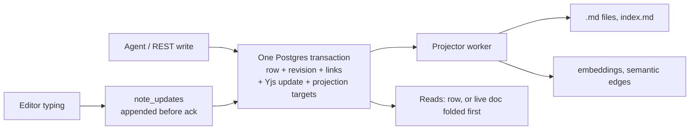

# Elara fix programme: hand-off after phase 2

Date: 2026-10-22; promotion recorded 2026-10-23. Repository: [PIIIX-org/chapters](https://github.com/PIIIX-org/chapters) (product name Elara). Written for whoever continues the work: the owner, another agent, or a future session. Phase 1's hand-off is [phase-1.md](phase-1.md). This document covers what phase 2 changed; where phase-1 text still holds it links there instead of repeating it. Sections 7–13 and Appendix A follow phase-1's sections 3 and 5–10 and its Appendix A.

Every phase-2 pull request has merged, and phase 2 is on `prod` since 2026-10-23 (two promotion steps, section 5).

## 1. Where things stand

| | State |
|---|---|
| Phase 2 (stop data loss), milestone 3 | **52 of 52 issues closed.** The last ones: #408 and #476 ([#864](https://github.com/PIIIX-org/chapters/pull/864)), #485 ([#889](https://github.com/PIIIX-org/chapters/pull/889)), #488 ([#892](https://github.com/PIIIX-org/chapters/pull/892)), #501 ([#861](https://github.com/PIIIX-org/chapters/pull/861)), #486 and #489 ([#896](https://github.com/PIIIX-org/chapters/pull/896), section 1.1). |
| Design | ADR-003 (Elara `decision/adr-003-authoritative-store`, rev 7) signed off by the owner with every default on [#704](https://github.com/PIIIX-org/chapters/issues/704). Slices S1 to S6 are all on `dev` (S3 is [#847](https://github.com/PIIIX-org/chapters/pull/847)), and so is the S2b bin export for rollback ([#885](https://github.com/PIIIX-org/chapters/pull/885)). |
| Rehearsal | [#703](https://github.com/PIIIX-org/chapters/issues/703): restore + S2a migration + rollback ([comment 6314996795](https://github.com/PIIIX-org/chapters/issues/703#issuecomment-6314996795)) and S2b migration ([comment 6321492109](https://github.com/PIIIX-org/chapters/issues/703#issuecomment-6321492109), **GO with conditions**) on a copy of production. |
| `dev` | `e3ff312` was #885's merge, the last phase-2 PR. After the hand-off, #902, #909, #910 and #912 merged; `dev` was `d3b210e` at step B. |
| `prod` | **`d3b210e`** since 2026-10-23 07:55 UTC: step A ([#899](https://github.com/PIIIX-org/chapters/pull/899), `f3724d0`) on 2026-10-22, then step B ([#920](https://github.com/PIIIX-org/chapters/pull/920)). Section 5. |

### 1.1 How #486 and #489 closed

ADR-003 removed the SIGKILL windows #486 and #489 measured: row, revision and CRDT update commit in one transaction and files are projections. The full-tier rerun of every SIGKILL boundary (`crash-write`, `collab-duplication`, `collab-s2b`, `store-failpoints`, `store-migration`, `store-rollback`, `fix-crash-catchup`, `restart-extraction`), each SHA run twice ([#489 comment](https://github.com/PIIIX-org/chapters/issues/489), mapping of #486's done-when in [#486's comment](https://github.com/PIIIX-org/chapters/issues/486)):

| Run | Commit | crash-write |
|---|---|---|
| [39734379501](https://github.com/PIIIX-org/chapters/actions/runs/39734379501) | `dev` `927890d` | 74/74 checks over boundaries a1, a4, a10, a20, a30, a38, t100, t400 |
| [39734384384](https://github.com/PIIIX-org/chapters/actions/runs/39734384384) | same SHA (branch `lab/rerun-489`) | 74/74 |
| [39739748260](https://github.com/PIIIX-org/chapters/actions/runs/39739748260) | `dev` `5e07bd4` | 74/74 |
| [39739753171](https://github.com/PIIIX-org/chapters/actions/runs/39739753171) | same SHA | 74/74 |
| [39739825944](https://github.com/PIIIX-org/chapters/actions/runs/39739825944) | #896's branch, entries removed | gate green |

The only collab-duplication failures in those runs are the S18 pair, baselined under #891 (section 3.2). [#896](https://github.com/PIIIX-org/chapters/pull/896) then dropped the four `crash-write` entries (#486 ×3, #489 ×1), so a recurrence is a gate regression, and closed both issues.

## 2. What phase 2 delivered

### 2.1 The store after phase 2

- **One authoritative store: Postgres.** `notes` (text, frontmatter with its key order in `frontmatter_src`, path, `seq`), `note_revisions` (one per `seq`, ordered by `ord`), `note_links`, `note_crdt` (Yjs snapshot) and `note_updates` (Yjs tail). Nothing outside Postgres is read back as truth. Every write (create, edit, append/upsert, rename, delete, restore, revert, purge, import, backup restore, the CLIs) is one transaction under the note's lock and the instance's shared maintenance lock, and folds pending collab typing first (Invariant W).
- **Files are projections.** `.md` files, folder `index.md` and embeddings are written after commit by a worker that records `last_applied_seq`. Files are owned by path through the `projected_files` ledger: bytes Elara did not write are copied to `vaults/<id>/.conflicts/` before anything overwrites them, never lost. Hand or `git` edits are no longer an input (ADR Q2). FTS stays a generated column of the row.
- **Collab documents are named by note id** (`<vault>/~<noteId>`). A rename never closes an editor; a tab on an older page is refused with `reload-required` (a document and socket close, never an authentication failure, #907): the current page shows "Reload to keep editing", a step-A page "Offline — not saved yet" until it is reloaded. `.crdt/*.bin` files are retired; their state lives in `note_crdt`.
- **Append before ack (S3, [#847](https://github.com/PIIIX-org/chapters/pull/847)).** Each collab update is decoded, size-checked and committed to `note_updates` before the relay acknowledges it, so "saved" in the editor means committed in Postgres. A failed append closes the socket with no ack, so the editor keeps the typing and resends it.
- **Reads** (`read_note`, `export_note`, REST GET) fold a loaded live document first, so they return what the editor shows, with `rev`.

### 2.2 ADR-003 slices

| Slice | PR | What it guarantees | Proof |
|---|---|---|---|
| S1 schema + dry run | [#783](https://github.com/PIIIX-org/chapters/pull/783) | Migration 0021 is additive in schema (once the S2a migration has run, older code goes on it only through the backup.md §5 rollback). `migrate-store --dry-run` reads production in one read-only transaction and reports conflicts, files that change bytes, CRDT classes and timing. | `server/test/migrate-store.test.ts`, `store-schema.test.ts`; the #703 dry run. |
| S2a-1 transactional store | [#828](https://github.com/PIIIX-org/chapters/pull/828) | Every server write is one transaction; `DirectConnection` gone from writes; projector with ownership and conflict copies; reads from the DB; resumable backfill (`store_migrated_at`) and boot reconciliation on every boot. | `store-s2a.test.ts`; lab `store-failpoints`; #703 S2a rehearsal (944/944 row hashes unchanged). |
| S2a-2 maintenance lock, rollback export | [#838](https://github.com/PIIIX-org/chapters/pull/838) | Instance maintenance lock (a stopped-server export refuses to run beside a server, and a server refuses to start during it); `store-export-legacy`; verify-after-unclean-shutdown and orphan sweep at boot; instance backups read rows, not files. | `maintenance-lock.test.ts`, `store-s2a2-boot.test.ts`, `store-s2a-shutdown.test.ts`; lab `store-migration`, `store-rollback`; #703 rollback run. |
| S2b relay through Postgres | [#843](https://github.com/PIIIX-org/chapters/pull/843) | CRDT state in `note_crdt` + `note_updates`, written in the note's transaction; id-named documents; three-way rebase when the row changed outside the store; deterministic seed; S2b backfill (`collab_migrated_at`) and `.crdt/` → `.crdt.pre-adr-003/`. Closes #832, #834. | `collab-s2b.test.ts`, `collab-backfill.test.ts`, `note-crdt.test.ts`; #703 S2b rehearsal (355 bins attached, 0 set aside, 0 `fold_error`). |
| S2b bin export | [#885](https://github.com/PIIIX-org/chapters/pull/885) | `store-export-legacy` first folds every collab tail into the rows, then writes `.crdt/<path>.bin` (snapshot ⊕ tail, in the pre-S2b layout) for every live note whose CRDT state equals its row, so a code-only rollback over S2b keeps editor history. A note with a `fold_error` gets no bin and is listed. | `store-rollback.test.ts`, `collab-backfill.test.ts`, `store-s2a2-boot.test.ts`, `revision-compaction-job.test.ts` |
| S3 durable acks | [#847](https://github.com/PIIIX-org/chapters/pull/847) | Collab updates committed before the ack; fold policy; compaction on unload. Closes #487. | `collab-s3.test.ts`, `collab-s3-sigkill.test.ts`, `collab-s3-races.test.ts`, `collab-s3-pg-outage.test.ts`, `collab-s3-shutdown.test.ts`, `collab-s3-perf.test.ts`; removed both #487 baseline entries (S16 and crash-write closed-tab). |
| S4 read path + write result | [#840](https://github.com/PIIIX-org/chapters/pull/840) | Fold on read; `rev` on every read and write; `status: applied/merged/conflicted/retry`, `indexed`, `idempotency_key`, `dry_run`. Closes #474, #477. | `mcp-write-result.test.ts`, `edit-note-base-rev.test.ts`; browser `read_note` entry removed. |
| S5 durable jobs | [#817](https://github.com/PIIIX-org/chapters/pull/817) | Extraction and embeddings on a `jobs` table with leases, attempts, `last_error`, idempotency keys; survives restarts. Closes #494. It also orders every query that feeds Louvain, the fix #816 asked for (#816 closed with that evidence). | `durable-jobs.test.ts`, `durable-jobs-retry.test.ts`; lab `restart-extraction` still green. |
| S6 doctor | [#839](https://github.com/PIIIX-org/chapters/pull/839) | `pnpm doctor` compares file, row, revision, CRDT, FTS, vectors, links and projections (23 classes, `DOCTOR_CLASSES`), `--repair`; `check-notes` reports orphans; last-resort `rows-from-files`. Closes #495. | `doctor.test.ts`, `note-integrity.test.ts`, `rows-from-files.test.ts`. |

### 2.3 Every milestone 3 item

**Agent writes and history**

| Issue | Fix | PR | Proof |
|---|---|---|---|
| #403 | Edits are attributed to the agent, not `collab`: actor-aware dedupe, then writes no longer pass through the relay (S2a). | [#770](https://github.com/PIIIX-org/chapters/pull/770), [#828](https://github.com/PIIIX-org/chapters/pull/828) | 11 lab attribution entries removed in #770 ([full tier 39303323644](https://github.com/PIIIX-org/chapters/actions/runs/39303323644)). |
| #408 | `edit_note` applies a minimal diff and accepts ops; a whole body merges from the agent's last read. | [#807](https://github.com/PIIIX-org/chapters/pull/807), [#886](https://github.com/PIIIX-org/chapters/pull/886), [#864](https://github.com/PIIIX-org/chapters/pull/864) | `edit-note-ops.test.ts`, `text-diff.test.ts`, `last-read-restart.test.ts`, `server-client-id.test.ts`; #864 removed all 5 browser S1 #408 entries, so #408 closed with no entry left. |
| #411 | `note_history` returns metadata only, paginated; `get_revision` added. | [#772](https://github.com/PIIIX-org/chapters/pull/772) | `mcp-note-history.test.ts` |
| #437, #769 | Every tool schema is strict; unknown arguments are refused with the real parameter names, bounded, safe on `constructor`. | [#768](https://github.com/PIIIX-org/chapters/pull/768), [#789](https://github.com/PIIIX-org/chapters/pull/789) | `mcp-strict-args.test.ts`, `mcp-strict-args-limits.test.ts` |
| #438, #480 | `edit_note` frontmatter merges per key (`replace`, `removeKeys`); revisions deduplicated by deep equality. | [#770](https://github.com/PIIIX-org/chapters/pull/770) | `note-frontmatter-merge.test.ts`, `revision-dedupe.test.ts` |
| #474, #477 | `read_note` serves the live document; every write returns `rev`, `status`, `diff_stats`. | [#840](https://github.com/PIIIX-org/chapters/pull/840) | `mcp-write-result.test.ts` |
| #475 | A stale `base_rev` is three-way merged; overlaps become a linked proposal revision. | [#822](https://github.com/PIIIX-org/chapters/pull/822) | `edit-note-base-rev.test.ts`, `three-way-merge.test.ts` |
| #476 | A whole body without `base_rev` merges from the connection's last read (kept in Postgres, migration 0028), so typing done after the read stays. `upsert_note` and REST PUT do the same ([#879](https://github.com/PIIIX-org/chapters/pull/879), #865). | [#864](https://github.com/PIIIX-org/chapters/pull/864), [#879](https://github.com/PIIIX-org/chapters/pull/879) | `edit-note-base-rev.test.ts`, `three-way-merge.test.ts`, `last-read-restart.test.ts` |
| #478 | Atomic `append_note` / `upsert_note`; concurrent appends all land. | [#819](https://github.com/PIIIX-org/chapters/pull/819) | `mcp-append-note.test.ts`, `note-create-if-missing.test.ts` |
| #479 | Delete, restore and rename are history events; revert gets its own row (migration 0023). | [#805](https://github.com/PIIIX-org/chapters/pull/805) | `history-events.test.ts` |
| #482 | Restore point before an MCP connection's first write in a session (30 min idle). | [#806](https://github.com/PIIIX-org/chapters/pull/806) | `mcp-restore-point.test.ts` |
| #484, #803 | Rename, delete, restore, purge and create take the note lock; referrers of a renamed note rewritten by id under their own locks. | [#804](https://github.com/PIIIX-org/chapters/pull/804), [#812](https://github.com/PIIIX-org/chapters/pull/812) | `note-lifecycle-race.test.ts`, `note-write-race.test.ts` |
| #490 | Concurrent `create_note` into one folder: already fixed by #401, pinned by a test. | [#778](https://github.com/PIIIX-org/chapters/pull/778) | `mcp-concurrent-create.test.ts` |
| #491 | One body-size cap (`ELARA_NOTE_MAX_BYTES`, UTF-8 bytes) on every write path including the relay. | [#781](https://github.com/PIIIX-org/chapters/pull/781) | `note-size-cap.test.ts`, `collab-size.test.ts` |
| #492 | Writes that grow a note ≥ 1.9× or repeat a block are quarantined as a revision, not applied. | [#782](https://github.com/PIIIX-org/chapters/pull/782) | `growth-guard.test.ts`, `note-growth-quarantine.test.ts` |
| #501 | Long revision histories stored as lossless deltas (migration 0026); every revision reads exactly as before. | [#861](https://github.com/PIIIX-org/chapters/pull/861) | `revision-compaction.test.ts`, `revision-compaction-job.test.ts`, `migration-order.test.ts` |
| #779 | Folder `index.md` regeneration serialised per folder. | [#793](https://github.com/PIIIX-org/chapters/pull/793) | `index-regen-race.test.ts` |

**Editors and collab**

| Issue | Fix | PR | Proof |
|---|---|---|---|
| #481 | Agents show in editor presence. | [#810](https://github.com/PIIIX-org/chapters/pull/810) | `agent-presence.test.ts`, `agent-presence-renew.test.ts` |
| #483 | Agent edits keep the caret and the person's Ctrl+Z. | [#809](https://github.com/PIIIX-org/chapters/pull/809) | `collab-agent-edit.test.ts`; lab browser |
| #485 | Offline typing stays where it was typed when an agent writes. | [#889](https://github.com/PIIIX-org/chapters/pull/889) | Lab browser S8a/S8b; both #485 entries removed. |
| #486 | One authoritative store (ADR-003, section 2.2). | #783, #828, #838, #843, #847, #817, #840, #839, [#896](https://github.com/PIIIX-org/chapters/pull/896) | SIGKILL rerun (section 1.1); 3 crash-write entries removed. |
| #487 | Collab state saved before the ack (S3). | [#847](https://github.com/PIIIX-org/chapters/pull/847) | `collab-s3*.test.ts`; both #487 baseline entries removed. |
| #488 | Never rebuild text from a stale CRDT state. | [#843](https://github.com/PIIIX-org/chapters/pull/843), [#892](https://github.com/PIIIX-org/chapters/pull/892) | Lab S18 now plants a database restore with a tab open; the manual-SQL case moved to #891. |
| #489 | SIGKILL boundary rerun. | [#896](https://github.com/PIIIX-org/chapters/pull/896) | Four full-tier runs, 74/74 crash-write each (section 1.1); orphan-`.tmp` entry removed. |
| #498 | Live collab sockets close when their session ends (logout, deactivation). | [#796](https://github.com/PIIIX-org/chapters/pull/796) | `collab-logout.test.ts` |
| #712 | Graph scope picker portalled so the toolbar can't clip it. | [#762](https://github.com/PIIIX-org/chapters/pull/762) | `client/src/components/shell/ScopePicker.test.tsx`, `client/src/components/graph/GraphCanvas.scopePicker.test.tsx` |
| #720 | Offline edits say Offline, survive a reload (`collabStash`), guard unload. **Prerequisite of S2b in production.** | [#763](https://github.com/PIIIX-org/chapters/pull/763) | Client tests and lab browser in the PR. |
| #765, #766 | Offline stash keeps a restored copy when its write fails; open tabs claim a copy released by another tab. | [#790](https://github.com/PIIIX-org/chapters/pull/790), [#808](https://github.com/PIIIX-org/chapters/pull/808) | Client tests in the PRs. |

**Backup, restore, import, export**

| Issue | Fix | PR | Proof |
|---|---|---|---|
| #409 | Archive format 2: trash, revisions, attachments, repositories, MFA; restore by validate, plan, apply. | [#776](https://github.com/PIIIX-org/chapters/pull/776) | `backup-roundtrip.test.ts`, `restore.test.ts` |
| #493 | Backup files mode 600, directory 700; SHA-256 per part in `backup.json`; restore-and-verify in CI on backup PRs. | [#777](https://github.com/PIIIX-org/chapters/pull/777) | `backup-hardening.test.ts` |
| #499 | Vault export/import keeps revisions and trash and rewrites attachment links. | [#802](https://github.com/PIIIX-org/chapters/pull/802) | `export-history.test.ts`, `export-roundtrip.test.ts` |
| #500 | Restore CLI says which MCP tokens keep working. | [#797](https://github.com/PIIIX-org/chapters/pull/797) | `restore-tokens.test.ts` |
| #621 | Import grants manifest shares only with `?applyShares=true`. | [#795](https://github.com/PIIIX-org/chapters/pull/795) | `import-shares.test.ts` |
| #813 | Restore CLI recognises drizzle query errors by class. | [#867](https://github.com/PIIIX-org/chapters/pull/867) | `restore-cli-errors.test.ts` |
| #841 | Restore keeps the app role's password from `.env` (`globals.sql` reset it; found in the #703 rehearsal). | [#855](https://github.com/PIIIX-org/chapters/pull/855) | Docs only. |

**Sync, jobs, search, monitoring, lab**

| Issue | Fix | PR | Proof |
|---|---|---|---|
| #410 | A webhook repository is polled again once its webhook is stale or its sync failed. | [#773](https://github.com/PIIIX-org/chapters/pull/773) | Tests in the PR. |
| #494 | Durable jobs (S5). | [#817](https://github.com/PIIIX-org/chapters/pull/817) | `durable-jobs.test.ts` |
| #495 | Doctor (S6). | [#839](https://github.com/PIIIX-org/chapters/pull/839) | `doctor.test.ts` |
| #496 | Embedding runs in a worker thread; per-file symbol embedding budget. | [#800](https://github.com/PIIIX-org/chapters/pull/800), [#857](https://github.com/PIIIX-org/chapters/pull/857) | `embedding-worker.test.ts`, `embeddings.test.ts` (event-loop lag) |
| #497 | Extraction served round-robin across repositories. | [#801](https://github.com/PIIIX-org/chapters/pull/801), [#863](https://github.com/PIIIX-org/chapters/pull/863) | `extraction-fairness.test.ts` |
| #705 | Server errors, failed jobs and slow endpoints recorded; `/api/admin/monitoring`; the uptime monitor alerts (#636, optional webhook). | [#764](https://github.com/PIIIX-org/chapters/pull/764) | `monitoring.test.ts`, `monitoring-metrics.test.ts`, lab `monitoring-alerts` |
| #775 | Overlapping poll and webhook syncs count one new failure per transition (no false #705 alert). | [#856](https://github.com/PIIIX-org/chapters/pull/856) | `repository-sync-overlap.test.ts` |
| #842 | Migration conflict copies reported apart from projection job failures (found in the #703 rehearsal). | [#866](https://github.com/PIIIX-org/chapters/pull/866) | `store-s2a.test.ts` |
| #706 | A red nightly lab opens/updates a `lab-nightly` issue. | [#791](https://github.com/PIIIX-org/chapters/pull/791) | CI script tests. |
| #658, #663 | Lab brings the app back after SIGKILL; restart-extraction prints both counts. | [#798](https://github.com/PIIIX-org/chapters/pull/798) | Lab runs in the PR. |
| #703, #704 | Production rehearsal and owner sign-off (section 1). | — | Issue comments. |

Also merged in phase 2, outside the milestone: #771 (backup build failure, [#792](https://github.com/PIIIX-org/chapters/pull/792)), #825/#788/#811 (revision order, migration 0024, [#826](https://github.com/PIIIX-org/chapters/pull/826)), #854 ([#860](https://github.com/PIIIX-org/chapters/pull/860)), #848 (backup doc, [#859](https://github.com/PIIIX-org/chapters/pull/859)), #851, #852, #849 (test flakes: [#857](https://github.com/PIIIX-org/chapters/pull/857), [#870](https://github.com/PIIIX-org/chapters/pull/870), [#863](https://github.com/PIIIX-org/chapters/pull/863)), #844 (S2a size-cap test race, [#838](https://github.com/PIIIX-org/chapters/pull/838)), #767 (restart-extraction pinned repo, [#798](https://github.com/PIIIX-org/chapters/pull/798)), #833 (character diff only on the changed region, [#837](https://github.com/PIIIX-org/chapters/pull/837)), #858 (security events in recorded order, migration 0027, [#869](https://github.com/PIIIX-org/chapters/pull/869)), #862 (30 s test timeouts, [#874](https://github.com/PIIIX-org/chapters/pull/874)), #873 (dry run predicts attached equal/diffed, [#876](https://github.com/PIIIX-org/chapters/pull/876)), #872 (operator scripts offline in the image, [#878](https://github.com/PIIIX-org/chapters/pull/878)), #880 (crash-write waits for idle projections, [#882](https://github.com/PIIIX-org/chapters/pull/882)), #845 (crash catch-up waits for extraction to settle, [#883](https://github.com/PIIIX-org/chapters/pull/883)). [#835](https://github.com/PIIIX-org/chapters/pull/835) is a baseline change only: it marked crash-write's stays-doc duplication check (#832) intermittent.

## 3. Known defects and deferred items

### 3.1 `lab/known-defects.json` on `dev` (`e3ff312`)

29 entries, **none for a phase-2 issue**. During the phase, [#847](https://github.com/PIIIX-org/chapters/pull/847) removed both #487 entries, [#883](https://github.com/PIIIX-org/chapters/pull/883) the #845 entry, [#864](https://github.com/PIIIX-org/chapters/pull/864) all five #408 entries, [#889](https://github.com/PIIIX-org/chapters/pull/889) both #485 entries, [#892](https://github.com/PIIIX-org/chapters/pull/892) moved the two #488 S18 entries to #891, and [#896](https://github.com/PIIIX-org/chapters/pull/896) removed the four crash-write entries (#486 ×3, #489 ×1).

| Issue | Entries | Test | Status |
|---|---|---|---|
| [#891](https://github.com/PIIIX-org/chapters/issues/891) | 2 | collab-duplication S18 (CRDT state put back by SQL, tab kept open) | Phase 5 (section 3.2). |
| #440, #461, #556 | 4 | access-behaviour | Phase 5. |
| #533, #560, #561, #562, #618 | 6 | attachments | Phases 5–6. |
| #444, #563, #564, #565, #619, #620 | 8 | export-roundtrip | Phase 5 (OKF). |
| #459, #528, #530 | 8 | multilingual-search | Phase 3. |
| #617 | 1 | browser console errors | Phase 5. |

### 3.2 Filed during phase 2 and moved out

| Issue | Now | Why |
|---|---|---|
| [#891](https://github.com/PIIIX-org/chapters/issues/891) | Phase 5 | A CRDT state put back by manual SQL behind a newer row doubles an open tab's typing. After S2b no supported path (restore, doctor, import, rollback/roll-forward) reaches it ([#488 analysis](https://github.com/PIIIX-org/chapters/issues/488#issuecomment-6324028607)); the lab keeps measuring it through the baselined S18 step. |
| [#780](https://github.com/PIIIX-org/chapters/issues/780) | No milestone | Relay: frontmatter and non-text document content have no size bound (#491 covers the body). |
| [#784](https://github.com/PIIIX-org/chapters/issues/784) | No milestone | Editors are not told their stores were quarantined (#492); typing vanishes on reload. |
| [#877](https://github.com/PIIIX-org/chapters/issues/877), [#787](https://github.com/PIIIX-org/chapters/issues/787), [#799](https://github.com/PIIIX-org/chapters/issues/799) | No milestone | Test and lab flakes under load (monitoring extraction count, repository-routes teardown log, monitoring-alerts sync check). |
| [#774](https://github.com/PIIIX-org/chapters/issues/774), [#785](https://github.com/PIIIX-org/chapters/issues/785) | No milestone | `fails-before` and agent-trial tooling. |
| [#830](https://github.com/PIIIX-org/chapters/issues/830) | Open | Nightly lab failing (the #706 alert issue); stays open until a green nightly. |

Filed during phase 2 and already fixed on `dev`: #816 ([#817](https://github.com/PIIIX-org/chapters/pull/817)), #865 ([#879](https://github.com/PIIIX-org/chapters/pull/879)), #833 ([#837](https://github.com/PIIIX-org/chapters/pull/837)), #845 ([#883](https://github.com/PIIIX-org/chapters/pull/883)), #858 ([#869](https://github.com/PIIIX-org/chapters/pull/869)), #862 ([#874](https://github.com/PIIIX-org/chapters/pull/874)), #872 ([#878](https://github.com/PIIIX-org/chapters/pull/878); found in the S2b rehearsal), #873 ([#876](https://github.com/PIIIX-org/chapters/pull/876); found in the S2b rehearsal, no data effect), #880 ([#882](https://github.com/PIIIX-org/chapters/pull/882)).

## 4. Operator-facing changes

**New commands** (run in the app container, `docker compose run --rm --no-deps app pnpm <name>` with the app stopped, or `exec` while it runs):

| Command | What it does | Doc |
|---|---|---|
| `migrate-store --dry-run --report <file>` | Read-only report of what the S2a/S2b migration will do (conflicts, files that change bytes, CRDT and collab classes, timing). | `docs/self-hosting/migration.md` |
| `check-notes [--wait-idle --fail-on-pending]` | Every live note's file parses and matches its row; now also lists orphans. | backup.md §4 |
| `doctor [--vault <id>] [--repair] [--report <file>]` | File, row, revision, CRDT, FTS, vectors, links, projections; conflict copies, rejected updates, fold errors. | backup.md §4 "The doctor" |
| `rows-from-files` | Last resort: rebuild note rows from `.md` files (revisions and CRDT history lost). | backup.md §4 |
| `store-export-legacy` | Stopped-server export for a code-only rollback; takes the maintenance lock. Writes files, `index.md` and (from S2b, [#885](https://github.com/PIIIX-org/chapters/pull/885)) `.crdt` bins. | backup.md §5 |

**Migrations** (all run at boot; all additive in schema. Older code still goes on a database the S2a boot migration ran on only through the rollback below, never directly: backup.md §5, "Which way back"):

| Migration | From | Note |
|---|---|---|
| 0021 `adr003_store` | #783 | Store tables and markers; builds two indexes on `note_revisions` under a write lock. The S2a backfill after it keeps the app down on the first boot (27–54 s on the #703 copy of production, step A; migration.md). |
| 0022 `repository_file_embedding_note` | #800 | |
| 0023 `revision_events` | #805 | Older code relabels revert again (backup.md §5). |
| 0024 `revision_order` | #826 | Backups made by the newer code are refused by older code. |
| 0025 `write_idempotency` | #840 | |
| 0026 `revision_compaction` | [#861](https://github.com/PIIIX-org/chapters/pull/861) | Journal `when` 1791750000000. Data change: older code reads compacted bodies as empty, so a code-only rollback runs the backup.md §5 `UPDATE` first. |
| 0027 `security_event_order` | [#869](https://github.com/PIIIX-org/chapters/pull/869) | Journal `when` 1791700000000. Backups made by the newer code are refused by older code. |
| 0028 `note_reads` | [#864](https://github.com/PIIIX-org/chapters/pull/864) | Journal `when` 1791800000000. An MCP connection's last read of a note, so a restart between read and edit does not turn the edit into a replace. |

**Order rule.** Drizzle skips a migration whose journal `when` is at or below the newest one applied. 0027 merged first, so 0026 kept its number and took `when` 1791750000000, above 0027's; 0028 is above both. On a database without them (production), all three run in journal order 0026, 0027, 0028; on one that already had 0027 (`dev` instances), 0026 and 0028 still run because their `when` is above it. `migration-order.test.ts` pins this. Later migrations take the next number with a `when` above the newest.

**Rollback** (backup.md §5).
- Clean: restore the pre-upgrade backup.
- Code-only, keeping the data written since, from step B (or later) to step A (`ae6ffb9`, `prod` commit `f3724d0`) or any older release, with nobody typing (step A itself has no export: restore-only, section 5.4):
  1. `docker compose stop app` (graceful: stores every open editor's typing).
  2. `docker compose run --rm --no-deps app pnpm store-export-legacy`: under the exclusive maintenance lock (exit 2 while any app or writing CLI is up), folds every collab tail, renders every note file and `index.md`, and from S2b writes the `.crdt` bins ([#885](https://github.com/PIIIX-org/chapters/pull/885)). Exit 1 means a file failed or the S2a migration has not finished: fix it and run it again. Report in `/data/elara/store-export-legacy-<time>.json`.
  3. **Rolling back over 0026:** with the app still stopped, run backup.md §5's `UPDATE note_revisions SET body = note_revision_body(body, body_delta, delta_base_id), body_delta = NULL, delta_base_id = NULL, body_bytes = NULL WHERE body_delta IS NOT NULL; DELETE FROM note_revision_compaction`, so older code reads whole bodies (the export does not undo compaction).
  4. Start the older release. No other SQL, unless backup.md §5 names some for a migration you roll back over (0019 and 0020, for releases before them). Roll-forward needs nothing: boot adopts what the older code wrote and merges bins the old relay wrote into `note_crdt`.
- From S2a only this was rehearsed on #703 (comment 6314996795): counts and 944 row hashes unchanged.

**Monitoring.** `/api/admin/monitoring` with `Authorization: Bearer $ELARA_MONITORING_TOKEN` reports 5xx, failed jobs per kind and slow endpoints; the uptime monitor alerts on them (#705, [#764](https://github.com/PIIIX-org/chapters/pull/764)). Migration and projector conflict copies are reported as `conflictCopies`, not as job failures (#842, [#866](https://github.com/PIIIX-org/chapters/pull/866)). `docs/self-hosting/monitoring.md`.

**Backup and restore docs.** `globals.sql` no longer leaves the app unable to connect: set the role password from `.env` after loading it (#841, [#855](https://github.com/PIIIX-org/chapters/pull/855)). The data-volume steps use the app service and the cron target is a `backup.sh` the operator saves (#848, [#859](https://github.com/PIIIX-org/chapters/pull/859)).

**Offline image scripts (#872).** [#878](https://github.com/PIIIX-org/chapters/pull/878) makes `pnpm <script>` run without network in the published image (`pnpm_config_verify_deps_before_run=false`). Images built before it (promotion step A) needed `node --import tsx src/scripts/<name>.ts` inside the container.

## 5. Promotion to `prod` (done)

### 5.1 Two steps (owner's decision)

ADR-003 R3-2/Q4: S2b ships only after a promotion has put the #720 client in production, so that a refused tab's typing survives in the browser copy. `prod` (`5c5bdc0`) did not contain #720's merge commit `150669c`, so **the owner decided on two steps**. The coordinator asked the owner before opening each promotion PR. A single promotion was rejected by the owner.

| Step | PR | `prod` ← | Pushed (UTC) | CI + publish on `prod` | Dry run on the production snapshot | After |
|---|---|---|---|---|---|---|
| A | [#899](https://github.com/PIIIX-org/chapters/pull/899) | `f3724d0` = `ae6ffb9` (`dev` just before #843) + one baseline-only commit | 2026-10-22 12:55:50 | [run 39782450732](https://github.com/PIIIX-org/chapters/actions/runs/39782450732) | [#703 comment 6337997585](https://github.com/PIIIX-org/chapters/issues/703#issuecomment-6337997585) (GO) | prod→dev sync [#904](https://github.com/PIIIX-org/chapters/pull/904); the owner confirmed post-flight on the server |
| B | [#920](https://github.com/PIIIX-org/chapters/pull/920) | `d3b210e` (`dev` head; fast-forward, `prod` `ahead_by` 0) | 2026-10-23 07:55:29 | [run 39921053378](https://github.com/PIIIX-org/chapters/actions/runs/39921053378) | [#703 comment 6359468988](https://github.com/PIIIX-org/chapters/issues/703#issuecomment-6359468988) (GO, rerun on the exact head) | no sync needed; [#900](https://github.com/PIIIX-org/chapters/issues/900) closed; the owner confirmed post-flight on the live server |

**Step A** shipped:
- the #720 client;
- S1, S2a-1, S4 and S5;
- migrations 0021–0025;
- every phase-2 fix merged before #843.

Its lab baseline needed one commit: [#900](https://github.com/PIIIX-org/chapters/issues/900) tracked the defects whose fixes were still only on `dev` ("Phase 2 step A: defects live in production until step B"). Prod's lab gate refuses a baseline entry for a closed issue (rule 5), so the baseline entries of those closed issues pointed at #900 for step A, and `prod` then had one commit `dev` lacked; #904 merged it back.

**Step B** shipped:
- S2a-2, S2b and S3;
- S6 and the #885 bin export;
- migrations 0026–0028;
- the whole-body merges, #837 and #878;
- the fixes made after the hand-off:
  - [#902](https://github.com/PIIIX-org/chapters/pull/902) (#901): rollback per release in backup.md §5; migration.md describes what shipped;
  - [#909](https://github.com/PIIIX-org/chapters/pull/909) (#908): `doctor` treats the upgrade's own conflict copies as `INFO` and stale links as repairable (exit 3);
  - [#910](https://github.com/PIIIX-org/chapters/pull/910) (#907): a step-A tab left open says "Offline — not saved yet", keeps its typing and reconnects until it is reloaded, instead of "Access removed";
  - [#912](https://github.com/PIIIX-org/chapters/pull/912) (#911): `ELARA_TRUST_PROXY`.

Open after the promotion: [#921](https://github.com/PIIIX-org/chapters/issues/921), an Ajv `allowUnionTypes` warning on every boot (REST PUT `baseRev` schema from #865). It is cosmetic: integer and revision-id `baseRev` are both accepted.

### 5.2 Pre-flight as run (for the next promotion)

1. The owner was asked before the promotion PR was opened. Every check on the promotion PR had to be done, including the full lab tier and the full benchmark on the exact head. Then an independent promotion review, and only then `git push origin <sha>:prod`: production deploys on that push (#664 is still open).
2. A backup immediately before the push, per backup.md §1 (pg_dump + the data volume through a one-off app container). For step A's image the data-volume steps of its own backup.md failed (#848), so the backup followed `dev`'s backup.md at `b465e2a`.
3. Open editor tabs reloaded before step B (announced: a step-A tab left open shows "Offline — not saved yet" until it is reloaded; the reload brings its typing back once, #910).
4. Operator scripts: in step A's image, `node --import tsx src/scripts/<name>.ts` (#872); from step B, `pnpm <script>` works offline (#878).
5. `ELARA_MONITORING_TOKEN` in the production `.env`, the repository secret's value, at least 32 characters.
6. A dry run and first boot of the exact head on the production snapshot, posted to #703 (comments above).

### 5.3 Post-flight as run

The owner confirmed each item on the live server after each step:
1. `/health`: up, a new `bootId`, `version` = the promoted commit, `lastShutdown: graceful`.
2. The boot log:
   - step A: `[store] backfill:` with 0 failed;
   - step B: the collab backfill with 0 set aside and 0 failed, and `.crdt.pre-adr-003/` present;
   - `DATA_DIR/migration-report-*.json` and `collab-migration-report-*.json`.
3. `check-notes --wait-idle --fail-on-pending`: 0 broken, 0 pending. On step B, `doctor --repair` then `doctor` (exit 3 and then 0 in the rehearsal), with one `INFO migration-copy` line per unparseable file in the migration report (#908).
4. `/api/admin/monitoring` answers with the token, and the uptime monitor passes.
5. The editor shows `Synced`.

There is no staging server: the lab builds its own instance from the commit under test (`docs/agents/lab.md`), never against production.

### 5.4 Rollback (valid until the next promotion)

`prod` runs step B (`d3b210e`). backup.md §5, "Which way back", has the commands.
- **Code-only to step A, keeping every write since step B** (ADR-003 Q10: supported for one release, so until the next promotion; keep `.crdt.pre-adr-003/` until then). With nobody typing:
  1. `docker compose stop app`.
  2. `docker compose run --rm --no-deps app pnpm store-export-legacy`. It writes files, `index.md` and `.crdt` bins; exit 0 is required, and the summary must count the bins written.
  3. With the app still stopped, run backup.md §5's 0026 `UPDATE`, so step A's code reads whole revision bodies.
  4. Check out `f3724d0` and run `docker compose up -d --build app`. It reads the exported bins, so tabs that reload keep their history.
  5. Rolling forward to step B again needs nothing: the S2b boot merges the bins the step-A relay wrote and compacts the history again.
  
  This was rehearsed on the exact step-B head (#703 comment 6359468988).
- **Restore, losing every write since the upgrade:** stop the app, remove the database and data volumes (`docker compose down -v`), check out the release the backup was taken on, follow backup.md §2 steps 1–8 with the pre-step-B backup, and start it. After the next promotion this is the only way back over phase 2.

## 6. Open pull requests

None. The last phase-2 PRs merged on 2026-10-22: [#892](https://github.com/PIIIX-org/chapters/pull/892), [#889](https://github.com/PIIIX-org/chapters/pull/889), [#861](https://github.com/PIIIX-org/chapters/pull/861), [#864](https://github.com/PIIIX-org/chapters/pull/864), [#879](https://github.com/PIIIX-org/chapters/pull/879), [#896](https://github.com/PIIIX-org/chapters/pull/896), [#885](https://github.com/PIIIX-org/chapters/pull/885). Merged on 2026-10-21, after the first draft: [#837](https://github.com/PIIIX-org/chapters/pull/837), [#847](https://github.com/PIIIX-org/chapters/pull/847), [#869](https://github.com/PIIIX-org/chapters/pull/869), [#874](https://github.com/PIIIX-org/chapters/pull/874), [#876](https://github.com/PIIIX-org/chapters/pull/876), [#878](https://github.com/PIIIX-org/chapters/pull/878), [#882](https://github.com/PIIIX-org/chapters/pull/882), [#883](https://github.com/PIIIX-org/chapters/pull/883).

## 7. How the work is done (changes since phase 1)

The loop of [phase-1.md §3](phase-1.md#3-how-the-work-is-done-keep-doing-it-this-way) still holds: issue → plan note → failing test → fix → CI, lab and benchmark → independent review → merge. Promotions still need a full lab tier, the full benchmark and an independent review of the exact head. What changed in phase 2:

- **Machine and paths.** The work moved to macOS. Everything lives under `~/elara`, never under `/tmp` (section 12). Docker and pnpm now run locally, so local test runs are possible as well as CI.
- **Roles.**
  - **Coordinator.** One coordinator session spawns fix agents and does not fix issues itself.
  - **Fix agents.** Each fix agent takes one issue and opens one PR to `dev`. It works in a worktree `~/elara/worktrees/<branch>` made from `origin/dev`, after `source ~/elara/env.sh` (Node 24; a private test database `elara_test_<worktree>` on the shared `elara-test-pg` at `localhost:5444`; the commit identity). Every commit carries the trailer `Co-Authored-By: Claude Opus <noreply@anthropic.com>`. It follows `~/elara/tools/BRIEF.md` and keeps the plan note `fixes/<n>-<slug>` in Elara (Problem, Plan, Test plan, Result, append-only Log). It opens its PR without waiting for CI and stops.
  - **Reviewer.** A separate reviewer session follows `~/elara/tools/REVIEW.md`. It posts the `VERDICT:` comment with a gist review record and `Head reviewed:`, then merges with `safe-merge.ts`.
  - **CHANGES verdicts.** The coordinator forwards each CHANGES verdict to the authoring agent at once (owner's instruction: don't wait until every PR has been reviewed). The agent fixes it on the same branch and reports the new head.
- **Watching.** `~/elara/tools/watch-verdicts.sh` scans every open PR for verdict comments and for merges and closes. It keeps a persistent handled-state file (`~/elara/tools/.handled`), so a restart loses no event, and acknowledges with `--ack` or `--ack-all`. MERGE verdicts and merges only go to `merged.log`, unless the PR is in `WAKE_ON_MERGE` (PRs other work depends on). CHANGES verdicts and closes always wake the coordinator.
- **Agents never** post `VERDICT` comments, review other PRs, press "Update branch", merge, or push to `prod`.

**Rules learned in phase 2**

- **Migration journal `when`.**
  - Drizzle skips a migration whose `when` is at or below the newest applied one. On every `dev` merge, a PR carrying a migration renumbers it, or moves its `when` above `dev`'s newest.
  - Phase 2's case: 0027 (#869, `when` 1791700000000) merged before 0026 (#861). 0026 kept its number but took `when` 1791750000000, and 0028 (#864) has 1791800000000.
  - `server/test/migration-order.test.ts` pins this (section 4).
- **Order revisions by `ord`, never by `created_at` or the database clock.** The test database's clock steps back by seconds, and rows written in one transaction share `now()` (#826 for revisions, #854/#860 for the audit trail, #858/#869 for security events).
  - The exception is #852. lastActivityAt keeps `max(created_at)`, and the test was fixed instead (#870, decision in section 8).
- **Lab gate rule 5.** A baseline entry pointing at a closed issue fails every lab run (prod's gate too).
  - Close an issue only with the PR that removes its last baseline entry. Write `Refs #N` everywhere else; GitHub closes on any "fixes #N".
  - #408 was reopened once for this, after an automatic close by a merge keyword.
  - A duplicate is closed as a duplicate and its entries point at the open issue: #875 and #888 were closed as duplicates of #408.
- **Stacked PRs.** When a PR builds on another open PR, merge the base branch into it every time the base moves. Say "merges after #N" in the body (#864's "Merge order" note is the pattern).
- **Fails-before must fail on an assertion.** A test that only times out, or fails only on a missing export, is not proof. #774 records one way the job miscounts.
- **Promotions.**
  - A promotion goes through a branch pinned at a SHA (`promote/<name>`), not `dev` itself, so `dev` keeps moving.
  - It is pushed to `prod` by fast-forward after the verdict on that head.
  - It may need a baseline-only commit on the promotion branch, plus the documented prod→dev sync afterwards (#899, #904; section 5).
- **Owner decisions without an answer** still get the conservative default, recorded on the issue and in the plan note, with the alternatives listed.

## 8. Decisions taken for the owner (can be changed)

| Issue | Decision | Alternatives / record |
|---|---|---|
| [#704](https://github.com/PIIIX-org/chapters/issues/704) | ADR-003 (rev 7) approved by the owner with every default (Q1–Q11), including: Postgres is the only authority; hand edits are copied to `.conflicts/`; frontmatter key order is kept; documents are id-named; the file wins at migration; migration is offline at boot; code-only rollback for one release. | ADR-003 §13 in Elara `decision/adr-003-authoritative-store`. |
| [#703](https://github.com/PIIIX-org/chapters/issues/703) | Production backup and rehearsals signed off by the owner (closed); every promotion step got its own GO report (section 5). | — |
| Promotion | Two steps (section 5.1); single promotion rejected by the owner. | — |
| [#621](https://github.com/PIIIX-org/chapters/issues/621) | A vault import grants no shares unless the importer opts in (`applyShares=true`); skipped shares are listed. | [Issue comment](https://github.com/PIIIX-org/chapters/issues/621#issuecomment-6286998890). |
| [#483](https://github.com/PIIIX-org/chapters/issues/483) | Ctrl+Z in the editor undoes only the person's own edits; agent edits are reverted through history. | [Issue comment](https://github.com/PIIIX-org/chapters/issues/483#issuecomment-6288682254). |
| [#499](https://github.com/PIIIX-org/chapters/issues/499) | An imported revision keeps its author id only if that author is the importer (user or the importer's MCP connection); otherwise the actor kind stays and the id is null. | [Issue comment](https://github.com/PIIIX-org/chapters/issues/499#issuecomment-6288295125). |
| [#705](https://github.com/PIIIX-org/chapters/issues/705) | Monitoring alerts go through the existing uptime monitor and issue #636; `ALERT_WEBHOOK_URL` optional. | [Issue comment](https://github.com/PIIIX-org/chapters/issues/705#issuecomment-6266719352). |
| [#872](https://github.com/PIIIX-org/chapters/issues/872) | Kept the image ENV defence (`pnpm_config_verify_deps_before_run=false`) as well as the manifest fix (#878). | Manifest fix alone. |
| [#851](https://github.com/PIIIX-org/chapters/issues/851) | The embedding test with the real model is opt-in and runs in the nightly lab (`real-model` job); the server suite uses a fake worker (#857). | Download the model in every CI run. |
| [#852](https://github.com/PIIIX-org/chapters/issues/852) | Team stats keep `max(created_at)` for `lastActivityAt`; the test was fixed (#870). Ordering by `ord` was reverted on review because imported revisions get a new `ord` but keep their date. | — |
| [#891](https://github.com/PIIIX-org/chapters/issues/891) | Moved to phase 5: only manual SQL on `note_crdt`/`note_updates` reaches it after S2b. | [#488 analysis](https://github.com/PIIIX-org/chapters/issues/488#issuecomment-6324028607). |
| [#408](https://github.com/PIIIX-org/chapters/issues/408) | #864's server client id is 2^32 + 48 random bits, above every editor's id, so typing in flight goes before a server insert at the same spot. This deviates from ADR-003 §5.2 ("one random uint32 per process"). | [Issue comment](https://github.com/PIIIX-org/chapters/issues/408#issuecomment-6318626577). |
| [#909](https://github.com/PIIIX-org/chapters/pull/909) | Stale link rows are reported as repairable (`doctor --repair`), not rebuilt at boot. | A one-time rebuild at boot with a new marker. |

The phase-1 decisions ([phase-1.md §5](phase-1.md#5-decisions-taken-for-the-owner-can-be-changed)) still stand.

## 9. Waiting on the owner (optional unless marked)

1. **[#589](https://github.com/PIIIX-org/chapters/issues/589) (required):** revoke the 5 GitHub tokens exposed before #383, then close the issue.
2. **[#664](https://github.com/PIIIX-org/chapters/issues/664) (required):** production deploys on the push to `prod`, before CI publishes the gated image. Both phase-2 promotions were pushed only after every check on the head was done, which made this safe, but the gap remains.

   These two are all that is open in the Phase 0 milestone.
3. **Optional, [#912](https://github.com/PIIIX-org/chapters/pull/912):** if production sits behind a reverse proxy on the host, set `ELARA_TRUST_PROXY` (`docs/self-hosting/checklist.md` §3). Without it, rate limits, lockout and security events see the proxy's address for every user (#911).
4. **Optional, from phase 1 and unchanged:**
   - replace `STATE_MD_TOKEN` with a fine-grained token;
   - turn on the agent trial: the `agent-trial` environment still has no secret or variable;
   - delete the unused repository connections.

   See [phase-1.md §6](phase-1.md#6-waiting-on-the-owner-optional-unless-marked) items 4–6.
5. **Optional, [#905](https://github.com/PIIIX-org/chapters/issues/905):** decide how the `collab-s3-perf` p95 bound should work on CI runners. Its reviewer left the assertion as it is for the owner.

## 10. Open follow-ups found during phase 2

Every open issue filed since 2026-10-19 (`gh issue list --search "created:>=2026-10-19" --state open`), classified. Section 3.2 has the reasons for the ones moved out during the phase.

| Issue | Kind | Proposed |
|---|---|---|
| [#784](https://github.com/PIIIX-org/chapters/issues/784) | Bug, user-visible: editors are not told their stores were quarantined (#492); the typing vanishes on reload | First in the next phase: it is the one remaining way typing disappears. |
| [#780](https://github.com/PIIIX-org/chapters/issues/780) | Bug: the relay bounds the body (#491) but not frontmatter or other document content | Next phase, with #784. |
| [#891](https://github.com/PIIIX-org/chapters/issues/891) | Bug, manual SQL only | Phase 5 (decided, section 8); the lab keeps measuring it (2 baseline entries). |
| [#921](https://github.com/PIIIX-org/chapters/issues/921) | Cosmetic: an Ajv `allowUnionTypes` warning on every boot (REST PUT `baseRev`, #865) | Any time; small. |
| [#905](https://github.com/PIIIX-org/chapters/issues/905) | Flake: `collab-s3-perf` p95 < 250 ms on CI runners | Needs the owner's call (section 9). |
| [#877](https://github.com/PIIIX-org/chapters/issues/877), [#787](https://github.com/PIIIX-org/chapters/issues/787), [#799](https://github.com/PIIIX-org/chapters/issues/799) | Test and lab flakes (monitoring extraction count, repository-routes teardown log, monitoring-alerts sync check) | Phase 5, or earlier whenever one turns a required check red. |
| [#774](https://github.com/PIIIX-org/chapters/issues/774), [#785](https://github.com/PIIIX-org/chapters/issues/785) | Tooling: `fails-before` and `vi.waitFor`; agent-trial T8 grades against old facts | Phase 5 (with #650, #657, #662). |
| [#918](https://github.com/PIIIX-org/chapters/issues/918) | Tooling: the STATE.md bot alternates real and empty data | Soon: the bot PRs are merged by the reviewer and can publish wrong numbers. |
| [#830](https://github.com/PIIIX-org/chapters/issues/830) | The nightly-lab alert issue | Closes itself on the next green nightly; the last red one failed only on rule 5 before #864/#896. |

The phase-1 follow-ups in [phase-1.md §7](phase-1.md#7-open-follow-ups-found-during-phase-1) that phase 2 closed: #658, #663, #621. The rest are in their phases (Appendix A).

## 11. What the next phases fix

Phase 3 comes next: **[milestone 4](https://github.com/PIIIX-org/chapters/milestone/4), 74 open (29 P0, 34 P1, 11 P2).** Goal: exact answers in fewer tokens than grep. Every retrieval or token change has to show its improvement in the benchmark and record the new median in `benchmarks/baseline.json` (`bench-gate`). The themes, in fix-list order:

| # | Theme | Issues |
|---|---|---|
| 1 | Token budgets and honest truncation; slim write replies; working limits on browse and graph | #420–#423, #427, #424–#426 |
| 2 | A small tool surface: reader/writer/admin profiles, two-sentence descriptions, schema cleanup, short path ids, `structuredContent`, annotations, `initialize.instructions`, tool search | #428, #429, #430, #432–#436, #431 |
| 3 | Errors and empty answers that say what happened: structured errors, 429 as JSON-RPC, "no match" vs "index unavailable", NUL bytes, OKF `type`, plain-text `read_note`, timestamps, fuzzy graph lookups, cross-vault search | #439–#448 |
| 4 | A code index that works: TSX, arrow functions, `.mts`/`.cts`, content-hash keys, symbol chunking, filters inside both channels, identifier-aware keyword channel, RRF fusion | #449–#456 |
| 5 | Located hits and reads: blocks with stable ids, `path#Lx-Ly` hits, grouping, multi-target reads, outlines instead of whole bodies, newlines kept, frontmatter off by default | #413–#419 |
| 6 | Ranking and vectors: code above docs, `retrieval_mode`/`degraded`, no timestamps in embeddings, all vectors replaced on edit, tenant-filtered neighbours, `ef_search`, stale re-embeds; then more languages, `build/`, imports, reranker only if it helps | #457–#463, #464–#467 |
| 7 | Code questions without grep: `grep`, symbol and edge tables, `symbol_at`/`references`/`callers`/`impact`, git awareness, backlinks with context, deterministic answers, `orient` | #468–#473, #534 |
| 8 | Added issues: tie-breaks (#623); then the cacheable prompt and caching contract (#681, #680), result caches (#682–#685); then routing hints, compound calls, working-tree overlay, vault as a git remote, usage learning, shared reading cache (#674–#679), and client compatibility runs (#709) | #623, #674–#685, #709 |

Work order: slim profile and budgets first, then #681, #680 and the caches, then #674–#679 and #709 ([phase-1.md §8a](phase-1.md#8a-new-features-added-2026-10-17), "Work order"). After phase 3:

| Phase | Open | Goal |
|---|---|---|
| 4: knowledge truth and memory | 35 | Code claims tied to commits and re-checked on sync; lessons and drift repair. |
| 5: everything else | 47 | Persian/Arabic search, sync, prompts, graph, attachments, OKF, docs, flakes and tooling (#891 added). |
| 6: rendered views and data attachments | 5 | Rendered views, queryable attachments, text extraction, sandboxed HTML (#667: Markdown stays the stored format). |
| 7: new capabilities | 8 | Secret guard, issue/PR/CI links, coordination, events, transclusion, capture, importers, review inbox. |
| 8: UI and UX | 46 | The UI/UX audit's fixes ([phase-1.md §8b](phase-1.md#8b-ui-and-ux-audit-2026-10-17)); the owner may pull them forward. |

Appendix A lists every open item per phase.

## 12. Where everything is

| What | Where |
|---|---|
| Workspace | `~/elara` (= `/Users/taha/elara`; never `/tmp`). |
| Main checkout | `~/elara/chapters`: never edited, only fetched. |
| Work trees | `~/elara/worktrees/<branch>`, one per PR. Remove each when it is done and drop its database. |
| Tools | `~/elara/tools/`, listed below. |
| Rehearsal | `~/elara/rehearsal/` (mode 700, private: compose file, app env, build logs, reports and hashes of the production-copy runs; never commit or upload it). The Docker volume `elara-rehearsal_db-data` remains; the `elara-rehearsal:*` images named in the #703 reports have since been removed. |
| Review records | `~/elara/reviews/<pr>.md`, the gists linked from each verdict, and Elara `reviews/pr-<n>`. |
| Scratch | `~/elara/scratch/`: PR bodies, one-off scripts such as `handoff-html.mjs` (renders `docs/handoff/phase-N.md` to `.html` in the phase-1 layout), and `stepa-gate-proof.mjs` (prod's lab gate on a baseline with live issue states). |
| Environment | `~/elara/env.sh`: Node 24 on `PATH`; `TEST_DATABASE_URL`/`DATABASE_URL` for `elara_test_<worktree>` on `elara-test-pg` (`localhost:5444`); `DATA_DIR=$PWD/.test-data`; the commit identity. The monitoring token sits in a separate file of mode 600 in `~/elara`; never print or paste it. |
| Elara | Production MCP via `bun ~/elara/tools/elara-call.ts <tool> '<json>'` (`ELARA_AGENT=fix-<n>`; large arguments via `ELARA_ARGS_FILE`). Vault "Chapters" `c1e3c446-d3f9-4868-9716-44b9c3234e72`: ADR-003 at `decision/adr-003-authoritative-store`, the plan in `fixes/phase-N`, one `fixes/<n>-<slug>` per item, `fixes/phase-2-handoff`, `fixes/phase-2-promotion`, `reviews/*`. |
| Rehearsal reports | #703: [S2a](https://github.com/PIIIX-org/chapters/issues/703#issuecomment-6314996795), [S2b](https://github.com/PIIIX-org/chapters/issues/703#issuecomment-6321492109), [step A](https://github.com/PIIIX-org/chapters/issues/703#issuecomment-6337997585), [step B on 1f419a0](https://github.com/PIIIX-org/chapters/issues/703#issuecomment-6342575659), [step B on d3b210e](https://github.com/PIIIX-org/chapters/issues/703#issuecomment-6359468988). Aggregate numbers only. |
| Phase-1 locations | Study reports, fix list, the archive repo: [phase-1.md §9](phase-1.md#9-where-everything-is). |

**Tools in `~/elara/tools/`**

| Tool | What it does |
|---|---|
| `BRIEF.md`, `REVIEW.md` | The fix-agent brief and the reviewer brief. Hand them over as they are. |
| `safe-merge.ts` | The only sanctioned merge: refuses unless every check on the PR head is green, then merges with `--match-head-commit`. |
| `verdict-merge.sh` | Posts an independent MERGE verdict and merges with `safe-merge.ts`. Refuses if the head moved since the review. |
| `update-branch.sh` | Merges `origin/dev` into a PR branch with the trailer, pushes, waits for the checks. Refuses on conflicts. |
| `watch-verdicts.sh` | Verdict and merge watcher with a persistent state file and `WAKE_ON_MERGE`. |
| `watch-prs.sh`, `watch-merges.sh` | Exit on the first change (comment, review, merge, close) of the given PRs. |
| `pr-status.sh` | For each open PR: the head, the latest verdict and the head it reviewed (`NEEDS-WORK` = CHANGES on the current head). |
| `elara-call.ts` | Calls one Elara MCP tool or prompt from the shell. |
| `fix-status.ts` | Sets an item's status cell in its `fixes/phase-N` note. |
| `merged.log` | Merges and MERGE verdicts logged by the watcher. |

## 13. Gotchas

Phase-1's gotchas ([phase-1.md §10](phase-1.md#10-gotchas)) still hold, except for "Local machine", which described the old Windows sandbox. New in phase 2:

- **Strict branch protection keeps every other PR `BEHIND`** after each merge to `dev`, so expect constant dev-merge churn and stale verdicts. Agents merge `origin/dev` themselves (with the trailer); nobody presses "Update branch".
- **A PR head can lag a push.** Closing and reopening the PR resyncs it (#839 and #859, both closed and reopened within seconds on 2026-10-21).
- **The test Postgres clock steps back.** On Docker Desktop on this Mac, `clock_timestamp()` on `elara-test-pg` stepped back by up to 3.47 s (#860, #870). Never order or bound by the database clock in tests or code (section 7).
- **Load on the shared test database.** Many agents running suites against the one shared Postgres pushed the load average to 20–80 on 10 cores (#862, #863, #870), and 5 s test timeouts failed. #874 raised them to 30 s. Keep parallel fix agents to about 6–8.
- **Never `pkill` machine-wide.** A `pkill` of vitest killed every agent's suite. A `pkill -f <pattern>` can also match and kill the shell running it. (From the coordinator's session record; there is no issue for these.)
- **Watchers die silently** when the session that started them restarts. Restart `watch-verdicts.sh` after any restart; its state file means nothing is lost.
- **`/tmp` is wiped on reboot.** Keep work, scripts and bodies under `~/elara`.
- **Stacked-PR fixtures can pollute the shared database.** #861's fixture inserted `note_crdt.snapshot = '\x'` (zero bytes, not a valid Yjs update), which broke #885's tests on the same database (#885's PR thread). Each worktree has its own database; drop it when the worktree goes.
- **The Elara MCP on production** still runs the code it was promoted with. `edit_note` frontmatter merges per key (#438); never put `---` inside a frontmatter value.

## Appendix A. Every remaining item, in order

Generated 2026-10-23 from phase-1's Appendix A (order, fix-list item, priority) and the GitHub milestones (state and title at generation time). Only open issues are listed. The full change text of each fix-list item is in [phase-1.md Appendix A](phase-1.md#appendix-a-every-remaining-item-in-order) and in Elara `fixes/phase-N`; it has not changed. Phase 1 (25/25) and phase 2 (52/52) are closed.

### Phase 0: owner actions

2 open ([milestone 1](https://github.com/PIIIX-org/chapters/milestone/1)). 4 fix-list items plus 2 added issues (after the fix-list items). Closed: #586, #587, #588, #635.

| Order | Item | Issue | Priority | Title |
|---|---|---|---|---|
| 4 | 192 | [#589](https://github.com/PIIIX-org/chapters/issues/589) | Now | [fix 192] Revoke the 5 GitHub tokens exposed before #383 |
| — | — | [#664](https://github.com/PIIIX-org/chapters/issues/664) | P1 | Production deploys on the push to prod, before CI publishes the gated image (#590 is bypassed) |

### Phase 3: the premise (fewer tokens, exact answers)

74 open ([milestone 4](https://github.com/PIIIX-org/chapters/milestone/4)). 60 fix-list items plus 14 added issues (after the fix-list items: #681, #680, #682–#685, then #674–#679 and #709; #623 where it fits).

| Order | Item | Issue | Priority | Title |
|---|---|---|---|---|
| 1 | 17 | [#420](https://github.com/PIIIX-org/chapters/issues/420) | P0 | [fix 17] Every read, search, browse, graph and history tool takes budget_tokens |
| 2 | 18 | [#421](https://github.com/PIIIX-org/chapters/issues/421) | P0 | [fix 18] Over budget: drop whole low-ranked items, then step down a ladder |
| 3 | 19 | [#422](https://github.com/PIIIX-org/chapters/issues/422) | P0 | [fix 19] Every response ends with a truncated block: shown, total (fetch limit+1 to know),… |
| 4 | 20 | [#423](https://github.com/PIIIX-org/chapters/issues/423) | P0 | [fix 20] Very large results become a pageable, greppable handle instead of inline text |
| 5 | 25 | [#427](https://github.com/PIIIX-org/chapters/issues/427) | P0 | [fix 25] Strip embedding and internal columns from every write reply |
| 6 | 21 | [#424](https://github.com/PIIIX-org/chapters/issues/424) | P0 | [fix 21] browse_repository: path prefix filter and cursor |
| 7 | 22 | [#425](https://github.com/PIIIX-org/chapters/issues/425) | P0 | [fix 22] browse_vault: root listing must respect recursive:false; return path and title only by… |
| 8 | 23 | [#426](https://github.com/PIIIX-org/chapters/issues/426) | P0 | [fix 23] graph: limit, neighborsOf, depth, edgeTypes actually implemented |
| 9 | 26 | [#428](https://github.com/PIIIX-org/chapters/issues/428) | P0 | [fix 26] Tool profiles: reader (~6 tools: orient, search, grep, read, outline, code questions),… |
| 10 | 27 | [#429](https://github.com/PIIIX-org/chapters/issues/429) | P0 | [fix 27] Two-sentence tool descriptions; long manuals served as MCP resources; CI fails if the… |
| 11 | 28 | [#430](https://github.com/PIIIX-org/chapters/issues/430) | P1 | [fix 28] Replace the UUID regex repeated 60 times with format: "uuid"; describe every parameter… |
| 12 | 30 | [#432](https://github.com/PIIIX-org/chapters/issues/432) | P1 | [fix 30] Print paths once per response with short ids the agent can cite |
| 13 | 31 | [#433](https://github.com/PIIIX-org/chapters/issues/433) | P1 | [fix 31] Return structuredContent with outputSchema, plus a short text summary |
| 14 | 32 | [#434](https://github.com/PIIIX-org/chapters/issues/434) | P1 | [fix 32] Tool annotations: readOnlyHint, destructiveHint, idempotentHint, title |
| 15 | 33 | [#435](https://github.com/PIIIX-org/chapters/issues/435) | P1 | [fix 33] Put essential usage rules in MCP initialize.instructions |
| 16 | 34 | [#436](https://github.com/PIIIX-org/chapters/issues/436) | P1 | [fix 34] Drop the listChanged:true capability or implement it (GET /mcp returns 404) |
| 17 | 29 | [#431](https://github.com/PIIIX-org/chapters/issues/431) | P1 | [fix 29] Tool search for the long tail instead of listing every tool (Cognee pattern) |
| 18 | 37 | [#439](https://github.com/PIIIX-org/chapters/issues/439) | P1 | [fix 37] Structured errors: {code, rule, retryable, retryAfterMs, suggestions} |
| 19 | 38 | [#440](https://github.com/PIIIX-org/chapters/issues/440) | P1 | [fix 38] HTTP 429 sent as a JSON-RPC error with a Retry-After header |
| 20 | 39 | [#441](https://github.com/PIIIX-org/chapters/issues/441) | P1 | [fix 39] find_symbols and search say "no match" instead of returning unrelated low-score hits… |
| 21 | 40 | [#442](https://github.com/PIIIX-org/chapters/issues/442) | P1 | [fix 40] Distinguish "no match" from "index unavailable or still building" in every search response |
| 22 | 41 | [#443](https://github.com/PIIIX-org/chapters/issues/443) | P1 | [fix 41] A NUL byte in a body must produce a clean error, not echo the SQL and full body |
| 23 | 42 | [#444](https://github.com/PIIIX-org/chapters/issues/444) | P1 | [fix 42] Split the semantic OKF type from the folder |
| 24 | 43 | [#445](https://github.com/PIIIX-org/chapters/issues/445) | P1 | [fix 43] read_note returns the body as plain text, not escaped JSON inside JSON |
| 25 | 44 | [#446](https://github.com/PIIIX-org/chapters/issues/446) | P1 | [fix 44] Update a note's timestamp on edit so recency ranking works |
| 26 | 45 | [#447](https://github.com/PIIIX-org/chapters/issues/447) | P2 | [fix 45] find_graph_path and graph lookups accept names or partial paths with candidate… |
| 27 | 46 | [#448](https://github.com/PIIIX-org/chapters/issues/448) | P2 | [fix 46] Cross-vault search for account tokens (today search refuses without a vaultId) |
| 28 | 47 | [#449](https://github.com/PIIIX-org/chapters/issues/449) | P0 | [fix 47] Parse .tsx with the TSX grammar (230 of 231 .tsx files fail to parse today) |
| 29 | 48 | [#450](https://github.com/PIIIX-org/chapters/issues/450) | P0 | [fix 48] Extract export const f = () => and other arrow-function or exported consts, and class… |
| 30 | 49 | [#451](https://github.com/PIIIX-org/chapters/issues/451) | P0 | [fix 49] Give .mts/.cts files a language and parse them |
| 31 | 51 | [#453](https://github.com/PIIIX-org/chapters/issues/453) | P0 | [fix 51] Key every derived artifact by content hash + parser version + embedder id; save… |
| 32 | 50 | [#452](https://github.com/PIIIX-org/chapters/issues/452) | P0 | [fix 50] Chunk code by symbol plus a skeleton chunk per large file or class; chunk notes by… |
| 33 | 52 | [#454](https://github.com/PIIIX-org/chapters/issues/454) | P0 | [fix 52] Apply repo, vault, path glob, language and kind filters inside both the keyword and the… |
| 34 | 53 | [#455](https://github.com/PIIIX-org/chapters/issues/455) | P0 | [fix 53] Keyword channel: split camelCase and snake_case, add a trigram index, weight path,… |
| 35 | 54 | [#456](https://github.com/PIIIX-org/chapters/issues/456) | P0 | [fix 54] Fuse keyword and vector with RRF over a fixed window; exact and identifier matches… |
| 36 | 10 | [#413](https://github.com/PIIIX-org/chapters/issues/413) | P0 | [fix 10] Index every note heading section and every code symbol as a block with a stable id,… |
| 37 | 11 | [#414](https://github.com/PIIIX-org/chapters/issues/414) | P0 | [fix 11] Search hits return {path#Lx-Ly, block id, heading path, approx tokens, snippet of up to… |
| 38 | 12 | [#415](https://github.com/PIIIX-org/chapters/issues/415) | P0 | [fix 12] Group hits by note, at most 3 passages per note |
| 39 | 13 | [#416](https://github.com/PIIIX-org/chapters/issues/416) | P0 | [fix 13] One read call accepts several targets (line range, block id or heading path) and… |
| 40 | 14 | [#417](https://github.com/PIIIX-org/chapters/issues/417) | P0 | [fix 14] read_file and read_note without a range return an outline with line spans, not the… |
| 41 | 15 | [#418](https://github.com/PIIIX-org/chapters/issues/418) | P0 | [fix 15] Never collapse newlines in stored text, so line addressing stays valid |
| 42 | 16 | [#419](https://github.com/PIIIX-org/chapters/issues/419) | P1 | [fix 16] Search results stop carrying frontmatter by default (53% of a note hit today) |
| 43 | 55 | [#457](https://github.com/PIIIX-org/chapters/issues/457) | P1 | [fix 55] Rank code above docs and plans for code-shaped queries (35% of code top-10 were docs) |
| 44 | 56 | [#458](https://github.com/PIIIX-org/chapters/issues/458) | P1 | [fix 56] Report retrieval_mode and degraded in search responses |
| 45 | 57 | [#459](https://github.com/PIIIX-org/chapters/issues/459) | P1 | [fix 57] Don't bake timestamps into embedded text (caused unstable Persian ranking) |
| 46 | 58 | [#460](https://github.com/PIIIX-org/chapters/issues/460) | P1 | [fix 58] On edit, replace all of a note's vectors, not one row |
| 47 | 59 | [#461](https://github.com/PIIIX-org/chapters/issues/461) | P1 | [fix 59] Semantic-edge neighbour lookup filtered by vault/tenant |
| 48 | 60 | [#462](https://github.com/PIIIX-org/chapters/issues/462) | P1 | [fix 60] Set hnsw.ef_search / iterative scan on every vector query, not only semantic-edge… |
| 49 | 61 | [#463](https://github.com/PIIIX-org/chapters/issues/463) | P1 | [fix 61] Re-embed notes whose embedding is stale after a restart, not only notes with no embedding |
| 50 | 62 | [#464](https://github.com/PIIIX-org/chapters/issues/464) | P2 | [fix 62] Structure for more languages (Rust, Java, C/C++, Swift) and heading outlines for… |
| 51 | 63 | [#465](https://github.com/PIIIX-org/chapters/issues/465) | P2 | [fix 63] Don't silently skip real source in folders named build/; report skipped files |
| 52 | 64 | [#466](https://github.com/PIIIX-org/chapters/issues/466) | P2 | [fix 64] Resolve ?raw and workspace-package imports |
| 53 | 65 | [#467](https://github.com/PIIIX-org/chapters/issues/467) | P2 | [fix 65] Only add a reranker after the benchmark shows it helps |
| 54 | 66 | [#468](https://github.com/PIIIX-org/chapters/issues/468) | P0 | [fix 66] grep over notes and code: regex, path glob, repo, ref, context lines, same line… |
| 55 | 67 | [#469](https://github.com/PIIIX-org/chapters/issues/469) | P0 | [fix 67] Symbol and edge table at index time: definitions, references, calls, imports, tests |
| 56 | 68 | [#470](https://github.com/PIIIX-org/chapters/issues/470) | P0 | [fix 68] Tools symbol_at(path:line), references, callers, impact(depth) |
| 57 | 69 | [#471](https://github.com/PIIIX-org/chapters/issues/471) | P0 | [fix 69] Git awareness: indexed commit SHA everywhere, changed_since(commit or date, path),… |
| 58 | 70 | [#472](https://github.com/PIIIX-org/chapters/issues/472) | P1 | [fix 70] Note backlinks carry the link's line and surrounding paragraph; neighbors(depth)… |
| 59 | 71 | [#473](https://github.com/PIIIX-org/chapters/issues/473) | P1 | [fix 71] No LLM in the query path for these tools; deterministic answers only |
| 60 | 136 | [#534](https://github.com/PIIIX-org/chapters/issues/534) | P0 | [fix 136] orient(query?, focus?, budget): ranked repo map |
| — | — | [#623](https://github.com/PIIIX-org/chapters/issues/623) | P2 | Search results with equal scores have no tie-breaker: ranks move between identical instances |
| — | — | [#674](https://github.com/PIIIX-org/chapters/issues/674) | P1 | [phase 3] Elara tells the agent when not to use it |
| — | — | [#675](https://github.com/PIIIX-org/chapters/issues/675) | P1 | [phase 3] One budgeted call for compound questions: where, who calls it, why, is it still true |
| — | — | [#676](https://github.com/PIIIX-org/chapters/issues/676) | P1 | [phase 3] Answer for the code the agent is editing: branch, ref and working-tree overlay |
| — | — | [#677](https://github.com/PIIIX-org/chapters/issues/677) | P1 | [phase 3] Vault as a git remote: clone, grep locally, push back |
| — | — | [#678](https://github.com/PIIIX-org/chapters/issues/678) | P2 | [phase 3] Learn from real usage: zero-result searches, unread notes, fallbacks to grep |
| — | — | [#679](https://github.com/PIIIX-org/chapters/issues/679) | P1 | [phase 3] Shared reading cache across agents: one digest per file at a commit |
| — | — | [#680](https://github.com/PIIIX-org/chapters/issues/680) | P1 | [phase 3] Caching contract: every cache key carries the caller's scope and the content revision |
| — | — | [#681](https://github.com/PIIIX-org/chapters/issues/681) | P1 | [phase 3] Make the agent's prompt cacheable: stable, deterministic tool list and instructions |
| — | — | [#682](https://github.com/PIIIX-org/chapters/issues/682) | P1 | [phase 3] "Unchanged since revision N" answers instead of repeating content |
| — | — | [#683](https://github.com/PIIIX-org/chapters/issues/683) | P2 | [phase 3] Per-session de-duplication: refer to content already sent in this session |
| — | — | [#684](https://github.com/PIIIX-org/chapters/issues/684) | P1 | [phase 3] Content-addressed index caches: reuse parse, symbols and embeddings by blob hash |
| — | — | [#685](https://github.com/PIIIX-org/chapters/issues/685) | P2 | [phase 3] Search and graph result cache keyed by query, scope and index version |
| — | — | [#709](https://github.com/PIIIX-org/chapters/issues/709) | P2 | [phase 3] Compatibility runs with several agent clients (Claude Code, Codex, Cursor, Gemini) |

### Phase 4: knowledge truth and memory

35 open ([milestone 5](https://github.com/PIIIX-org/chapters/milestone/5)). 29 fix-list items plus 6 added issues (#686 comes before the fix-list items; #687–#691 after the claim items #502–#505).

| Order | Item | Issue | Priority | Title |
|---|---|---|---|---|
| 1 | 104 | [#502](https://github.com/PIIIX-org/chapters/issues/502) | P0 | [fix 104] Code claims in notes carry a quote, source ref, resolved path:Lx-Ly, commit, a hash of… |
| 2 | 105 | [#503](https://github.com/PIIIX-org/chapters/issues/503) | P0 | [fix 105] Resolve the quote at write time; a quote that can't be found makes the claim unverified |
| 3 | 106 | [#504](https://github.com/PIIIX-org/chapters/issues/504) | P0 | [fix 106] On every index sync, regrade each claim: fresh, moved, stale or lost; show the state in… |
| 4 | 107 | [#505](https://github.com/PIIIX-org/chapters/issues/505) | P0 | [fix 107] repository_drift MCP tool: notes whose cited code changed since verified_against, so… |
| 5 | 108 | [#506](https://github.com/PIIIX-org/chapters/issues/506) | P0 | [fix 108] Audit checks content, not just format: cited files and lines exist and match, future… |
| 6 | 111 | [#509](https://github.com/PIIIX-org/chapters/issues/509) | P1 | [fix 111] Actually enforce stale_after and superseded (format-checked today, never read) |
| 7 | 110 | [#508](https://github.com/PIIIX-org/chapters/issues/508) | P1 | [fix 110] Agent-written claims labelled unverified until a check passes |
| 8 | 109 | [#507](https://github.com/PIIIX-org/chapters/issues/507) | P1 | [fix 109] Note-level verification: human verifier, verified_at_commit, review_every, expiry;… |
| 9 | 112 | [#510](https://github.com/PIIIX-org/chapters/issues/510) | P1 | [fix 112] Extract [[repo:...]] links consistently: one link parser shared by graph, audit and… |
| 10 | 113 | [#511](https://github.com/PIIIX-org/chapters/issues/511) | P1 | [fix 113] Rename: rewrite bare [[name]] links, don't rewrite links inside code spans, update… |
| 11 | 114 | [#512](https://github.com/PIIIX-org/chapters/issues/512) | P1 | [fix 114] Repo links to files survive file and repo renames; repo names unique or case-insensitive |
| 12 | 115 | [#513](https://github.com/PIIIX-org/chapters/issues/513) | P1 | [fix 115] Per-vault REST graph includes repository edges (today hard-codes repositoryIds: []) |
| 13 | 116 | [#514](https://github.com/PIIIX-org/chapters/issues/514) | P1 | [fix 116] types/tags/date filters must not drop every code node and repo-link edge |
| 14 | 117 | [#515](https://github.com/PIIIX-org/chapters/issues/515) | P0 | [fix 117] Session log per agent: append-only typed events |
| 15 | 118 | [#516](https://github.com/PIIIX-org/chapters/issues/516) | P0 | [fix 118] Rolling session summary that records which event it covers up to |
| 16 | 119 | [#517](https://github.com/PIIIX-org/chapters/issues/517) | P0 | [fix 119] handoff(budget): best summary (≤40% of budget), newer events, pinned facts, open items,… |
| 17 | 120 | [#518](https://github.com/PIIIX-org/chapters/issues/518) | P0 | [fix 120] First-class handoff and decision-log note types; append-only logs that can't lose entries |
| 18 | 121 | [#519](https://github.com/PIIIX-org/chapters/issues/519) | P1 | [fix 121] Facts/claims with status (active, superseded, invalidated, expired), superseded_by, and… |
| 19 | 122 | [#520](https://github.com/PIIIX-org/chapters/issues/520) | P1 | [fix 122] A contradicting fact closes the old one instead of deleting it; reads default to… |
| 20 | 123 | [#521](https://github.com/PIIIX-org/chapters/issues/521) | P1 | [fix 123] Every fact links to the note, message or session it came from; a source is deleted only… |
| 21 | 124 | [#522](https://github.com/PIIIX-org/chapters/issues/522) | P1 | [fix 124] Dedup and contradiction detection on write: exact matches merge, similar ones become… |
| 22 | 125 | [#523](https://github.com/PIIIX-org/chapters/issues/523) | P1 | [fix 125] Don't use ingestion time as event time unless the text has no date (Zep pitfall) |
| 23 | 126 | [#524](https://github.com/PIIIX-org/chapters/issues/524) | P1 | [fix 126] Ingestion and job states an agent can check per item (processed, error) (Zep batch tasks) |
| 24 | 127 | [#525](https://github.com/PIIIX-org/chapters/issues/525) | P1 | [fix 127] Batch operations: read_notes, bulk import/export as one async job with per-item status |
| 25 | 128 | [#526](https://github.com/PIIIX-org/chapters/issues/526) | P2 | [fix 128] A budgeted context call that packs the best facts across scopes into a character budget… |
| 26 | 129 | [#527](https://github.com/PIIIX-org/chapters/issues/527) | P2 | [fix 129] Prompt that prepares the next session from the log |
| 27 | 137 | [#535](https://github.com/PIIIX-org/chapters/issues/535) | P1 | [fix 137] Retire the heavy mapping protocol: one deterministic, cited outline note per repo;… |
| 28 | 138 | [#536](https://github.com/PIIIX-org/chapters/issues/536) | P1 (partial) | [fix 138] Mapping protocol: templates server-valid and links un-backticked (#406); still to do:… |
| 29 | 139 | [#537](https://github.com/PIIIX-org/chapters/issues/537) | P1 | [fix 139] One elara vault per project; remove the duplicate codebase/chapters and… |
| — | — | [#686](https://github.com/PIIIX-org/chapters/issues/686) | P1 | [phase 4] Lessons shown at the moment they matter (procedural memory) |
| — | — | [#687](https://github.com/PIIIX-org/chapters/issues/687) | P1 | [phase 4] Drift auto-repair: re-anchor moved citations automatically on every sync |
| — | — | [#688](https://github.com/PIIIX-org/chapters/issues/688) | P1 | [phase 4] Drift repair proposals: fix_drift tool and a drift inbox in the app |
| — | — | [#689](https://github.com/PIIIX-org/chapters/issues/689) | P1 | [phase 4] Catch drift before merge: PR check lists notes that cite the changed lines |
| — | — | [#690](https://github.com/PIIIX-org/chapters/issues/690) | P2 | [phase 4] Treat Markdown docs inside repositories as claim-bearing documents |
| — | — | [#691](https://github.com/PIIIX-org/chapters/issues/691) | P1 | [phase 4] Index drift self-check: compare indexed tree with the remote and the files, repair automatically |

### Phase 5: everything else

47 open ([milestone 6](https://github.com/PIIIX-org/chapters/milestone/6)). 34 fix-list items plus 12 added issues (#707 together with #556; the rest where they fit).

| Order | Item | Issue | Priority | Title |
|---|---|---|---|---|
| 1 | 130 | [#528](https://github.com/PIIIX-org/chapters/issues/528) | P1 (P0 for Persian vaults) | [fix 130] Canonical search view: NFC, ي/ى→ی, ك→ک, strip tatweel and diacritics, map… |
| 2 | 131 | [#529](https://github.com/PIIIX-org/chapters/issues/529) | P1 | [fix 131] Trigram channel and a recorded language per note; pick the text-search analyser by script |
| 3 | 132 | [#530](https://github.com/PIIIX-org/chapters/issues/530) | P1 | [fix 132] Multilingual embedder (e5 or bge-m3 class) with its query/passage prefixes; today… |
| 4 | 133 | [#531](https://github.com/PIIIX-org/chapters/issues/531) | P1 | [fix 133] index_version with a shadow reindex when the embedder changes |
| 5 | 134 | [#532](https://github.com/PIIIX-org/chapters/issues/532) | P1 | [fix 134] Judged Persian/English benchmark before the switch |
| 6 | 135 | [#533](https://github.com/PIIIX-org/chapters/issues/533) | P2 | [fix 135] Vector search must be able to say "nothing relevant" for nonsense queries |
| 7 | 141 | [#538](https://github.com/PIIIX-org/chapters/issues/538) | P1 | [fix 141] Webhook receiver: ignore ping and pushes to non-default branches; remember delivery ids… |
| 8 | 142 | [#539](https://github.com/PIIIX-org/chapters/issues/539) | P1 | [fix 142] Non-UUID repository id returns 404, not 500 (22P02 mapping misses wrapped errors) |
| 9 | 143 | [#540](https://github.com/PIIIX-org/chapters/issues/540) | P1 | [fix 143] repository_status: indexed commit SHA, lastWebhookAt, symbol coverage, last extraction… |
| 10 | 144 | [#541](https://github.com/PIIIX-org/chapters/issues/541) | P1 | [fix 144] Track a non-default branch |
| 11 | 145 | [#542](https://github.com/PIIIX-org/chapters/issues/542) | P1 | [fix 145] Don't re-clone the whole repo every poll when nothing changed (rea: 71 MB every 5 min) |
| 12 | 146 | [#543](https://github.com/PIIIX-org/chapters/issues/543) | P1 | [fix 146] Viewer-only users must not be able to force a sync over MCP (REST already blocks it) |
| 13 | 147 | [#544](https://github.com/PIIIX-org/chapters/issues/544) | P1 | [fix 147] UI confirms the first valid webhook delivery after a secret is generated |
| 14 | 148 | [#545](https://github.com/PIIIX-org/chapters/issues/545) | P2 | [fix 148] lastSyncedAt should not lag the actual visible state |
| 15 | 154 | [#551](https://github.com/PIIIX-org/chapters/issues/551) | P2 | [fix 154] graph actually applies saved perspectives |
| 16 | 156 | [#553](https://github.com/PIIIX-org/chapters/issues/553) | P1 | [fix 156] Cut the 20 prompts to the ~6 that inject real data |
| 17 | 157 | [#554](https://github.com/PIIIX-org/chapters/issues/554) | P1 | [fix 157] Fix templates that produce notes the server rejects |
| 18 | 158 | [#555](https://github.com/PIIIX-org/chapters/issues/555) | P1 | [fix 158] Hydrate code too (take repositoryId); surface hydration failures |
| 19 | 159 | [#556](https://github.com/PIIIX-org/chapters/issues/556) | P1 | [fix 159] Put injected note content in an embedded-resource block marked untrusted, not in… |
| 20 | 160 | [#557](https://github.com/PIIIX-org/chapters/issues/557) | P1 | [fix 160] Label communities; drop singleton communities from output |
| 21 | 161 | [#558](https://github.com/PIIIX-org/chapters/issues/558) | P1 | [fix 161] Paths and edges returned with names, direction and the reason the edge exists, not bare… |
| 22 | 162 | [#559](https://github.com/PIIIX-org/chapters/issues/559) | P2 | [fix 162] Keep LLM-extracted entity graphs out of the default lookup path |
| 23 | 163 | [#560](https://github.com/PIIIX-org/chapters/issues/560) | P1 | [fix 163] Index PDF text for search |
| 24 | 164 | [#561](https://github.com/PIIIX-org/chapters/issues/561) | P1 | [fix 164] Purging a note cleans up its attachments; add an attachment delete route and MCP tool |
| 25 | 165 | [#562](https://github.com/PIIIX-org/chapters/issues/562) | P1 | [fix 165] Send private files with Cache-Control: private |
| 26 | 166 | [#563](https://github.com/PIIIX-org/chapters/issues/563) | P1 | [fix 166] Accept OKF verified without a tier field; fix the vendored schema that wrongly requires… |
| 27 | 167 | [#564](https://github.com/PIIIX-org/chapters/issues/564) | P1 | [fix 167] Quote YAML values that other parsers misread (yes, NO, 1:20) |
| 28 | 168 | [#565](https://github.com/PIIIX-org/chapters/issues/565) | P2 | [fix 168] Export attachment links relative to the bundle, not as instance API URLs |
| 29 | 169 | [#566](https://github.com/PIIIX-org/chapters/issues/566) | P1 | [fix 169] CI check that regenerates mcp-tools.md, SKILL tables and llms.txt from live… |
| 30 | 170 | [#567](https://github.com/PIIIX-org/chapters/issues/567) | P1 | [fix 170] Delete the legacy skills/chapters copy once nothing depends on it |
| 31 | 171 | [#568](https://github.com/PIIIX-org/chapters/issues/568) | P1 | [fix 171] Keep the always-on rule text short and load the long reference on demand; allow grep… |
| 32 | 172 | [#569](https://github.com/PIIIX-org/chapters/issues/569) | P2 | [fix 172] Make elara.piiix.org live with a valid certificate, or keep docs on chapters.piiix.org |
| 33 | 187 | [#584](https://github.com/PIIIX-org/chapters/issues/584) | P2 | [fix 187] Freeze UI redesigns, rebrands and new editions until the benchmark shows Elara beating… |
| 34 | 188 | [#585](https://github.com/PIIIX-org/chapters/issues/585) | P2 | [fix 188] Move HTML reports, profile generators and benchmarks/runs (14 MB) out of the product… |
| — | — | [#617](https://github.com/PIIIX-org/chapters/issues/617) | P2 | Web client logs a 401 console error after logout |
| — | — | [#618](https://github.com/PIIIX-org/chapters/issues/618) | P2 | MCP has no tool to list or read vault attachments |
| — | — | [#619](https://github.com/PIIIX-org/chapters/issues/619) | P2 | Attachment upload drops non-ASCII file names |
| — | — | [#620](https://github.com/PIIIX-org/chapters/issues/620) | P2 | OKF interop: exports have no root index.md/okf_version; OKF markdown links are not graph edges on import |
| — | — | [#644](https://github.com/PIIIX-org/chapters/issues/644) | P2 | Git credential redaction is quadratic on long error text (200 KB: 10 s+) |
| — | — | [#650](https://github.com/PIIIX-org/chapters/issues/650) | P2 | fails-before cannot check .github/scripts/*.test.mjs tests |
| — | — | [#656](https://github.com/PIIIX-org/chapters/issues/656) | P2 | Deactivation leaves repository sync tokens and export links working; concurrent admin deactivation |
| — | — | [#657](https://github.com/PIIIX-org/chapters/issues/657) | P2 | Agent trial follow-ups from the #651 review |
| — | — | [#662](https://github.com/PIIIX-org/chapters/issues/662) | P2 | Gate hardening follow-ups from the post-merge delta reviews (#590, #597, #602, #622) |
| — | — | [#707](https://github.com/PIIIX-org/chapters/issues/707) | P1 | [phase 5] Mark note and file content as untrusted data in every tool response, not only prompts |
| — | — | [#708](https://github.com/PIIIX-org/chapters/issues/708) | P1 | [phase 5] Real account deletion: erase a user and their data |
| — | — | [#710](https://github.com/PIIIX-org/chapters/issues/710) | P2 | [phase 5] User-facing release notes for each promotion |
| — | — | [#891](https://github.com/PIIIX-org/chapters/issues/891) | P2 | collab: a CRDT state put back by SQL behind a newer row doubles an open tab's typing (rebase stand-ins vs. original items) (added in phase 2) |

### Phase 6: rendered views and data attachments

5 open ([milestone 7](https://github.com/PIIIX-org/chapters/milestone/7)). 6 issues, not from the fix list; plan note in Elara `fixes/phase-6`. Closed: #667.

| Order | Item | Issue | Priority | Title |
|---|---|---|---|---|
| 2 | — | [#668](https://github.com/PIIIX-org/chapters/issues/668) | P2 | [phase 6] Rendered views of any note: HTML page, PDF, public link |
| 3 | — | [#669](https://github.com/PIIIX-org/chapters/issues/669) | P2 | [phase 6] Data attachments that can be queried: JSON, CSV, YAML |
| 4 | — | [#670](https://github.com/PIIIX-org/chapters/issues/670) | P2 | [phase 6] Extract text from every attachment type for search and citations |
| 5 | — | [#671](https://github.com/PIIIX-org/chapters/issues/671) | P2 | [phase 6] Sandboxed interactive HTML attachments |
| 6 | — | [#692](https://github.com/PIIIX-org/chapters/issues/692) | P1 | [phase 6] Structured note fields and live queries: user-defined types, query_notes, live tables |

### Phase 7: new capabilities

8 open ([milestone 8](https://github.com/PIIIX-org/chapters/milestone/8)). 8 issues, not from the fix list; plan note in Elara `fixes/phase-7`.

| Order | Item | Issue | Priority | Title |
|---|---|---|---|---|
| 1 | — | [#693](https://github.com/PIIIX-org/chapters/issues/693) | P1 | [phase 7] Secret guard on write: block, quarantine or redact secrets in notes |
| 2 | — | [#694](https://github.com/PIIIX-org/chapters/issues/694) | P1 | [phase 7] Index issues, PRs, reviews and CI runs, linked to code and notes |
| 3 | — | [#695](https://github.com/PIIIX-org/chapters/issues/695) | P2 | [phase 7] Coordination for many agents: task claims, expiring locks, assignment, agent inbox |
| 4 | — | [#696](https://github.com/PIIIX-org/chapters/issues/696) | P2 | [phase 7] Outbound events and subscriptions: note changed, claim stale, drift found |
| 5 | — | [#697](https://github.com/PIIIX-org/chapters/issues/697) | P2 | [phase 7] Embed a section of one note in another (transclusion by block id) |
| 6 | — | [#698](https://github.com/PIIIX-org/chapters/issues/698) | P2 | [phase 7] Save external sources as citable notes: URL snapshots with date and provenance |
| 7 | — | [#699](https://github.com/PIIIX-org/chapters/issues/699) | P2 | [phase 7] Importers for Obsidian, Notion and Logseq |
| 8 | — | [#700](https://github.com/PIIIX-org/chapters/issues/700) | P2 | [phase 7] Review inbox for agent changes: approve or revert what agents wrote |

### Phase 8: UI and UX

46 open ([milestone 9](https://github.com/PIIIX-org/chapters/milestone/9)). 46 issues, not from the fix list; plan note in Elara `fixes/phase-8`.

| Order | Item | Issue | Priority | Title |
|---|---|---|---|---|
| 1 | — | [#713](https://github.com/PIIIX-org/chapters/issues/713) | P1 | [ui] Landing page says "No notes" to a user with notes |
| 2 | — | [#714](https://github.com/PIIIX-org/chapters/issues/714) | P1 | [ui] Floating top bar collides with page controls; status pill duplicated (DEF-02, DEF-08 still present) |
| 3 | — | [#715](https://github.com/PIIIX-org/chapters/issues/715) | P1 | [ui] Primary actions rest at 20 % opacity |
| 4 | — | [#716](https://github.com/PIIIX-org/chapters/issues/716) | P1 | [ui] Session expiry is not handled |
| 5 | — | [#717](https://github.com/PIIIX-org/chapters/issues/717) | P2 | [ui] Settings and Admin sections are not in the URL |
| 6 | — | [#718](https://github.com/PIIIX-org/chapters/issues/718) | P2 | [ui] Mobile navigation gaps |
| 7 | — | [#719](https://github.com/PIIIX-org/chapters/issues/719) | P2 | [ui] Bottom bar paints over popovers and content |
| 8 | — | [#721](https://github.com/PIIIX-org/chapters/issues/721) | P1 | [ui] Note load: blank while loading, one message for every error |
| 9 | — | [#722](https://github.com/PIIIX-org/chapters/issues/722) | P2 | [ui] Markdown tables render as raw pipes in the editor |
| 10 | — | [#723](https://github.com/PIIIX-org/chapters/issues/723) | P2 | [ui] Notes are shown by slug, not title |
| 11 | — | [#724](https://github.com/PIIIX-org/chapters/issues/724) | P2 | [ui] Duplicate surfaces and inconsistent dialogs |
| 12 | — | [#725](https://github.com/PIIIX-org/chapters/issues/725) | P2 | [ui] Global Ctrl+Z |
| 13 | — | [#726](https://github.com/PIIIX-org/chapters/issues/726) | P2 | [ui] Untyped wikilinks still cannot be created (prior "missing journey", still present) |
| 14 | — | [#727](https://github.com/PIIIX-org/chapters/issues/727) | P2 | [ui] Read-only note gives no feedback to typing |
| 15 | — | [#728](https://github.com/PIIIX-org/chapters/issues/728) | P1 | [ui] Enter after a search creates a vault |
| 16 | — | [#729](https://github.com/PIIIX-org/chapters/issues/729) | P1 | [ui] Snippets show markup; mobile drops the title |
| 17 | — | [#730](https://github.com/PIIIX-org/chapters/issues/730) | P2 | [ui] Opening a note result starts at the top (prior item, still present) |
| 18 | — | [#731](https://github.com/PIIIX-org/chapters/issues/731) | P1 | [ui] The default graph of a small vault is four unlabeled dots |
| 19 | — | [#732](https://github.com/PIIIX-org/chapters/issues/732) | P2 | [ui] Perspective and inspector polish |
| 20 | — | [#733](https://github.com/PIIIX-org/chapters/issues/733) | P1 | [ui] Vault card footer clips "Delete"; the delete confirmation is unreadable |
| 21 | — | [#734](https://github.com/PIIIX-org/chapters/issues/734) | P1 | [ui] The irreversible action has the weaker guard |
| 22 | — | [#735](https://github.com/PIIIX-org/chapters/issues/735) | P2 | [ui] Vault settings is one long dialog |
| 23 | — | [#736](https://github.com/PIIIX-org/chapters/issues/736) | P2 | [ui] Delete wording disagrees with behaviour |
| 24 | — | [#737](https://github.com/PIIIX-org/chapters/issues/737) | P2 | [ui] Vault pages lack identity and actions |
| 25 | — | [#738](https://github.com/PIIIX-org/chapters/issues/738) | P2 | [ui] Attachments and export have no feedback surfaces |
| 26 | — | [#739](https://github.com/PIIIX-org/chapters/issues/739) | P1 | [ui] Repository page double-offsets the content |
| 27 | — | [#740](https://github.com/PIIIX-org/chapters/issues/740) | P2 | [ui] Two token concepts, no repository MCP |
| 28 | — | [#741](https://github.com/PIIIX-org/chapters/issues/741) | P1 | [ui] Token tables are unusable on desktop |
| 29 | — | [#742](https://github.com/PIIIX-org/chapters/issues/742) | P1 | [ui] Some tokens are invisible to their owner |
| 30 | — | [#743](https://github.com/PIIIX-org/chapters/issues/743) | P1 | [ui] No screen says how to connect a client |
| 31 | — | [#744](https://github.com/PIIIX-org/chapters/issues/744) | P1 | [ui] The allow-list picker is raw and overlapping |
| 32 | — | [#745](https://github.com/PIIIX-org/chapters/issues/745) | P2 | [ui] Form and list polish |
| 33 | — | [#746](https://github.com/PIIIX-org/chapters/issues/746) | P1 | [ui] Admin oversight cannot see token capabilities |
| 34 | — | [#747](https://github.com/PIIIX-org/chapters/issues/747) | P1 | [ui] Role dropdown promises what the server does not do |
| 35 | — | [#748](https://github.com/PIIIX-org/chapters/issues/748) | P1 | [ui] Export links cannot be revoked later |
| 36 | — | [#749](https://github.com/PIIIX-org/chapters/issues/749) | P2 | [ui] Sharing panel rough edges |
| 37 | — | [#750](https://github.com/PIIIX-org/chapters/issues/750) | P2 | [ui] Approvals queue has no decline |
| 38 | — | [#751](https://github.com/PIIIX-org/chapters/issues/751) | P2 | [ui] Team page stats and membership |
| 39 | — | [#752](https://github.com/PIIIX-org/chapters/issues/752) | P1 | [ui] Email verification dead end |
| 40 | — | [#753](https://github.com/PIIIX-org/chapters/issues/753) | P2 | [ui] Auth copy and states |
| 41 | — | [#754](https://github.com/PIIIX-org/chapters/issues/754) | P2 | [ui] Security settings has only MFA |
| 42 | — | [#755](https://github.com/PIIIX-org/chapters/issues/755) | P1 | [ui] Color contrast |
| 43 | — | [#756](https://github.com/PIIIX-org/chapters/issues/756) | P1 | [ui] Missing focus indicators and a non-keyboard menu |
| 44 | — | [#757](https://github.com/PIIIX-org/chapters/issues/757) | P1 | [ui] Touch targets (DEF-16 still present) |
| 45 | — | [#758](https://github.com/PIIIX-org/chapters/issues/758) | P1 | [ui] Note drawer has no semantics |
| 46 | — | [#759](https://github.com/PIIIX-org/chapters/issues/759) | P2 | [ui] Structure |
