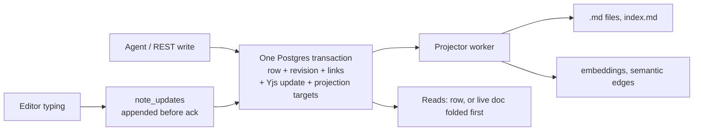

# Elara fix programme: hand-off after phase 2

Date: 2026-10-21 (draft). Repository: [PIIIX-org/chapters](https://github.com/PIIIX-org/chapters) (product name Elara). Written for whoever continues the work: the owner, another agent, or a future session. Phase 1's hand-off is [phase-1.md](phase-1.md); its working method (section 3) and gotchas (section 10) still apply.

**Draft.** Lines marked **[pending #N]** depend on a pull request that was still open when this was written. The final pass flips each one to the merged PR (or removes it) and fills in the promotion results in section 5.

## 1. Where things stand

| | State |
|---|---|
| Phase 2 (stop data loss), milestone 3 | 44 of 52 issues closed. Open: #408, #476, #485, #486, #487, #488, #489, #501, each with an open PR or waiting on one (table below). |
| Design | ADR-003 (Elara `decision/adr-003-authoritative-store`, rev 7) signed off by the owner with every default on [#704](https://github.com/PIIIX-org/chapters/issues/704). Slices S1, S2a, S2b, S4, S5 and S6 are on `dev`; S3 is [#847](https://github.com/PIIIX-org/chapters/pull/847). |
| Rehearsal | [#703](https://github.com/PIIIX-org/chapters/issues/703): restore + S2a migration + rollback ([comment 6314996795](https://github.com/PIIIX-org/chapters/issues/703#issuecomment-6314996795)) and S2b migration ([comment 6321492109](https://github.com/PIIIX-org/chapters/issues/703#issuecomment-6321492109), **GO with conditions**) on a copy of production. |
| `dev` | `1e07e36` at the time of writing, 450 commits ahead of `prod`. |
| `prod` | `5c5bdc0` (phase 1). It does **not** ship the #720 client, so the promotion is two steps (section 5). |

**Still open in phase 2**

| Issue | Waiting on |
|---|---|
| [#408](https://github.com/PIIIX-org/chapters/issues/408), [#476](https://github.com/PIIIX-org/chapters/issues/476) | **[pending #864]** a whole `edit_note` body merges from the agent's last read; **[pending #879]** the same for `upsert_note` and REST PUT (#865). |
| [#485](https://github.com/PIIIX-org/chapters/issues/485) | **[pending #889]** lab proof that offline typing stays where it was typed when an agent appends (drops the S8a/S8b entries). |
| [#486](https://github.com/PIIIX-org/chapters/issues/486) | The umbrella item for ADR-003. Its last three `crash-write` baseline entries (SIGKILL windows) are expected to clear with S3; closes once the full-tier SIGKILL rerun (#489) is clean. |
| [#487](https://github.com/PIIIX-org/chapters/issues/487) | **[pending #847]** ADR-003 S3: collab updates appended to Postgres before the ack. |
| [#488](https://github.com/PIIIX-org/chapters/issues/488) | **[pending #892]** S18 plants a database restore with a tab left open; the SQL-only case moves to #891. |
| [#489](https://github.com/PIIIX-org/chapters/issues/489) | A full-tier lab rerun of every SIGKILL boundary after #847 merges (`gh workflow run elara-lab.yml --ref dev -f tier=full -f tests=crash-write,collab-duplication,store-failpoints`). |
| [#501](https://github.com/PIIIX-org/chapters/issues/501) | **[pending #861]** lossless delta compaction of long revision histories. |

## 2. What phase 2 delivered

### 2.1 The store after phase 2

- **One authoritative store: Postgres.** `notes` (text, frontmatter with its key order in `frontmatter_src`, path, `seq`), `note_revisions` (one per `seq`, ordered by `ord`), `note_links`, `note_crdt` (Yjs snapshot) and `note_updates` (Yjs tail). Nothing outside Postgres is read back as truth. Every write (create, edit, append/upsert, rename, delete, restore, revert, purge, import, restore, the CLIs) is one transaction under the note's lock and the instance's shared maintenance lock, and folds pending collab typing first (Invariant W).
- **Files are projections.** `.md` files, folder `index.md` and embeddings are written after commit by a worker that records `last_applied_seq`. Files are owned by path through the `projected_files` ledger: bytes Elara did not write are copied to `vaults/<id>/.conflicts/` before anything overwrites them, never lost. Hand or `git` edits are no longer an input (ADR Q2). FTS stays a generated column of the row.
- **Collab documents are named by note id** (`<vault>/~<noteId>`). A rename never closes an editor; a tab on an older page is refused with `reload-required` and shows "Reload to keep editing". `.crdt/*.bin` files are retired; their state lives in `note_crdt`.
- **Append before ack (S3, [pending #847]).** Each collab update is decoded, size-checked and committed to `note_updates` before the relay acknowledges it, so "saved" in the editor means committed in Postgres. Until #847 merges, collab updates are still acked from memory (the #487 window).
- **Reads** (`read_note`, `export_note`, REST GET) fold a loaded live document first, so they return what the editor shows, with `rev`.

### 2.2 ADR-003 slices

| Slice | PR | What it guarantees | Proof |
|---|---|---|---|
| S1 schema + dry run | [#783](https://github.com/PIIIX-org/chapters/pull/783) | Migration 0021 is additive (older code runs on it with no SQL). `migrate-store --dry-run` reads production in one read-only transaction and reports conflicts, files that change bytes, CRDT classes and timing. | `server/test/migrate-store.test.ts`, `store-schema.test.ts`; the #703 dry run. |
| S2a-1 transactional store | [#828](https://github.com/PIIIX-org/chapters/pull/828) | Every server write is one transaction; `DirectConnection` gone from writes; projector with ownership and conflict copies; reads from the DB; resumable backfill (`store_migrated_at`) and boot reconciliation on every boot. | `store-s2a.test.ts`; lab `store-failpoints`; #703 S2a rehearsal (944/944 row hashes unchanged). |
| S2a-2 maintenance lock, rollback export | [#838](https://github.com/PIIIX-org/chapters/pull/838) | Instance maintenance lock (a stopped-server export refuses to run beside a server, and a server refuses to start during it); `store-export-legacy`; verify-after-unclean-shutdown and orphan sweep at boot; instance backups read rows, not files. | `maintenance-lock.test.ts`, `store-s2a2-boot.test.ts`, `store-s2a-shutdown.test.ts`; lab `store-migration`, `store-rollback`; #703 rollback run. |
| S2b relay through Postgres | [#843](https://github.com/PIIIX-org/chapters/pull/843) | CRDT state in `note_crdt` + `note_updates`, written in the note's transaction; id-named documents; three-way rebase when the row changed outside the store; deterministic seed; S2b backfill (`collab_migrated_at`) and `.crdt/` → `.crdt.pre-adr-003/`. Closes #832, #834. | `collab-s2b.test.ts`, `collab-backfill.test.ts`, `note-crdt.test.ts`; #703 S2b rehearsal (355 bins attached, 0 set aside, 0 `fold_error`). |
| S2b bin export | **[pending #885]** | `store-export-legacy` also writes `.crdt/<path>.bin` for every note whose state equals its row, so a code-only rollback over S2b keeps editor history. | Tests in #885. |
| S3 durable acks | **[pending #847]** | Collab updates committed before the ack; fold policy; compaction on unload. Closes #487. | Removes the two #487 baseline entries (S16 and crash-write closed-tab). |
| S4 read path + write result | [#840](https://github.com/PIIIX-org/chapters/pull/840) | Fold on read; `rev` on every read and write; `status: applied/merged/conflicted/retry`, `indexed`, `idempotency_key`, `dry_run`. Closes #474, #477. | `mcp-write-result.test.ts`, `edit-note-base-rev.test.ts`; browser `read_note` entry removed. |
| S5 durable jobs | [#817](https://github.com/PIIIX-org/chapters/pull/817) | Extraction and embeddings on a `jobs` table with leases, attempts, `last_error`, idempotency keys; survives restarts. Closes #494, #816. | `durable-jobs.test.ts`, `durable-jobs-retry.test.ts`; lab `restart-extraction` still green. |
| S6 doctor | [#839](https://github.com/PIIIX-org/chapters/pull/839) | `pnpm doctor` compares file, row, revision, CRDT, FTS, vectors, links and projections (22 classes), `--repair`; `check-notes` reports orphans; last-resort `rows-from-files`. Closes #495. | `doctor.test.ts`, `note-integrity.test.ts`, `rows-from-files.test.ts`. |

### 2.3 Every milestone 3 item

**Agent writes and history**

| Issue | Fix | PR | Proof |
|---|---|---|---|
| #403 | Edits are attributed to the agent, not `collab`: actor-aware dedupe, then writes no longer pass through the relay (S2a). | [#770](https://github.com/PIIIX-org/chapters/pull/770), [#828](https://github.com/PIIIX-org/chapters/pull/828) | 11 lab attribution entries removed in #770 ([full tier 39303323644](https://github.com/PIIIX-org/chapters/actions/runs/39303323644)). |
| #408 | `edit_note` applies a minimal diff and accepts ops; a whole body merges from the agent's last read. | [#807](https://github.com/PIIIX-org/chapters/pull/807), [#886](https://github.com/PIIIX-org/chapters/pull/886), **[pending #864]** | `edit-note-ops.test.ts`, `text-diff.test.ts`; #864 removes the browser S1 #408 entries. |
| #411 | `note_history` returns metadata only, paginated; `get_revision` added. | [#772](https://github.com/PIIIX-org/chapters/pull/772) | `mcp-note-history.test.ts` |
| #437, #769 | Every tool schema is strict; unknown arguments are refused with the real parameter names, bounded, safe on `constructor`. | [#768](https://github.com/PIIIX-org/chapters/pull/768), [#789](https://github.com/PIIIX-org/chapters/pull/789) | `mcp-strict-args.test.ts`, `mcp-strict-args-limits.test.ts` |
| #438, #480 | `edit_note` frontmatter merges per key (`replace`, `removeKeys`); revisions deduplicated by deep equality. | [#770](https://github.com/PIIIX-org/chapters/pull/770) | `note-frontmatter-merge.test.ts`, `revision-dedupe.test.ts` |
| #474, #477 | `read_note` serves the live document; every write returns `rev`, `status`, `diff_stats`. | [#840](https://github.com/PIIIX-org/chapters/pull/840) | `mcp-write-result.test.ts` |
| #475 | A stale `base_rev` is three-way merged; overlaps become a linked proposal revision. | [#822](https://github.com/PIIIX-org/chapters/pull/822) | `edit-note-base-rev.test.ts`, `three-way-merge.test.ts` |
| #476 | Whole-markdown writes accepted as a structural diff against the live doc. | **[pending #864]** | Tests in #864. |
| #478 | Atomic `append_note` / `upsert_note`; concurrent appends all land. | [#819](https://github.com/PIIIX-org/chapters/pull/819), [#835](https://github.com/PIIIX-org/chapters/pull/835) | `mcp-append-note.test.ts`, `note-create-if-missing.test.ts` |
| #479 | Delete, restore and rename are history events; revert gets its own row (migration 0023). | [#805](https://github.com/PIIIX-org/chapters/pull/805) | `history-events.test.ts` |
| #482 | Restore point before an MCP connection's first write in a session (30 min idle). | [#806](https://github.com/PIIIX-org/chapters/pull/806) | `mcp-restore-point.test.ts` |
| #484, #803 | Rename, delete, restore, purge and create take the note lock; referrers of a renamed note rewritten by id under their own locks. | [#804](https://github.com/PIIIX-org/chapters/pull/804), [#812](https://github.com/PIIIX-org/chapters/pull/812) | `note-lifecycle-race.test.ts`, `note-write-race.test.ts` |
| #490 | Concurrent `create_note` into one folder: already fixed by #401, pinned by a test. | [#778](https://github.com/PIIIX-org/chapters/pull/778) | `mcp-concurrent-create.test.ts` |
| #491 | One body-size cap (`ELARA_NOTE_MAX_BYTES`, UTF-8 bytes) on every write path including the relay. | [#781](https://github.com/PIIIX-org/chapters/pull/781) | `note-size-cap.test.ts`, `collab-size.test.ts` |
| #492 | Writes that grow a note ≥ 1.9× or repeat a block are quarantined as a revision, not applied. | [#782](https://github.com/PIIIX-org/chapters/pull/782) | `growth-guard.test.ts`, `note-growth-quarantine.test.ts` |
| #501 | Long revision histories stored as lossless deltas (migration 0026). | **[pending #861]** | Tests in #861. |
| #779 | Folder `index.md` regeneration serialised per folder. | [#793](https://github.com/PIIIX-org/chapters/pull/793) | `index-regen-race.test.ts` |

**Editors and collab**

| Issue | Fix | PR | Proof |
|---|---|---|---|
| #481 | Agents show in editor presence. | [#810](https://github.com/PIIIX-org/chapters/pull/810) | `agent-presence.test.ts`, `agent-presence-renew.test.ts` |
| #483 | Agent edits keep the caret and the person's Ctrl+Z. | [#809](https://github.com/PIIIX-org/chapters/pull/809) | `collab-agent-edit.test.ts`; lab browser |
| #485 | Offline typing stays where it was typed when an agent writes. | **[pending #889]** | Removes the S8a/S8b entries. |
| #486 | One authoritative store (ADR-003, section 2.2). | #783, #828, #838, #843, #817, #840, #839 | Issue stays open until #489's rerun. |
| #487 | Collab state saved before the ack. | **[pending #847]** | Removes the #487 entries. |
| #488 | Never rebuild text from a stale CRDT state. | [#843](https://github.com/PIIIX-org/chapters/pull/843), **[pending #892]** | Lab S18 (database restore with a tab open). |
| #489 | SIGKILL boundary rerun. | — | Full-tier run after #847 (section 1). |
| #498 | Live collab sockets close when their session ends (logout, deactivation). | [#796](https://github.com/PIIIX-org/chapters/pull/796) | `collab-logout.test.ts` |
| #712 | Graph scope picker portalled so the toolbar can't clip it. | [#762](https://github.com/PIIIX-org/chapters/pull/762) | `ui-audit.test.ts` |
| #720 | Offline edits say Offline, survive a reload (`collabStash`), guard unload. **Prerequisite of S2b in production.** | [#763](https://github.com/PIIIX-org/chapters/pull/763) | Client tests and lab browser in the PR. |
| #765, #766 | Offline stash keeps a restored copy when its write fails; open tabs claim a copy released by another tab. | [#790](https://github.com/PIIIX-org/chapters/pull/790), [#808](https://github.com/PIIIX-org/chapters/pull/808) | Client tests in the PRs. |

**Backup, restore, import, export**

| Issue | Fix | PR | Proof |
|---|---|---|---|
| #409 | Archive format 2: trash, revisions, attachments, repositories, MFA; restore by validate, plan, apply. | [#776](https://github.com/PIIIX-org/chapters/pull/776) | `backup-roundtrip.test.ts`, `restore.test.ts` |
| #493 | Backup files mode 600, directory 700; SHA-256 per part in `backup.json`; restore-and-verify in CI on backup PRs. | [#777](https://github.com/PIIIX-org/chapters/pull/777) | `backup-hardening.test.ts` |
| #499 | Vault export/import keeps revisions and trash and rewrites attachment links. | [#802](https://github.com/PIIIX-org/chapters/pull/802) | `export-history.test.ts`, `export-roundtrip.test.ts` |
| #500 | Restore CLI says which MCP tokens keep working. | [#797](https://github.com/PIIIX-org/chapters/pull/797) | `restore-tokens.test.ts` |
| #621 | Import grants manifest shares only with `?applyShares=true`. | [#795](https://github.com/PIIIX-org/chapters/pull/795) | `import-shares.test.ts` |
| #813 | Restore CLI recognises drizzle query errors by class. | [#867](https://github.com/PIIIX-org/chapters/pull/867) | `restore-cli-errors.test.ts` |
| #841 | Restore keeps the app role's password from `.env` (`globals.sql` reset it; found in the #703 rehearsal). | [#855](https://github.com/PIIIX-org/chapters/pull/855) | Docs only. |

**Sync, jobs, search, monitoring, lab**

| Issue | Fix | PR | Proof |
|---|---|---|---|
| #410 | A webhook repository is polled again once its webhook is stale or its sync failed. | [#773](https://github.com/PIIIX-org/chapters/pull/773) | Tests in the PR. |
| #494 | Durable jobs (S5). | [#817](https://github.com/PIIIX-org/chapters/pull/817) | `durable-jobs.test.ts` |
| #495 | Doctor (S6). | [#839](https://github.com/PIIIX-org/chapters/pull/839) | `doctor.test.ts` |
| #496 | Embedding runs in a worker thread; per-file symbol embedding budget. | [#800](https://github.com/PIIIX-org/chapters/pull/800), [#857](https://github.com/PIIIX-org/chapters/pull/857) | `embedding-worker.test.ts`, `embeddings.test.ts` (event-loop lag) |
| #497 | Extraction served round-robin across repositories. | [#801](https://github.com/PIIIX-org/chapters/pull/801), [#863](https://github.com/PIIIX-org/chapters/pull/863) | `extraction-fairness.test.ts` |
| #705 | Server errors, failed jobs and slow endpoints recorded; `/api/admin/monitoring`; the uptime monitor alerts (#636, optional webhook). | [#764](https://github.com/PIIIX-org/chapters/pull/764) | `monitoring.test.ts`, `monitoring-metrics.test.ts`, lab `monitoring-alerts` |
| #775 | Overlapping poll and webhook syncs count one new failure per transition (no false #705 alert). | [#856](https://github.com/PIIIX-org/chapters/pull/856) | `repository-sync-overlap.test.ts` |
| #842 | Migration conflict copies reported apart from projection job failures (found in the #703 rehearsal). | [#866](https://github.com/PIIIX-org/chapters/pull/866) | `store-s2a.test.ts` |
| #706 | A red nightly lab opens/updates a `lab-nightly` issue. | [#791](https://github.com/PIIIX-org/chapters/pull/791) | CI script tests. |
| #658, #663 | Lab brings the app back after SIGKILL; restart-extraction prints both counts. | [#798](https://github.com/PIIIX-org/chapters/pull/798) | Lab runs in the PR. |
| #703, #704 | Production rehearsal and owner sign-off (section 1). | — | Issue comments. |

Also merged in phase 2, outside the milestone: #771 (backup build failure, [#792](https://github.com/PIIIX-org/chapters/pull/792)), #825/#788/#811 (revision order, migration 0024, [#826](https://github.com/PIIIX-org/chapters/pull/826)), #854 ([#860](https://github.com/PIIIX-org/chapters/pull/860)), #848 (backup doc, [#859](https://github.com/PIIIX-org/chapters/pull/859)), #851, #852, #849 (test flakes: [#857](https://github.com/PIIIX-org/chapters/pull/857), [#870](https://github.com/PIIIX-org/chapters/pull/870), [#863](https://github.com/PIIIX-org/chapters/pull/863)).

## 3. Known defects and deferred items

### 3.1 `lab/known-defects.json` on `dev` (`1e07e36`)

42 entries. Phase 2 entries first; the rest belong to later phases and are unchanged.

| Issue | Entries | Test | Status |
|---|---|---|---|
| [#408](https://github.com/PIIIX-org/chapters/issues/408) | 4 | browser S1 | Intermittent since S2b. **[pending #864]** removes 3; #847 and #861 each add the intermittent "no lost agent edits" entry (#888). |
| [#485](https://github.com/PIIIX-org/chapters/issues/485) | 2 | browser S8a/S8b | **[pending #889]** removes both. |
| [#486](https://github.com/PIIIX-org/chapters/issues/486) | 3 | crash-write | SIGKILL windows (row without file, diverged round, missing revision); checked by the #489 rerun. |
| [#487](https://github.com/PIIIX-org/chapters/issues/487) | 2 | collab-duplication S16, crash-write | **[pending #847]** removes both. |
| [#488](https://github.com/PIIIX-org/chapters/issues/488) | 2 | collab-duplication S18 | **[pending #892]** replaces them with two #891 entries (CRDT state put back by SQL). |
| [#489](https://github.com/PIIIX-org/chapters/issues/489) | 1 | crash-write (orphaned temp file) | #489 rerun. |
| [#845](https://github.com/PIIIX-org/chapters/issues/845) | 1 | fix-crash-catchup | Intermittent lag; **[pending #883]** removes it. |
| #440, #461, #556 | 4 | access-behaviour | Phase 5. |
| #533, #560, #561, #562, #618 | 6 | attachments | Phases 5–6. |
| #444, #563, #564, #565, #619, #620 | 8 | export-roundtrip | Phase 5 (OKF). |
| #459, #528, #530 | 8 | multilingual-search | Phase 3. |
| #617 | 1 | browser console errors | Phase 5. |

### 3.2 Filed during phase 2 and moved out

| Issue | Now | Why |
|---|---|---|
| [#891](https://github.com/PIIIX-org/chapters/issues/891) | Phase 5 | A CRDT state put back by manual SQL behind a newer row doubles an open tab's typing. After S2b no supported path (restore, doctor, import, rollback/roll-forward) reaches it ([#488 analysis](https://github.com/PIIIX-org/chapters/issues/488#issuecomment-6324028607)); the lab keeps measuring it through the baselined S18 step. |
| [#780](https://github.com/PIIIX-org/chapters/issues/780) | No milestone | Relay: frontmatter and non-text document content have no size bound (#491 covers the body). |
| [#784](https://github.com/PIIIX-org/chapters/issues/784) | No milestone | Editors are not told their stores were quarantined (#492); typing vanishes on reload. |
| [#833](https://github.com/PIIIX-org/chapters/issues/833) | No milestone | Large-rewrite character diff blocks the event loop ~200 ms; **[pending #837]**. |
| [#858](https://github.com/PIIIX-org/chapters/issues/858) | No milestone | Security events ordered by the database clock; **[pending #869]** (migration 0027). |
| [#862](https://github.com/PIIIX-org/chapters/issues/862), [#877](https://github.com/PIIIX-org/chapters/issues/877), [#880](https://github.com/PIIIX-org/chapters/issues/880), [#787](https://github.com/PIIIX-org/chapters/issues/787), [#816](https://github.com/PIIIX-org/chapters/issues/816), [#799](https://github.com/PIIIX-org/chapters/issues/799) | No milestone | Test and lab flakes under load; **[pending #874]** (#862), **[pending #882]** (#880). |
| [#865](https://github.com/PIIIX-org/chapters/issues/865) | No milestone | `upsert_note` and REST PUT still diff from live text; **[pending #879]**. |
| [#872](https://github.com/PIIIX-org/chapters/issues/872) | No milestone | `pnpm <script>` reinstalls dependencies in the published image (hangs offline); **[pending #878]**. Found in the S2b rehearsal. |
| [#873](https://github.com/PIIIX-org/chapters/issues/873) | No milestone | Dry run counts bins as `matches-row` by body only; **[pending #876]**. Found in the S2b rehearsal. No data effect. |
| [#774](https://github.com/PIIIX-org/chapters/issues/774), [#785](https://github.com/PIIIX-org/chapters/issues/785) | No milestone | `fails-before` and agent-trial tooling. |
| [#830](https://github.com/PIIIX-org/chapters/issues/830) | Open | Nightly lab failing (the #706 alert issue); stays open until a green nightly. |

## 4. Operator-facing changes

**New commands** (run in the app container, `docker compose run --rm --no-deps app pnpm <name>` with the app stopped, or `exec` while it runs):

| Command | What it does | Doc |
|---|---|---|
| `migrate-store --dry-run --report <file>` | Read-only report of what the S2a/S2b migration will do (conflicts, files that change bytes, CRDT and collab classes, timing). | `docs/self-hosting/migration.md` |
| `check-notes [--wait-idle --fail-on-pending]` | Every live note's file parses and matches its row; now also lists orphans. | backup.md §4 |
| `doctor [--vault <id>] [--repair] [--report <file>]` | File, row, revision, CRDT, FTS, vectors, links, projections; conflict copies, rejected updates, fold errors. | backup.md §4 "The doctor" |
| `rows-from-files` | Last resort: rebuild note rows from `.md` files (revisions and CRDT history lost). | backup.md §4 |
| `store-export-legacy` | Stopped-server export for a code-only rollback; takes the maintenance lock. Writes files; **[pending #885]** also `.crdt` bins. | backup.md §5 |

**Migrations** (all run at boot; all additive in schema, so older code runs on them with no SQL except where noted):

| Migration | From | Note |
|---|---|---|
| 0021 `adr003_store` | #783 | Store tables and markers; builds two indexes on `note_revisions` under a write lock. |
| 0022 `repository_file_embedding_note` | #800 | |
| 0023 `revision_events` | #805 | Older code relabels revert again (backup.md §5). |
| 0024 `revision_order` | #826 | Backups made by the newer code are refused by older code. |
| 0025 `write_idempotency` | #840 | |
| 0026 `revision_compaction` | **[pending #861]** | Data change: older code shows compacted bodies as empty, so a code-only rollback needs the backup.md §5 `UPDATE` first. |
| 0027 `security_event_order` | **[pending #869]** | |
| 0028 `note_reads` | **[pending #864]** (also carried by #879) | |

**Order rule.** Drizzle skips a migration whose journal `when` is at or below the newest one applied. Merge **#861 (0026) → #869 (0027) → #864 (0028) → #879**; #879 carries the same 0028 file as #864 and must be rebased onto it after #864 merges. Any PR that lands out of order renumbers to the next free number with a `when` above `dev`'s newest before merging.

**Rollback.**
- Clean: restore the pre-upgrade backup (backup.md §5).
- From S2a only (S2b never booted, `collab_migrated_at` null): stop the app, `store-export-legacy`, start the older image; no SQL. Rehearsed on #703 (comment 6314996795): counts and 944 row hashes unchanged.
- Over S2b: until **[pending #885]** is on the release, only the pre-upgrade backup. With #885, the same stopped-server export also writes the bins, and roll-forward merges any bins the old relay wrote.
- Over 0026 (**[pending #861]**): the backup.md §5 `UPDATE` before starting older code.

**Monitoring.** `/api/admin/monitoring` with `Authorization: Bearer $ELARA_MONITORING_TOKEN` reports 5xx, failed jobs per kind and slow endpoints; the uptime monitor alerts on them (#705, [#764](https://github.com/PIIIX-org/chapters/pull/764)). Migration and projector conflict copies are reported as `conflictCopies`, not as job failures (#842, [#866](https://github.com/PIIIX-org/chapters/pull/866)). `docs/self-hosting/monitoring.md`.

**Backup and restore docs.** `globals.sql` no longer leaves the app unable to connect: set the role password from `.env` after loading it (#841, [#855](https://github.com/PIIIX-org/chapters/pull/855)). The data-volume steps use the app service and the cron target is a `backup.sh` the operator saves (#848, [#859](https://github.com/PIIIX-org/chapters/pull/859)).

**Offline image scripts (#872).** **[pending #878]** makes `pnpm <script>` run without network in the published image. Until it merges, run operator scripts as `node --import tsx src/scripts/<name>.ts` inside the container (rehearsal workaround).

## 5. Promotion plan (`dev` → `prod`)

### 5.1 One step or two

ADR-003 R3-2/Q4: S2b ships only after a promotion put the #720 client in production, so a refused tab's typing survives in the browser copy. **`prod` (`5c5bdc0`) does not contain #720's merge commit `150669c`**, so the promotion is **two steps**.

| Step | `prod` ← | Contains | Not yet |
|---|---|---|---|
| A | `ae6ffb9` (`dev` just before #843; fast-forward from `5c5bdc0`) | #720 client, S1, S2a-1, S4, S5, migrations 0021–0025, every phase-2 fix merged before #843 | S2b, S2a-2 (`store-export-legacy`, maintenance lock), S6 doctor |
| B | the `dev` head after the last phase-2 PR | S2a-2, S2b, S3, S6, 0026–0028, the rest | — |

- **Between A and B**, every browser that keeps an editor open must load the step-A page once; leave at least a day, then reload tabs right before B.
- **Step A rollback is backup only**: #838 (`store-export-legacy`) merged after #843, so no prefix of `dev` has S2a with the export but without S2b. The #703 S2a rehearsal ran the S2a + S2a-2 image, not `ae6ffb9`; a dry run plus boot of `ae6ffb9` on the rehearsal snapshot before step A closes that gap.
- Alternative (owner's call): a single promotion with every open editor tab reloaded before it and nobody typing. ADR Q4 accepts that a pre-#720 tab loses unsent typing; it rejected this as the default.

### 5.2 Pre-flight (each step)

1. Every check on the promotion PR green, full lab tier and full benchmark on the exact head, independent promotion review (phase-1 section 3). Only then `git push origin <sha>:prod`: production deploys on that push (#664, still open).
2. **Backup immediately before** (backup.md §1: pg_dump + data volume), checksums verified. For step B it is the only way back over S2b unless #885 is in the release (#703 condition 1).
3. **Reload open editor tabs** before the upgrade, and nobody types during it (#703 condition 2; required for step B).
4. **[pending #878]** If #878 is not in the release, run operator scripts as `node --import tsx src/scripts/<name>.ts` (#703 condition 3). If it is, `pnpm <script>` works offline.
5. **`ELARA_MONITORING_TOKEN`** set in the production `.env` and in the uptime monitor's environment (owner).
6. Dry run on production (read-only) or a fresh copy: `migrate-store --dry-run --report /data/elara/migration-dry-run.json`; expect 0 conflicts, as on #703. Owner sign-off on Q3/Q5/Q6 asked for in the S2a rehearsal comment.
7. Step B adds migrations 0026–0028 and #861's compaction, which the #703 S2b rehearsal (`aa73289`) did not cover: rerun the S2b rehearsal on the snapshot with the step-B head.

### 5.3 Post-flight

1. `/health`: up, new `bootId`, `lastShutdown: graceful`.
2. Boot log: `[store] backfill:` summary with 0 failed (step A); collab backfill with 0 set aside and 0 failed, `.crdt.pre-adr-003/` present (step B); `DATA_DIR/migration-report-*.json` and `collab-migration-report-*.json`.
3. `check-notes --wait-idle --fail-on-pending`: 0 broken, 0 pending. `doctor` (step B): no fold errors, no rejected updates.
4. `/api/admin/monitoring` answers with the token; `conflictCopies` matches the migration report's unparseable count; the next uptime run is green.
5. Lab smoke against a staging-like target built from the same image, never production (`docs/agents/lab.md`).

### 5.4 Rollback

- Step A: restore the backup taken in pre-flight 2 (backup.md §2 and §5).
- Step B: with #885 in the release, stop the app, `store-export-legacy` (files and bins), start the step-A image; with #861's 0026 applied, run backup.md §5's `UPDATE` first. Without #885, restore the backup.

## 6. Open pull requests at the time of writing

Each is a **[pending]** marker above; the final pass flips them.

| PR | Issue | What |
|---|---|---|
| [#837](https://github.com/PIIIX-org/chapters/pull/837) | #833 | Character diff only on the changed region. |
| [#847](https://github.com/PIIIX-org/chapters/pull/847) | #487 | ADR-003 S3, append before ack. |
| [#861](https://github.com/PIIIX-org/chapters/pull/861) | #501 | Revision compaction, migration 0026. |
| [#864](https://github.com/PIIIX-org/chapters/pull/864) | #408, #476, #875 | Whole-body `edit_note` merges from the last read, migration 0028. |
| [#869](https://github.com/PIIIX-org/chapters/pull/869) | #858 | Security events in recorded order, migration 0027. |
| [#874](https://github.com/PIIIX-org/chapters/pull/874) | #862 | Test timeouts. |
| [#876](https://github.com/PIIIX-org/chapters/pull/876) | #873 | Dry run predicts attached equal/diffed. |
| [#878](https://github.com/PIIIX-org/chapters/pull/878) | #872 | Operator scripts offline in the image. |
| [#879](https://github.com/PIIIX-org/chapters/pull/879) | #832, #865 | `upsert_note` / REST PUT merge from base. |
| [#882](https://github.com/PIIIX-org/chapters/pull/882) | #880 | crash-write waits for idle projections. |
| [#883](https://github.com/PIIIX-org/chapters/pull/883) | #845 | Lab waits for extraction to settle. |
| [#885](https://github.com/PIIIX-org/chapters/pull/885) | — | S2b rollback exports `.crdt` bins. |
| [#889](https://github.com/PIIIX-org/chapters/pull/889) | #485 | Lab: offline typing stays where typed. |
| [#892](https://github.com/PIIIX-org/chapters/pull/892) | #488 | Lab S18 database restore; SQL plant to #891. |
