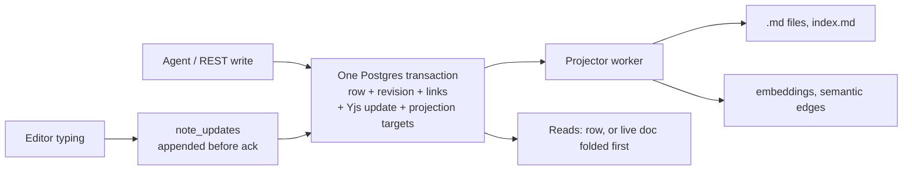

# Elara fix programme: hand-off after phase 2

Date: 2026-10-22. Repository: [PIIIX-org/chapters](https://github.com/PIIIX-org/chapters) (product name Elara). Written for whoever continues the work: the owner, another agent, or a future session. Phase 1's hand-off is [phase-1.md](phase-1.md); its working method (section 3) and gotchas (section 10) still apply.

Every phase-2 pull request has merged; no line of this document waits on an open PR. The promotion results go into section 5 once it has run.

## 1. Where things stand

| | State |
|---|---|
| Phase 2 (stop data loss), milestone 3 | **52 of 52 issues closed.** The last ones: #408 and #476 ([#864](https://github.com/PIIIX-org/chapters/pull/864)), #485 ([#889](https://github.com/PIIIX-org/chapters/pull/889)), #488 ([#892](https://github.com/PIIIX-org/chapters/pull/892)), #501 ([#861](https://github.com/PIIIX-org/chapters/pull/861)), #486 and #489 ([#896](https://github.com/PIIIX-org/chapters/pull/896), section 1.1). |
| Design | ADR-003 (Elara `decision/adr-003-authoritative-store`, rev 7) signed off by the owner with every default on [#704](https://github.com/PIIIX-org/chapters/issues/704). Slices S1 to S6 are all on `dev` (S3 is [#847](https://github.com/PIIIX-org/chapters/pull/847)), and so is the S2b bin export for rollback ([#885](https://github.com/PIIIX-org/chapters/pull/885)). |
| Rehearsal | [#703](https://github.com/PIIIX-org/chapters/issues/703): restore + S2a migration + rollback ([comment 6314996795](https://github.com/PIIIX-org/chapters/issues/703#issuecomment-6314996795)) and S2b migration ([comment 6321492109](https://github.com/PIIIX-org/chapters/issues/703#issuecomment-6321492109), **GO with conditions**) on a copy of production. |
| `dev` | `e3ff312` (#885's merge, the last phase-2 PR), 609 commits ahead of `prod`. |
| `prod` | `5c5bdc0` (phase 1). It does **not** ship the #720 client; the owner decided a two-step promotion (section 5). |

### 1.1 How #486 and #489 closed

ADR-003 removed the SIGKILL windows #486 and #489 measured: row, revision and CRDT update commit in one transaction and files are projections. The full-tier rerun of every SIGKILL boundary (`crash-write`, `collab-duplication`, `collab-s2b`, `store-failpoints`, `store-migration`, `store-rollback`, `fix-crash-catchup`, `restart-extraction`), each SHA run twice ([#489 comment](https://github.com/PIIIX-org/chapters/issues/489), mapping of #486's done-when in [#486's comment](https://github.com/PIIIX-org/chapters/issues/486)):

| Run | Commit | crash-write |
|---|---|---|
| [39734379501](https://github.com/PIIIX-org/chapters/actions/runs/39734379501) | `dev` `927890d` | 74/74 checks over boundaries a1, a4, a10, a20, a30, a38, t100, t400 |
| [39734384384](https://github.com/PIIIX-org/chapters/actions/runs/39734384384) | same SHA (branch `lab/rerun-489`) | 74/74 |
| [39739748260](https://github.com/PIIIX-org/chapters/actions/runs/39739748260) | `dev` `5e07bd4` | 74/74 |
| [39739753171](https://github.com/PIIIX-org/chapters/actions/runs/39739753171) | same SHA | 74/74 |
| [39739825944](https://github.com/PIIIX-org/chapters/actions/runs/39739825944) | #896's branch, entries removed | gate green |

The only collab-duplication failures in those runs are the S18 pair, baselined under #891 (section 3.2). [#896](https://github.com/PIIIX-org/chapters/pull/896) then dropped the four `crash-write` entries (#486 ×3, #489 ×1), so a recurrence is a gate regression, and closed both issues.

## 2. What phase 2 delivered

### 2.1 The store after phase 2

- **One authoritative store: Postgres.** `notes` (text, frontmatter with its key order in `frontmatter_src`, path, `seq`), `note_revisions` (one per `seq`, ordered by `ord`), `note_links`, `note_crdt` (Yjs snapshot) and `note_updates` (Yjs tail). Nothing outside Postgres is read back as truth. Every write (create, edit, append/upsert, rename, delete, restore, revert, purge, import, backup restore, the CLIs) is one transaction under the note's lock and the instance's shared maintenance lock, and folds pending collab typing first (Invariant W).
- **Files are projections.** `.md` files, folder `index.md` and embeddings are written after commit by a worker that records `last_applied_seq`. Files are owned by path through the `projected_files` ledger: bytes Elara did not write are copied to `vaults/<id>/.conflicts/` before anything overwrites them, never lost. Hand or `git` edits are no longer an input (ADR Q2). FTS stays a generated column of the row.
- **Collab documents are named by note id** (`<vault>/~<noteId>`). A rename never closes an editor; a tab on an older page is refused with `reload-required` and shows "Reload to keep editing". `.crdt/*.bin` files are retired; their state lives in `note_crdt`.
- **Append before ack (S3, [#847](https://github.com/PIIIX-org/chapters/pull/847)).** Each collab update is decoded, size-checked and committed to `note_updates` before the relay acknowledges it, so "saved" in the editor means committed in Postgres. A failed append closes the socket with no ack, so the editor keeps the typing and resends it.
- **Reads** (`read_note`, `export_note`, REST GET) fold a loaded live document first, so they return what the editor shows, with `rev`.

### 2.2 ADR-003 slices

| Slice | PR | What it guarantees | Proof |
|---|---|---|---|
| S1 schema + dry run | [#783](https://github.com/PIIIX-org/chapters/pull/783) | Migration 0021 is additive in schema (once the S2a migration has run, older code goes on it only through the backup.md §5 rollback). `migrate-store --dry-run` reads production in one read-only transaction and reports conflicts, files that change bytes, CRDT classes and timing. | `server/test/migrate-store.test.ts`, `store-schema.test.ts`; the #703 dry run. |
| S2a-1 transactional store | [#828](https://github.com/PIIIX-org/chapters/pull/828) | Every server write is one transaction; `DirectConnection` gone from writes; projector with ownership and conflict copies; reads from the DB; resumable backfill (`store_migrated_at`) and boot reconciliation on every boot. | `store-s2a.test.ts`; lab `store-failpoints`; #703 S2a rehearsal (944/944 row hashes unchanged). |
| S2a-2 maintenance lock, rollback export | [#838](https://github.com/PIIIX-org/chapters/pull/838) | Instance maintenance lock (a stopped-server export refuses to run beside a server, and a server refuses to start during it); `store-export-legacy`; verify-after-unclean-shutdown and orphan sweep at boot; instance backups read rows, not files. | `maintenance-lock.test.ts`, `store-s2a2-boot.test.ts`, `store-s2a-shutdown.test.ts`; lab `store-migration`, `store-rollback`; #703 rollback run. |
| S2b relay through Postgres | [#843](https://github.com/PIIIX-org/chapters/pull/843) | CRDT state in `note_crdt` + `note_updates`, written in the note's transaction; id-named documents; three-way rebase when the row changed outside the store; deterministic seed; S2b backfill (`collab_migrated_at`) and `.crdt/` → `.crdt.pre-adr-003/`. Closes #832, #834. | `collab-s2b.test.ts`, `collab-backfill.test.ts`, `note-crdt.test.ts`; #703 S2b rehearsal (355 bins attached, 0 set aside, 0 `fold_error`). |
| S2b bin export | [#885](https://github.com/PIIIX-org/chapters/pull/885) | `store-export-legacy` first folds every collab tail into the rows, then writes `.crdt/<path>.bin` (snapshot ⊕ tail, in the pre-S2b layout) for every live note whose CRDT state equals its row, so a code-only rollback over S2b keeps editor history. A note with a `fold_error` gets no bin and is listed. | `store-rollback.test.ts`, `collab-backfill.test.ts`, `store-s2a2-boot.test.ts`, `revision-compaction-job.test.ts` |
| S3 durable acks | [#847](https://github.com/PIIIX-org/chapters/pull/847) | Collab updates committed before the ack; fold policy; compaction on unload. Closes #487. | `collab-s3.test.ts`, `collab-s3-sigkill.test.ts`, `collab-s3-races.test.ts`, `collab-s3-pg-outage.test.ts`, `collab-s3-shutdown.test.ts`, `collab-s3-perf.test.ts`; removed both #487 baseline entries (S16 and crash-write closed-tab). |
| S4 read path + write result | [#840](https://github.com/PIIIX-org/chapters/pull/840) | Fold on read; `rev` on every read and write; `status: applied/merged/conflicted/retry`, `indexed`, `idempotency_key`, `dry_run`. Closes #474, #477. | `mcp-write-result.test.ts`, `edit-note-base-rev.test.ts`; browser `read_note` entry removed. |
| S5 durable jobs | [#817](https://github.com/PIIIX-org/chapters/pull/817) | Extraction and embeddings on a `jobs` table with leases, attempts, `last_error`, idempotency keys; survives restarts. Closes #494. It also orders every query that feeds Louvain, the fix #816 asked for (#816 closed with that evidence). | `durable-jobs.test.ts`, `durable-jobs-retry.test.ts`; lab `restart-extraction` still green. |
| S6 doctor | [#839](https://github.com/PIIIX-org/chapters/pull/839) | `pnpm doctor` compares file, row, revision, CRDT, FTS, vectors, links and projections (23 classes, `DOCTOR_CLASSES`), `--repair`; `check-notes` reports orphans; last-resort `rows-from-files`. Closes #495. | `doctor.test.ts`, `note-integrity.test.ts`, `rows-from-files.test.ts`. |

### 2.3 Every milestone 3 item

**Agent writes and history**

| Issue | Fix | PR | Proof |
|---|---|---|---|
| #403 | Edits are attributed to the agent, not `collab`: actor-aware dedupe, then writes no longer pass through the relay (S2a). | [#770](https://github.com/PIIIX-org/chapters/pull/770), [#828](https://github.com/PIIIX-org/chapters/pull/828) | 11 lab attribution entries removed in #770 ([full tier 39303323644](https://github.com/PIIIX-org/chapters/actions/runs/39303323644)). |
| #408 | `edit_note` applies a minimal diff and accepts ops; a whole body merges from the agent's last read. | [#807](https://github.com/PIIIX-org/chapters/pull/807), [#886](https://github.com/PIIIX-org/chapters/pull/886), [#864](https://github.com/PIIIX-org/chapters/pull/864) | `edit-note-ops.test.ts`, `text-diff.test.ts`, `last-read-restart.test.ts`, `server-client-id.test.ts`; #864 removed all 5 browser S1 #408 entries, so #408 closed with no entry left. |
| #411 | `note_history` returns metadata only, paginated; `get_revision` added. | [#772](https://github.com/PIIIX-org/chapters/pull/772) | `mcp-note-history.test.ts` |
| #437, #769 | Every tool schema is strict; unknown arguments are refused with the real parameter names, bounded, safe on `constructor`. | [#768](https://github.com/PIIIX-org/chapters/pull/768), [#789](https://github.com/PIIIX-org/chapters/pull/789) | `mcp-strict-args.test.ts`, `mcp-strict-args-limits.test.ts` |
| #438, #480 | `edit_note` frontmatter merges per key (`replace`, `removeKeys`); revisions deduplicated by deep equality. | [#770](https://github.com/PIIIX-org/chapters/pull/770) | `note-frontmatter-merge.test.ts`, `revision-dedupe.test.ts` |
| #474, #477 | `read_note` serves the live document; every write returns `rev`, `status`, `diff_stats`. | [#840](https://github.com/PIIIX-org/chapters/pull/840) | `mcp-write-result.test.ts` |
| #475 | A stale `base_rev` is three-way merged; overlaps become a linked proposal revision. | [#822](https://github.com/PIIIX-org/chapters/pull/822) | `edit-note-base-rev.test.ts`, `three-way-merge.test.ts` |
| #476 | A whole body without `base_rev` merges from the connection's last read (kept in Postgres, migration 0028), so typing done after the read stays. `upsert_note` and REST PUT do the same ([#879](https://github.com/PIIIX-org/chapters/pull/879), #865). | [#864](https://github.com/PIIIX-org/chapters/pull/864), [#879](https://github.com/PIIIX-org/chapters/pull/879) | `edit-note-base-rev.test.ts`, `three-way-merge.test.ts`, `last-read-restart.test.ts` |
| #478 | Atomic `append_note` / `upsert_note`; concurrent appends all land. | [#819](https://github.com/PIIIX-org/chapters/pull/819) | `mcp-append-note.test.ts`, `note-create-if-missing.test.ts` |
| #479 | Delete, restore and rename are history events; revert gets its own row (migration 0023). | [#805](https://github.com/PIIIX-org/chapters/pull/805) | `history-events.test.ts` |
| #482 | Restore point before an MCP connection's first write in a session (30 min idle). | [#806](https://github.com/PIIIX-org/chapters/pull/806) | `mcp-restore-point.test.ts` |
| #484, #803 | Rename, delete, restore, purge and create take the note lock; referrers of a renamed note rewritten by id under their own locks. | [#804](https://github.com/PIIIX-org/chapters/pull/804), [#812](https://github.com/PIIIX-org/chapters/pull/812) | `note-lifecycle-race.test.ts`, `note-write-race.test.ts` |
| #490 | Concurrent `create_note` into one folder: already fixed by #401, pinned by a test. | [#778](https://github.com/PIIIX-org/chapters/pull/778) | `mcp-concurrent-create.test.ts` |
| #491 | One body-size cap (`ELARA_NOTE_MAX_BYTES`, UTF-8 bytes) on every write path including the relay. | [#781](https://github.com/PIIIX-org/chapters/pull/781) | `note-size-cap.test.ts`, `collab-size.test.ts` |
| #492 | Writes that grow a note ≥ 1.9× or repeat a block are quarantined as a revision, not applied. | [#782](https://github.com/PIIIX-org/chapters/pull/782) | `growth-guard.test.ts`, `note-growth-quarantine.test.ts` |
| #501 | Long revision histories stored as lossless deltas (migration 0026); every revision reads exactly as before. | [#861](https://github.com/PIIIX-org/chapters/pull/861) | `revision-compaction.test.ts`, `revision-compaction-job.test.ts`, `migration-order.test.ts` |
| #779 | Folder `index.md` regeneration serialised per folder. | [#793](https://github.com/PIIIX-org/chapters/pull/793) | `index-regen-race.test.ts` |

**Editors and collab**

| Issue | Fix | PR | Proof |
|---|---|---|---|
| #481 | Agents show in editor presence. | [#810](https://github.com/PIIIX-org/chapters/pull/810) | `agent-presence.test.ts`, `agent-presence-renew.test.ts` |
| #483 | Agent edits keep the caret and the person's Ctrl+Z. | [#809](https://github.com/PIIIX-org/chapters/pull/809) | `collab-agent-edit.test.ts`; lab browser |
| #485 | Offline typing stays where it was typed when an agent writes. | [#889](https://github.com/PIIIX-org/chapters/pull/889) | Lab browser S8a/S8b; both #485 entries removed. |
| #486 | One authoritative store (ADR-003, section 2.2). | #783, #828, #838, #843, #847, #817, #840, #839, [#896](https://github.com/PIIIX-org/chapters/pull/896) | SIGKILL rerun (section 1.1); 3 crash-write entries removed. |
| #487 | Collab state saved before the ack (S3). | [#847](https://github.com/PIIIX-org/chapters/pull/847) | `collab-s3*.test.ts`; both #487 baseline entries removed. |
| #488 | Never rebuild text from a stale CRDT state. | [#843](https://github.com/PIIIX-org/chapters/pull/843), [#892](https://github.com/PIIIX-org/chapters/pull/892) | Lab S18 now plants a database restore with a tab open; the manual-SQL case moved to #891. |
| #489 | SIGKILL boundary rerun. | [#896](https://github.com/PIIIX-org/chapters/pull/896) | Four full-tier runs, 74/74 crash-write each (section 1.1); orphan-`.tmp` entry removed. |
| #498 | Live collab sockets close when their session ends (logout, deactivation). | [#796](https://github.com/PIIIX-org/chapters/pull/796) | `collab-logout.test.ts` |
| #712 | Graph scope picker portalled so the toolbar can't clip it. | [#762](https://github.com/PIIIX-org/chapters/pull/762) | `client/src/components/shell/ScopePicker.test.tsx`, `client/src/components/graph/GraphCanvas.scopePicker.test.tsx` |
| #720 | Offline edits say Offline, survive a reload (`collabStash`), guard unload. **Prerequisite of S2b in production.** | [#763](https://github.com/PIIIX-org/chapters/pull/763) | Client tests and lab browser in the PR. |
| #765, #766 | Offline stash keeps a restored copy when its write fails; open tabs claim a copy released by another tab. | [#790](https://github.com/PIIIX-org/chapters/pull/790), [#808](https://github.com/PIIIX-org/chapters/pull/808) | Client tests in the PRs. |

**Backup, restore, import, export**

| Issue | Fix | PR | Proof |
|---|---|---|---|
| #409 | Archive format 2: trash, revisions, attachments, repositories, MFA; restore by validate, plan, apply. | [#776](https://github.com/PIIIX-org/chapters/pull/776) | `backup-roundtrip.test.ts`, `restore.test.ts` |
| #493 | Backup files mode 600, directory 700; SHA-256 per part in `backup.json`; restore-and-verify in CI on backup PRs. | [#777](https://github.com/PIIIX-org/chapters/pull/777) | `backup-hardening.test.ts` |
| #499 | Vault export/import keeps revisions and trash and rewrites attachment links. | [#802](https://github.com/PIIIX-org/chapters/pull/802) | `export-history.test.ts`, `export-roundtrip.test.ts` |
| #500 | Restore CLI says which MCP tokens keep working. | [#797](https://github.com/PIIIX-org/chapters/pull/797) | `restore-tokens.test.ts` |
| #621 | Import grants manifest shares only with `?applyShares=true`. | [#795](https://github.com/PIIIX-org/chapters/pull/795) | `import-shares.test.ts` |
| #813 | Restore CLI recognises drizzle query errors by class. | [#867](https://github.com/PIIIX-org/chapters/pull/867) | `restore-cli-errors.test.ts` |
| #841 | Restore keeps the app role's password from `.env` (`globals.sql` reset it; found in the #703 rehearsal). | [#855](https://github.com/PIIIX-org/chapters/pull/855) | Docs only. |

**Sync, jobs, search, monitoring, lab**

| Issue | Fix | PR | Proof |
|---|---|---|---|
| #410 | A webhook repository is polled again once its webhook is stale or its sync failed. | [#773](https://github.com/PIIIX-org/chapters/pull/773) | Tests in the PR. |
| #494 | Durable jobs (S5). | [#817](https://github.com/PIIIX-org/chapters/pull/817) | `durable-jobs.test.ts` |
| #495 | Doctor (S6). | [#839](https://github.com/PIIIX-org/chapters/pull/839) | `doctor.test.ts` |
| #496 | Embedding runs in a worker thread; per-file symbol embedding budget. | [#800](https://github.com/PIIIX-org/chapters/pull/800), [#857](https://github.com/PIIIX-org/chapters/pull/857) | `embedding-worker.test.ts`, `embeddings.test.ts` (event-loop lag) |
| #497 | Extraction served round-robin across repositories. | [#801](https://github.com/PIIIX-org/chapters/pull/801), [#863](https://github.com/PIIIX-org/chapters/pull/863) | `extraction-fairness.test.ts` |
| #705 | Server errors, failed jobs and slow endpoints recorded; `/api/admin/monitoring`; the uptime monitor alerts (#636, optional webhook). | [#764](https://github.com/PIIIX-org/chapters/pull/764) | `monitoring.test.ts`, `monitoring-metrics.test.ts`, lab `monitoring-alerts` |
| #775 | Overlapping poll and webhook syncs count one new failure per transition (no false #705 alert). | [#856](https://github.com/PIIIX-org/chapters/pull/856) | `repository-sync-overlap.test.ts` |
| #842 | Migration conflict copies reported apart from projection job failures (found in the #703 rehearsal). | [#866](https://github.com/PIIIX-org/chapters/pull/866) | `store-s2a.test.ts` |
| #706 | A red nightly lab opens/updates a `lab-nightly` issue. | [#791](https://github.com/PIIIX-org/chapters/pull/791) | CI script tests. |
| #658, #663 | Lab brings the app back after SIGKILL; restart-extraction prints both counts. | [#798](https://github.com/PIIIX-org/chapters/pull/798) | Lab runs in the PR. |
| #703, #704 | Production rehearsal and owner sign-off (section 1). | — | Issue comments. |

Also merged in phase 2, outside the milestone: #771 (backup build failure, [#792](https://github.com/PIIIX-org/chapters/pull/792)), #825/#788/#811 (revision order, migration 0024, [#826](https://github.com/PIIIX-org/chapters/pull/826)), #854 ([#860](https://github.com/PIIIX-org/chapters/pull/860)), #848 (backup doc, [#859](https://github.com/PIIIX-org/chapters/pull/859)), #851, #852, #849 (test flakes: [#857](https://github.com/PIIIX-org/chapters/pull/857), [#870](https://github.com/PIIIX-org/chapters/pull/870), [#863](https://github.com/PIIIX-org/chapters/pull/863)), #844 (S2a size-cap test race, [#838](https://github.com/PIIIX-org/chapters/pull/838)), #767 (restart-extraction pinned repo, [#798](https://github.com/PIIIX-org/chapters/pull/798)), #833 (character diff only on the changed region, [#837](https://github.com/PIIIX-org/chapters/pull/837)), #858 (security events in recorded order, migration 0027, [#869](https://github.com/PIIIX-org/chapters/pull/869)), #862 (30 s test timeouts, [#874](https://github.com/PIIIX-org/chapters/pull/874)), #873 (dry run predicts attached equal/diffed, [#876](https://github.com/PIIIX-org/chapters/pull/876)), #872 (operator scripts offline in the image, [#878](https://github.com/PIIIX-org/chapters/pull/878)), #880 (crash-write waits for idle projections, [#882](https://github.com/PIIIX-org/chapters/pull/882)), #845 (crash catch-up waits for extraction to settle, [#883](https://github.com/PIIIX-org/chapters/pull/883)). [#835](https://github.com/PIIIX-org/chapters/pull/835) is a baseline change only: it marked crash-write's stays-doc duplication check (#832) intermittent.

## 3. Known defects and deferred items

### 3.1 `lab/known-defects.json` on `dev` (`e3ff312`)

29 entries, **none for a phase-2 issue**. During the phase, [#847](https://github.com/PIIIX-org/chapters/pull/847) removed both #487 entries, [#883](https://github.com/PIIIX-org/chapters/pull/883) the #845 entry, [#864](https://github.com/PIIIX-org/chapters/pull/864) all five #408 entries, [#889](https://github.com/PIIIX-org/chapters/pull/889) both #485 entries, [#892](https://github.com/PIIIX-org/chapters/pull/892) moved the two #488 S18 entries to #891, and [#896](https://github.com/PIIIX-org/chapters/pull/896) removed the four crash-write entries (#486 ×3, #489 ×1).

| Issue | Entries | Test | Status |
|---|---|---|---|
| [#891](https://github.com/PIIIX-org/chapters/issues/891) | 2 | collab-duplication S18 (CRDT state put back by SQL, tab kept open) | Phase 5 (section 3.2). |
| #440, #461, #556 | 4 | access-behaviour | Phase 5. |
| #533, #560, #561, #562, #618 | 6 | attachments | Phases 5–6. |
| #444, #563, #564, #565, #619, #620 | 8 | export-roundtrip | Phase 5 (OKF). |
| #459, #528, #530 | 8 | multilingual-search | Phase 3. |
| #617 | 1 | browser console errors | Phase 5. |

### 3.2 Filed during phase 2 and moved out

| Issue | Now | Why |
|---|---|---|
| [#891](https://github.com/PIIIX-org/chapters/issues/891) | Phase 5 | A CRDT state put back by manual SQL behind a newer row doubles an open tab's typing. After S2b no supported path (restore, doctor, import, rollback/roll-forward) reaches it ([#488 analysis](https://github.com/PIIIX-org/chapters/issues/488#issuecomment-6324028607)); the lab keeps measuring it through the baselined S18 step. |
| [#780](https://github.com/PIIIX-org/chapters/issues/780) | No milestone | Relay: frontmatter and non-text document content have no size bound (#491 covers the body). |
| [#784](https://github.com/PIIIX-org/chapters/issues/784) | No milestone | Editors are not told their stores were quarantined (#492); typing vanishes on reload. |
| [#877](https://github.com/PIIIX-org/chapters/issues/877), [#787](https://github.com/PIIIX-org/chapters/issues/787), [#799](https://github.com/PIIIX-org/chapters/issues/799) | No milestone | Test and lab flakes under load (monitoring extraction count, repository-routes teardown log, monitoring-alerts sync check). |
| [#774](https://github.com/PIIIX-org/chapters/issues/774), [#785](https://github.com/PIIIX-org/chapters/issues/785) | No milestone | `fails-before` and agent-trial tooling. |
| [#830](https://github.com/PIIIX-org/chapters/issues/830) | Open | Nightly lab failing (the #706 alert issue); stays open until a green nightly. |

Filed during phase 2 and already fixed on `dev`: #816 ([#817](https://github.com/PIIIX-org/chapters/pull/817)), #865 ([#879](https://github.com/PIIIX-org/chapters/pull/879)), #833 ([#837](https://github.com/PIIIX-org/chapters/pull/837)), #845 ([#883](https://github.com/PIIIX-org/chapters/pull/883)), #858 ([#869](https://github.com/PIIIX-org/chapters/pull/869)), #862 ([#874](https://github.com/PIIIX-org/chapters/pull/874)), #872 ([#878](https://github.com/PIIIX-org/chapters/pull/878); found in the S2b rehearsal), #873 ([#876](https://github.com/PIIIX-org/chapters/pull/876); found in the S2b rehearsal, no data effect), #880 ([#882](https://github.com/PIIIX-org/chapters/pull/882)).

## 4. Operator-facing changes

**New commands** (run in the app container, `docker compose run --rm --no-deps app pnpm <name>` with the app stopped, or `exec` while it runs):

| Command | What it does | Doc |
|---|---|---|
| `migrate-store --dry-run --report <file>` | Read-only report of what the S2a/S2b migration will do (conflicts, files that change bytes, CRDT and collab classes, timing). | `docs/self-hosting/migration.md` |
| `check-notes [--wait-idle --fail-on-pending]` | Every live note's file parses and matches its row; now also lists orphans. | backup.md §4 |
| `doctor [--vault <id>] [--repair] [--report <file>]` | File, row, revision, CRDT, FTS, vectors, links, projections; conflict copies, rejected updates, fold errors. | backup.md §4 "The doctor" |
| `rows-from-files` | Last resort: rebuild note rows from `.md` files (revisions and CRDT history lost). | backup.md §4 |
| `store-export-legacy` | Stopped-server export for a code-only rollback; takes the maintenance lock. Writes files, `index.md` and (from S2b, [#885](https://github.com/PIIIX-org/chapters/pull/885)) `.crdt` bins. | backup.md §5 |

**Migrations** (all run at boot; all additive in schema. Older code still goes on a database the S2a boot migration ran on only through the rollback below, never directly: backup.md §5, "Which way back"):

| Migration | From | Note |
|---|---|---|
| 0021 `adr003_store` | #783 | Store tables and markers; builds two indexes on `note_revisions` under a write lock. The S2a backfill after it keeps the app down on the first boot (27–54 s on the #703 copy of production, step A; migration.md). |
| 0022 `repository_file_embedding_note` | #800 | |
| 0023 `revision_events` | #805 | Older code relabels revert again (backup.md §5). |
| 0024 `revision_order` | #826 | Backups made by the newer code are refused by older code. |
| 0025 `write_idempotency` | #840 | |
| 0026 `revision_compaction` | [#861](https://github.com/PIIIX-org/chapters/pull/861) | Journal `when` 1791750000000. Data change: older code reads compacted bodies as empty, so a code-only rollback runs the backup.md §5 `UPDATE` first. |
| 0027 `security_event_order` | [#869](https://github.com/PIIIX-org/chapters/pull/869) | Journal `when` 1791700000000. Backups made by the newer code are refused by older code. |
| 0028 `note_reads` | [#864](https://github.com/PIIIX-org/chapters/pull/864) | Journal `when` 1791800000000. An MCP connection's last read of a note, so a restart between read and edit does not turn the edit into a replace. |

**Order rule.** Drizzle skips a migration whose journal `when` is at or below the newest one applied. 0027 merged first, so 0026 kept its number and took `when` 1791750000000, above 0027's; 0028 is above both. On a database without them (production), all three run in journal order 0026, 0027, 0028; on one that already had 0027 (`dev` instances), 0026 and 0028 still run because their `when` is above it. `migration-order.test.ts` pins this. Later migrations take the next number with a `when` above the newest.

**Rollback** (backup.md §5).
- Clean: restore the pre-upgrade backup.
- Code-only, keeping the data written since, from step B (or later) to step A (`ae6ffb9`, `prod` commit `f3724d0`) or any older release, with nobody typing (step A itself has no export: restore-only, section 5.4):
  1. `docker compose stop app` (graceful: stores every open editor's typing).
  2. `docker compose run --rm --no-deps app pnpm store-export-legacy`: under the exclusive maintenance lock (exit 2 while any app or writing CLI is up), folds every collab tail, renders every note file and `index.md`, and from S2b writes the `.crdt` bins ([#885](https://github.com/PIIIX-org/chapters/pull/885)). Exit 1 means a file failed or the S2a migration has not finished: fix it and run it again. Report in `/data/elara/store-export-legacy-<time>.json`.
  3. **Rolling back over 0026:** with the app still stopped, run backup.md §5's `UPDATE note_revisions SET body = note_revision_body(body, body_delta, delta_base_id), body_delta = NULL, delta_base_id = NULL, body_bytes = NULL WHERE body_delta IS NOT NULL; DELETE FROM note_revision_compaction`, so older code reads whole bodies (the export does not undo compaction).
  4. Start the older release. No other SQL, unless backup.md §5 names some for a migration you roll back over (0019 and 0020, for releases before them). Roll-forward needs nothing: boot adopts what the older code wrote and merges bins the old relay wrote into `note_crdt`.
- From S2a only this was rehearsed on #703 (comment 6314996795): counts and 944 row hashes unchanged.

**Monitoring.** `/api/admin/monitoring` with `Authorization: Bearer $ELARA_MONITORING_TOKEN` reports 5xx, failed jobs per kind and slow endpoints; the uptime monitor alerts on them (#705, [#764](https://github.com/PIIIX-org/chapters/pull/764)). Migration and projector conflict copies are reported as `conflictCopies`, not as job failures (#842, [#866](https://github.com/PIIIX-org/chapters/pull/866)). `docs/self-hosting/monitoring.md`.

**Backup and restore docs.** `globals.sql` no longer leaves the app unable to connect: set the role password from `.env` after loading it (#841, [#855](https://github.com/PIIIX-org/chapters/pull/855)). The data-volume steps use the app service and the cron target is a `backup.sh` the operator saves (#848, [#859](https://github.com/PIIIX-org/chapters/pull/859)).

**Offline image scripts (#872).** [#878](https://github.com/PIIIX-org/chapters/pull/878) makes `pnpm <script>` run without network in the published image (`pnpm_config_verify_deps_before_run=false`). Images built before it (including promotion step A, section 5) still need `node --import tsx src/scripts/<name>.ts` inside the container.

## 5. Promotion plan (`dev` → `prod`)

### 5.1 Two steps (owner's decision)

ADR-003 R3-2/Q4: S2b ships only after a promotion put the #720 client in production, so a refused tab's typing survives in the browser copy. **`prod` (`5c5bdc0`) does not contain #720's merge commit `150669c`.** **The owner decided on two steps.** **The coordinator asks the owner before opening each promotion PR.**

| Step | `prod` ← | Contains | Not yet |
|---|---|---|---|
| A | `ae6ffb9` (`dev` just before #843; fast-forward from `5c5bdc0`) | #720 client, S1, S2a-1, S4, S5, migrations 0021–0025, every phase-2 fix merged before #843 | S2b, S2a-2 (`store-export-legacy`, maintenance lock), S3, S6 doctor, #878 |
| B | the `dev` head at promotion time (`e3ff312` when phase 2 finished), after tabs have loaded step A's page | S2a-2, S2b, S3, S6, the #885 bin export, 0026–0028, #878, the rest | — |

- **Between A and B**, every browser that keeps an editor open must load step A's page once; leave at least a day, then reload tabs right before B.
- **Rollback differs per step.** Step A's rollback is **restore-only** (the pre-step-A backup): #838 (`store-export-legacy`) merged after #843, so no prefix of `dev` has S2a with the export but without S2b. Step B's rollback to the step-A image uses the **#885 export** (files and `.crdt` bins), plus the 0026 `UPDATE` (section 5.4). The #703 S2a rehearsal ran the S2a + S2a-2 image, not `ae6ffb9`; a dry run plus boot of `ae6ffb9` on the rehearsal snapshot before step A closes that gap.
- A single promotion was rejected by the owner.

### 5.2 Pre-flight (each step)

1. Owner asked before the promotion PR is opened. Every check on the promotion PR green, full lab tier and full benchmark on the exact head, independent promotion review (phase-1 section 3). Only then `git push origin <sha>:prod`: production deploys on that push (#664, still open).
2. **Backup immediately before** (backup.md §1: pg_dump + data volume), checksums verified. For step A it is the only way back. Step B also has the #885 export, but take the backup anyway (#703 condition 1 is met by [#885](https://github.com/PIIIX-org/chapters/pull/885)).
3. **Reload open editor tabs** before the upgrade, and nobody types during it (#703 condition 2; required for step B).
4. Operator scripts (#703 condition 3): step A's image predates [#878](https://github.com/PIIIX-org/chapters/pull/878), so run them as `node --import tsx src/scripts/<name>.ts` inside the container; step B ships #878, so `pnpm <script>` works offline.
5. **`ELARA_MONITORING_TOKEN`** set in the production `.env` and in the uptime monitor's environment (owner).
6. Dry run on production (read-only) or a fresh copy: `migrate-store --dry-run --report /data/elara/migration-dry-run.json`; expect 0 conflicts, as on #703. Owner sign-off on Q3/Q5/Q6 asked for in the S2a rehearsal comment. In step B the dry run also predicts the `attach-equal` / `attach-diffed` split ([#876](https://github.com/PIIIX-org/chapters/pull/876)).
7. Step B adds S3, migrations 0026–0028 and #861's compaction, which the #703 S2b rehearsal (`aa73289`) did not cover: rerun the S2b rehearsal on the snapshot with the step-B head.

### 5.3 Post-flight

1. `/health`: up, new `bootId`, `lastShutdown: graceful`.
2. Boot log: `[store] backfill:` summary with 0 failed (step A); collab backfill with 0 set aside and 0 failed, `.crdt.pre-adr-003/` present (step B); `DATA_DIR/migration-report-*.json` and `collab-migration-report-*.json`.
3. `check-notes --wait-idle --fail-on-pending`: 0 broken, 0 pending. `doctor` (step B): `doctor --repair` (exit 0, or 3 with the `links-differ` repairs it queued for link rows from before GRAPH-09), then `doctor`: exit 0, `0 problem(s)`, one `INFO migration-copy` line per unparseable file the migration report counts ([#908](https://github.com/PIIIX-org/chapters/issues/908)).
4. `/api/admin/monitoring` answers with the token; `conflictCopies` matches the migration report's unparseable count; the next uptime run is green.
5. Lab smoke: there is no staging server. The lab (`docs/agents/lab.md`) builds its own instance from the commit under test on the CI runner, bootstraps it and runs `lab/tests` against it, never against production (phase-1 section 10: "the lab instance is the staging server"). Run it on the promoted commit: `gh workflow run elara-lab.yml --ref prod -f tier=fast`.

### 5.4 Rollback

- **Step A: restore-only.** Restore the backup taken in pre-flight 2 (backup.md §2), then start the `5c5bdc0` image. Writes made since step A are lost.
- **Step B: the #885 export**, keeping the data written since, with nobody typing:
  1. `docker compose stop app`.
  2. `docker compose run --rm --no-deps app pnpm store-export-legacy` (files, `index.md` and `.crdt` bins; exit 0 required).
  3. With the app still stopped, run backup.md §5's 0026 `UPDATE` (section 4, "Rollback", step 3), so the step-A code reads whole revision bodies.
  4. Start the step-A image (`ae6ffb9`). It reads the exported bins, so tabs that reload keep their history.
  5. Rolling forward to step B again needs nothing: the S2b boot merges the bins the step-A relay wrote and recompacts the history.
- If the export fails and cannot be fixed, restore the pre-step-B backup.

## 6. Open pull requests

None. The last phase-2 PRs merged on 2026-10-22: [#892](https://github.com/PIIIX-org/chapters/pull/892), [#889](https://github.com/PIIIX-org/chapters/pull/889), [#861](https://github.com/PIIIX-org/chapters/pull/861), [#864](https://github.com/PIIIX-org/chapters/pull/864), [#879](https://github.com/PIIIX-org/chapters/pull/879), [#896](https://github.com/PIIIX-org/chapters/pull/896), [#885](https://github.com/PIIIX-org/chapters/pull/885). Merged on 2026-10-21, after the first draft: [#837](https://github.com/PIIIX-org/chapters/pull/837), [#847](https://github.com/PIIIX-org/chapters/pull/847), [#869](https://github.com/PIIIX-org/chapters/pull/869), [#874](https://github.com/PIIIX-org/chapters/pull/874), [#876](https://github.com/PIIIX-org/chapters/pull/876), [#878](https://github.com/PIIIX-org/chapters/pull/878), [#882](https://github.com/PIIIX-org/chapters/pull/882), [#883](https://github.com/PIIIX-org/chapters/pull/883).
